# 疫情週報 2026-W41

涵蓋期間：2026-10-05 ~ 2026-10-11

> 本報告由 AI 自動產生，內容以疾管署原文為準。

## 監測數據

### 呼吸道病原體（整體）

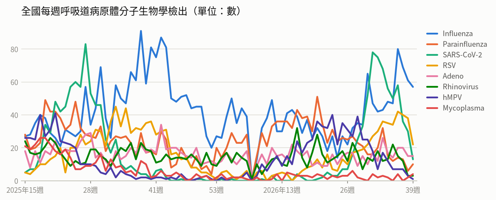

- **全國每週呼吸道病原體分子生物學檢出**（2026年第39週）：共 125，較前一週 ↓ -33（-21%）；陽性率 56.8%

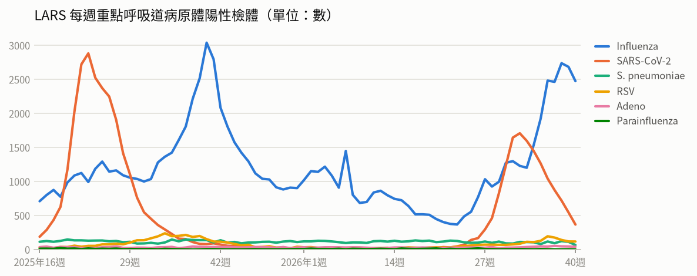

- **LARS 每週重點呼吸道病原體陽性檢體**（2026年第40週）：共 3,058，較前一週 ↓ -442（-13%）

### 新冠（COVID-19）

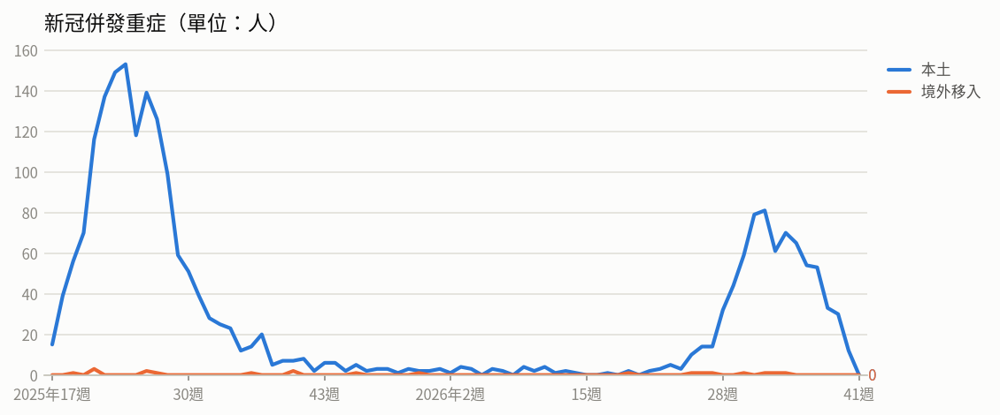

- **新冠併發重症**（2026年第39週）：共 30人（本土 30、境外移入 0），較前一週 ↓ -3（-9%）
  - 統計摘要：上週累計數 12、今年累計數 767、去年總數 1718、今年累計死亡數 171

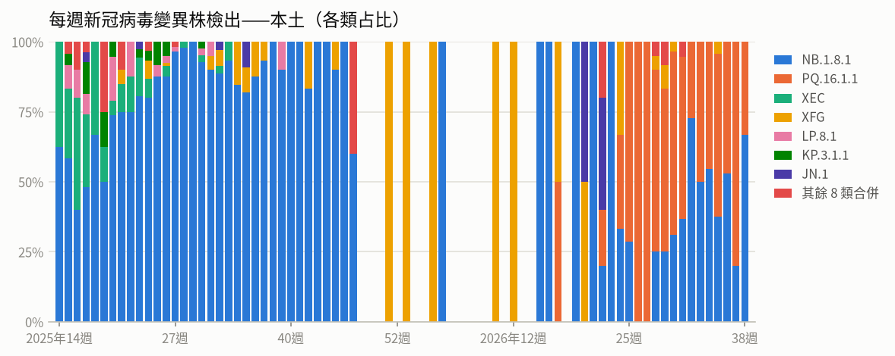

- **每週新冠病毒變異株檢出——本土**（2026年第38週）：共 3，較前一週 ↓ -7（-70%）

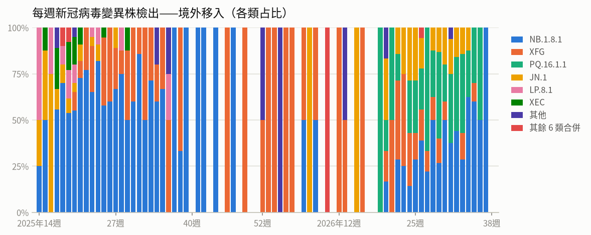

- **每週新冠病毒變異株檢出——境外移入**（2026年第37週）：共 1，較前一週 ↓ -3（-75%）

### 流感

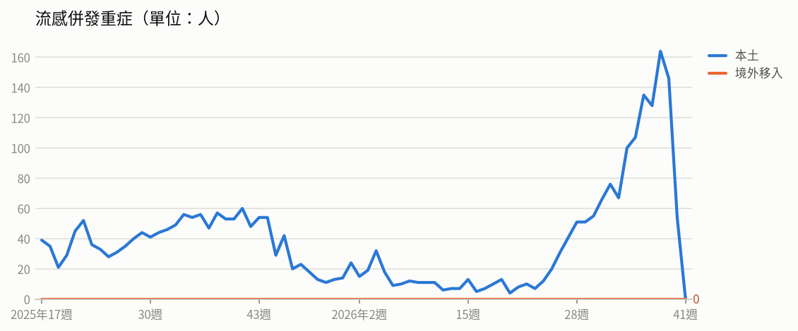

- **流感併發重症**（2026年第39週）：共 146人（本土 146、境外移入 0），較前一週 ↓ -18（-11%）
  - 統計摘要：上週累計數 54、今年累計數 1581、去年總數 2290、今年累計死亡數 335

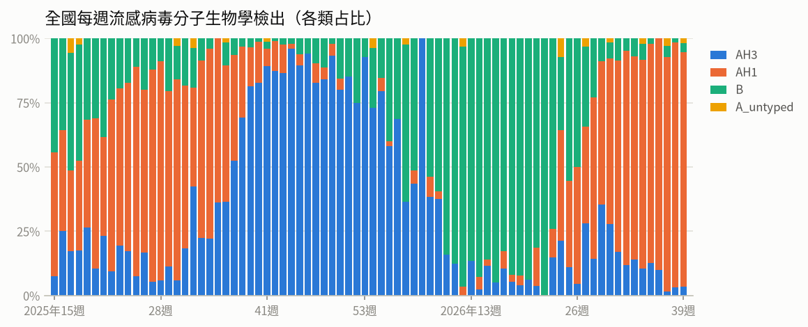

- **全國每週流感病毒分子生物學檢出**（2026年第39週）：共 57，較前一週 ↓ -4（-7%）；陽性率 25.9%

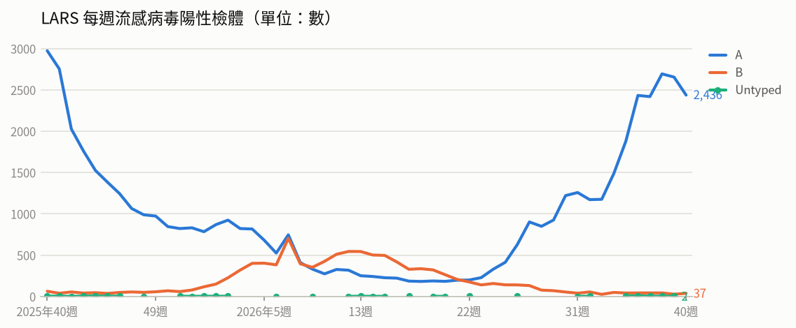

- **LARS 每週流感病毒陽性檢體**（2026年第40週）：共 2,473，較前一週 ↓ -210（-8%）

### 腸病毒

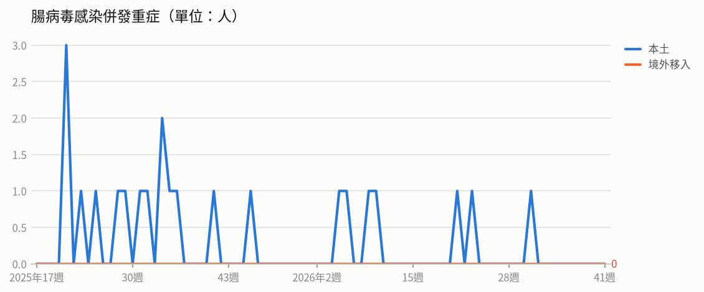

- **腸病毒感染併發重症**（2026年第31週）：共 1人（本土 1、境外移入 0）
  - 統計摘要：上週累計數 0、今年累計數 7、去年總數 19、今年累計死亡數 1

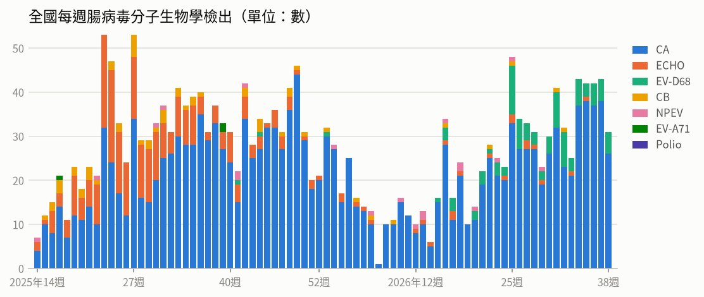

- **全國每週腸病毒分子生物學檢出**（2026年第38週）：共 31，較前一週 ↓ -12（-28%）；陽性率 11.5%

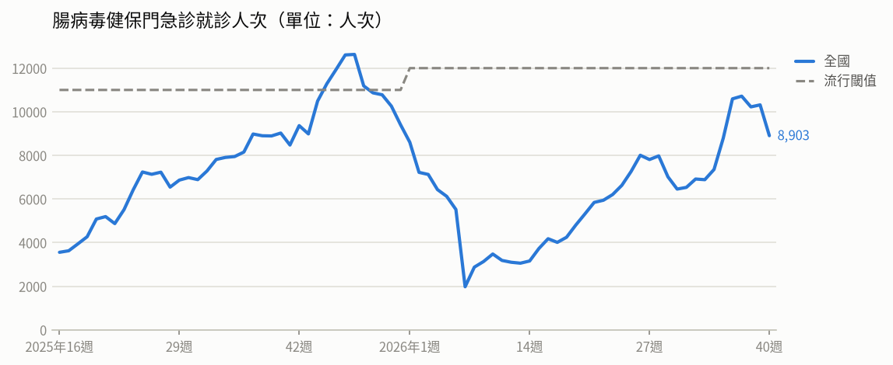

- **腸病毒健保門急診就診人次**（2026年第40週）：共 8,903人次，較前一週 ↓ -1,412（-14%）（流行閾值 12,000）

### 登革熱

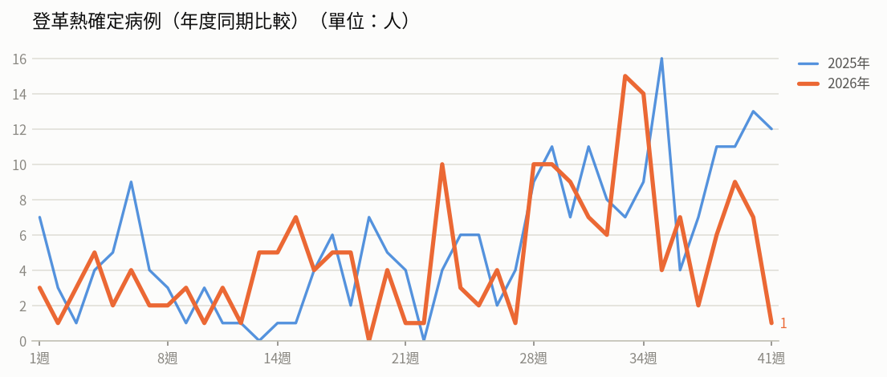

- **登革熱確定病例（年度同期比較）**（2026年第40週）：7人，2025年同期 13人
  - 統計摘要：上週累計數 7、今年累計數 194、去年總數 293、今年累計死亡數 0

> 數據取自 NIDSS（目前為 2026年第41週，統計上一完整週；定序類資料與通報有時間落後，併發重症等項目改取再前一週，以各項標示的週次為準）。最新資料可能因後續回報而變動。

## 重點速覽

- 🔴 **剛果疫情持續擴大，肯亞出現首例境外移入**：剛果民主共和國截至10/4累計8,603例確診、4,148例死亡，致死率約48%；肯亞10/6通報首例境外移入個案，患者入境後隔離並於10/5死亡，已匡列28名接觸者。計畫前往疫區者請留意防疫資訊。
- 🔴 **美國今年逾3,800例破去年紀錄，紐約州宣布緊急狀態**：美國47個行政區通報3,887例確定病例，95%為未接種或接種史不明；澳洲、敘利亞亦有疫情。出國前應確認麻疹疫苗接種完整。
- 🟠 **俄羅斯疑似鼠疫死亡事件待釐清，WHO評估對民眾風險低**：伊爾庫茨克州實驗室技術人員因不明原因肺炎死亡，另傳第2例疑似死亡；俄方稱無病原體外洩、接觸者未檢出高威脅病原體。疾管署已透過IHR窗口函詢俄羅斯與WHO，並強化機場港埠檢疫。
- 🟠 **國內出現今年首例本土傷寒，個案曾食用生鮮海產**：中部30多歲女性發病後住院確診，現已康復出院，5名接觸者無症狀；今年累計6例。提醒民眾avoid生食，注意飲食與手部衛生。
- 🟠 **流感、新冠疫情雖降仍在流行期，公費疫苗已開打**：第39週類流感門急診13.9萬人次略降1.4%、新冠門急診7,836人次降26.7%；上週新增219例流感重症、44例死亡。公費流感與新冠疫苗10月1日開打，長者與慢性病患者應儘早接種。
- 🟠 **屏東新增1例本土登革熱，全國本土病例累計13例**：屏東市40多歲女性確診第四型登革病毒，無國外旅遊史，衛生單位已完成化學防治與病媒蚊調查；國際上孟加拉疫情嚴峻，今年死亡逾2,200例。請落實清除住家積水容器。

## 國際重要疫情

- **剛果民主共和國－伊波拉病毒感染**（關注程度：高）：依據剛果民主共和國國家公共衛生研究所（DRC INSP）2026/10/1資料，該國伊波拉病毒感染疫情持續新增病例，單日新增76例確定病例、其中24例死亡，分布於伊圖里省（49例）、北基伍省（23例）、上韋萊省（3例）及喬波省（1例）。累計確診8,376例，含4,042例死亡、2,182例康復，致死率達48.3%。疫情已擴及7個省份、63個衛生區，以伊圖里省最為嚴峻，占全國病例數的75.7%。
  - 旅遊防疫建議：非必要應避免前往剛果民主共和國疫區，如須前往請勿接觸野生動物、病患及其體液或遺體；返國時若有發燒、嘔吐、腹瀉等症狀，應主動告知機場檢疫人員並儘速就醫，告知旅遊史。
  - [原文連結](https://www.cdc.gov.tw/TravelEpidemic/Detail/G3PSay_dafdAwjsYNm3CCA?epidemicId=SDKeYpkwYfjNTCOiP--ZfQ)
- **孟加拉－登革熱**（關注程度：高）：據The Strait Times與Outbreak News Today 2026/10/4報導，孟加拉登革熱疫情持續惡化，今年截至10月4日累計8萬4,369例住院病例及2,256例死亡，9月單月死亡148例，為2000年以來第四高的年度死亡數。病媒蚊埃及斑蚊已由主要城市蔓延至全國，專家預測10月疫情將進一步升溫。當局呼籲民眾積極清除家戶積水孳生源，以減輕醫療系統同時面對登革熱與麻疹等多重疫情的壓力。
  - 旅遊防疫建議：計劃前往孟加拉者應做好防蚊措施，穿著淺色長袖衣褲並使用政府核可的防蚊藥劑；返國後如有發燒、頭痛、後眼窩痛、肌肉關節痛或出疹等症狀，應儘速就醫並主動告知旅遊史。
  - [原文連結](https://www.cdc.gov.tw/TravelEpidemic/Detail/G3PSay_dafdAwjsYNm3CCA?epidemicId=DvpfTvH63g_CwrsVYx6DmA)
- **美國、澳洲、敘利亞－麻疹**（關注程度：高）：美國今年已有47個行政區通報3,887例麻疹確定病例，95%為未接種疫苗或接種狀況不明，以賓州963例、南卡羅萊納670例及猶他州535例最多；紐約州今年累計108例，並於10/5發布行政命令宣布緊急狀態，擴大疫苗施打對象、強化病例調查與接觸者追蹤及加速檢驗。澳洲今年截至9月底累計119例，雖低於去年全年181例，但明顯高於2022至2024年同期水準，病例多與境外感染及輸入有關，政府提供未完成2劑疫苗者免費接種；南澳州阿德萊德某中學發生群聚，截至9/24累計5例，該州今年累計9例已超過去年全年7例。敘利亞今年截至第33週累計765例實驗室確診病例，當局已與UNICEF、WHO等合作於7月下旬在高風險地區展開疫苗接種。
  - 旅遊防疫建議：計畫前往上述國家前，請先確認自身與同行孩童已完成2劑麻疹（MMR）疫苗接種，並可洽旅遊醫學門診評估。返國後如出現發燒、紅疹、咳嗽、結膜炎等症狀，應戴口罩儘速就醫並主動告知旅遊史。
  - [原文連結](https://www.cdc.gov.tw/TravelEpidemic/Detail/G3PSay_dafdAwjsYNm3CCA?epidemicId=wkGaehQ5K-mMBAn6EX_62w)
- **肯亞、剛果民主共和國－伊波拉病毒感染**（關注程度：高）：依WHO、Beacon及DRC INSP資料（2026/10/6），肯亞10/6通報首例境外移入伊波拉病例，為居住於剛果民主共和國的肯亞籍人士，10/3入境後即隔離、10/5死亡，當局已匡列28名接觸者（含同班機23名乘客及4名機組人員），WHO並與該國合作加強管制以防止傳播。剛果民主共和國疫情持續擴大，10/4新增59例確定病例、34例死亡，分布於北基伍省（33例）、伊圖里省（23例）、上韋萊省（2例）及喬波省（1例），並新增1個受影響衛生區。該國累計8,603例確診、4,148例死亡，致死率48.2%，疫情遍及7省64個衛生區，以伊圖里省最嚴峻，占全國75%病例數。
  - 旅遊防疫建議：非必要應避免前往剛果民主共和國疫區及鄰近受影響地區，旅途中避免接觸疑似病患、其血液體液及野生動物；返國後如出現發燒、腹瀉、出血等症狀，請主動聯繫1922並告知旅遊接觸史。
  - [原文連結](https://www.cdc.gov.tw/TravelEpidemic/Detail/G3PSay_dafdAwjsYNm3CCA?epidemicId=qpFXHip9GYcYzAcJzWqw6Q)
- **俄羅斯－鼠疫**（關注程度：中）：疾管署引述UNILAD與WHO 2026年10月7日資訊指出，據俄羅斯當地媒體報導，該國西伯利亞伊爾庫茨克州（Irkutsk）疑似出現第2例鼠疫死亡病例，但該病例尚未經證實。世界衛生組織表示，正要求俄羅斯提供更多病例相關資訊。
  - 旅遊防疫建議：計劃前往俄羅斯西伯利亞地區者應留意當地疫情發展，避免接觸齧齒類動物及其屍體；返國後如有發燒等不適症狀，請儘速就醫並主動告知旅遊史。
  - [原文連結](https://www.cdc.gov.tw/TravelEpidemic/Detail/G3PSay_dafdAwjsYNm3CCA?epidemicId=f75C6kv02eQZBiKXPVbzhg)
- **俄羅斯（西伯利亞伊爾庫茨克州、布里亞特共和國）－鼠疫（肺鼠疫）**（關注程度：中）：死亡個案為伊爾庫茨克防疫研究所28歲女性實驗室技術人員，疑似於9/25不慎打破裝有鼠疫桿菌的試管，2日後病情惡化、出現嚴重肺炎後死亡；另有一說指其自布里亞特共和國出差返回後發病。當局已匡列約200名密切接觸者隔離、醫院封鎖，並要求周邊工廠人員強制配戴口罩，惟官方宣稱該案為不明原因肺炎、周遭情況穩定，相關資訊仍待釐清。WHO資料顯示2019至2025年全球累計有10國報告疑似或確定鼠疫病例。
  - 旅遊防疫建議：前往疫情地區應避免接觸囓齒類動物與其屍體、做好防蚤措施並注意個人衛生；返國後如出現發燒、淋巴結腫痛或咳嗽等症狀，應盡速就醫並主動告知旅遊史與接觸史。
  - [原文連結](https://www.cdc.gov.tw/TravelEpidemic/Detail/G3PSay_dafdAwjsYNm3CCA?epidemicId=WBP8DFMOSZJ2S6j0JdwMDA)
- **全球（美國、加拿大、丹麥、德國、挪威、瑞典、荷蘭等）－新型A型流感（禽流感）**（關注程度：中）：疾管署每週更新全球新型A型流感疫情，本週人類病例新增1例，今年累計45例，個案發病前多有易感動物相關暴露史。禽/動物疫情方面，今年累計68個國家/地區報告4,181起高/低病原性禽流感疫情；2026/9/28至10/2期間共7國報告12起H5N1疫情，以美國4起、加拿大3起最多，丹麥、德國、挪威、瑞典、荷蘭各1起。
  - 旅遊防疫建議：前往流行地區應避免接觸禽鳥、生禽肉及其排泄物，勿生食禽肉與蛋類並落實勤洗手；返國後如出現發燒、咳嗽等症狀，應戴口罩儘速就醫並主動告知旅遊及接觸史。
  - [原文連結](https://www.cdc.gov.tw/TravelEpidemic/Detail/G3PSay_dafdAwjsYNm3CCA?epidemicId=30CNkLbRv-DHc4c17Npxjw)
- **南非、安哥拉－M痘（猴痘）**（關注程度：中）：疾管署引述南非衛生部、Outbreak News Today與Beacon（2026/9/25）資料指出，南非今年截至9月22日累計22例M痘確定病例，近期病例快速增加，患者以男性為主，年齡介於23至50歲，主要分布在西開普省（18例），當局持續加強監測與接觸者追蹤。安哥拉疫情自2024年11月中旬延燒至今，累計442例確定病例、2例死亡，疫情已擴及11個省份，9月23日單日新增19例確定病例。安哥拉當局將強化監測、預防及診斷等防治措施，並呼籲民眾出現相關症狀應立即就醫。
  - 旅遊防疫建議：計劃前往南非或安哥拉的民眾，應避免與不明對象發生性行為或親密接觸，並留意個人衛生；返國後如出現發燒、紅疹、水疱等疑似症狀，請戴口罩儘速就醫並主動告知旅遊接觸史。
  - [原文連結](https://www.cdc.gov.tw/TravelEpidemic/Detail/G3PSay_dafdAwjsYNm3CCA?epidemicId=DhNmHhRd1z9zeGJ8HB8_Xg)
- **宏都拉斯、哈薩克－百日咳**（關注程度：中）：疾管署引述Beacon及GOV.KZ（2026/9/30）資料指出，宏都拉斯百日咳疫情持續，今年截至9月23日累計280例確定病例、22例死亡，較去年全年114例增幅達145.6%，該國疫苗覆蓋率約80%，當局呼籲民眾落實常規疫苗接種。哈薩克自2026年以來累計76例確定病例，其中88%為未接種疫苗的兒童，當局推測病例較去年同期下降2.8倍，可能與持續推動疫苗接種及兒童補接種措施有關，並將持續加強接種衛教宣導。
  - 旅遊防疫建議：前往宏都拉斯、哈薩克等疫情地區前，請確認百日咳相關疫苗（含幼兒常規接種與補接種）是否完成；旅途中注意手部衛生與咳嗽禮節，返國後如出現持續咳嗽等症狀應儘速就醫並告知旅遊史。
  - [原文連結](https://www.cdc.gov.tw/TravelEpidemic/Detail/G3PSay_dafdAwjsYNm3CCA?epidemicId=a7-DlDDW-U1LWnW1LtH3hw)
- **尼泊爾－恙蟲病**（關注程度：中）：依BEACON 2026/10/3資料，尼泊爾恙蟲病疫情自7月起快速上升，今年截至10月初累計9,923例確定病例，其中7例死亡，病患遍及74個行政區，9月單月即新增2,746例。當局已加強宣導從事農業及戶外活動民眾穿著長袖衣褲並使用防蚊劑，並提供免費抗生素治療。該國2024-25年流行季則累計報告1.6萬例病例。
  - 旅遊防疫建議：前往尼泊爾從事農務或戶外活動時，應穿著長袖衣褲並使用防蚊（蟲）藥劑，避免於草叢、樹林等環境逗留；返國後如出現發燒、頭痛、皮疹或焦痂等症狀，應儘速就醫並告知旅遊史。
  - [原文連結](https://www.cdc.gov.tw/TravelEpidemic/Detail/G3PSay_dafdAwjsYNm3CCA?epidemicId=zN3HQI8J2cvKJGYqBt4YGQ)
- **泰國－鉤端螺旋體病**（關注程度：中）：依泰國疾管局及Beacon於2026/9/30的資料，泰國近期因持續降雨導致鉤端螺旋體病疫情上升，今年7月起新增病例數高於過去5年，截至9/23累計3,303例確診、46例死亡（致死率1.39%）。受影響族群以60歲以上為主，高風險族群為頻繁接觸土壤、水或潮濕環境的工作者。泰國當局指出，多數死亡病例與延遲就醫有關。
  - 旅遊防疫建議：前往泰國時應避免接觸可能受污染的土壤、積水或潮濕環境，必要時穿著防水鞋具並做好傷口防護；若出現發燒、頭痛、肌肉痠痛等症狀，切勿自行服藥，應儘速就醫並告知旅遊史。
  - [原文連結](https://www.cdc.gov.tw/TravelEpidemic/Detail/G3PSay_dafdAwjsYNm3CCA?epidemicId=31eLGXBg35PppF_DEJtILQ)
- **美國－西尼羅熱**（關注程度：中）：依據Outbreak News Today 2026年10月5日報導，美國今年西尼羅熱累計987例，以加州疫情最為嚴重；加州洛杉磯郡今年通報135例，其中130例住院、5例死亡，遠高於去(2025)年全年的22例與2例死亡。紐澤西州亦於10月5日報告今年首例死亡個案。當地衛生當局警告，入秋氣溫下降之際仍須嚴防蚊蟲叮咬，並呼籲民眾落實清除積水容器。
  - 旅遊防疫建議：前往美國（尤其加州、紐澤西州）旅遊時，應穿著淺色長袖衣褲並使用政府核可的防蚊藥劑，避免蚊蟲叮咬；返國後如出現發燒、頭痛、肌肉痠痛等症狀，應儘速就醫並告知旅遊史。
  - [原文連結](https://www.cdc.gov.tw/TravelEpidemic/Detail/G3PSay_dafdAwjsYNm3CCA?epidemicId=wqqBq_-tVYXrfxMRz-cHMg)
- **非洲流腦帶（自塞內加爾延伸至衣索比亞等26國）－流行性腦脊髓膜炎**（關注程度：中）：依WHO報告，自塞內加爾延伸至衣索比亞等26國的「非洲流腦帶」持續流行流行性腦脊髓膜炎，去年共24國通報21,526例疑似病例及971例死亡，致死率為4.5%，整體病例數較前年減少5.9%。目前當地正推動5價結合型疫苗（Men5CV/MMCV）接種，其中尼日（Niger）已於去年展開全國性疫苗接種活動。
  - 旅遊防疫建議：計畫前往非洲流腦帶國家的民眾，建議出國前至旅遊醫學門診諮詢並評估接種流行性腦脊髓膜炎疫苗；旅途中注意個人衛生、避免前往人潮擁擠且通風不良場所，返國後如有發燒、頭痛、頸部僵硬等症狀應儘速就醫並告知旅遊史。
  - [原文連結](https://www.cdc.gov.tw/TravelEpidemic/Detail/G3PSay_dafdAwjsYNm3CCA?epidemicId=E5lebaDUd25Vm3VP-UgnFQ)
- **俄羅斯－鼠疫（疑似）**（關注程度：低）：針對國際媒體報導俄羅斯疑似感染鼠疫死亡事件，疾管署已於10月5日透過國際衛生條例（IHR）窗口向俄羅斯詢問詳情，並於10月6日函詢WHO相關疫情資訊；俄方生物安全專家委員會證實該實驗室未發生病原體外洩，當地呼吸道疾病發病率仍在歷年季節性正常範圍，WHO評估對一般大眾公共衛生風險為低。我國自1953年後未再出現鼠疫病例；2019至2025年全球10國通報3,860例疑似病例、2,646例確定病例、423例死亡，約98%確定病例集中於剛果民主共和國及馬達加斯加。鼠疫為第一類法定傳染病，須於24小時內通報並就地收治隔離，首選藥物Aminoglycoside類與fluoroquinolone類國內供應穩定。
  - 旅遊防疫建議：出入境旅客請留意國際疫情資訊並做好自身防護；如自流行地區返國後出現發燒、咳嗽等症狀，應主動告知機場檢疫人員或儘速就醫並告知旅遊史。
  - [原文連結](https://www.cdc.gov.tw/Subscription/EpaperPreview?epaperId=103130&typeid=5)
- **全球（中國、香港、韓國、歐洲）－COVID-19（新冠肺炎）**（關注程度：低）：疾管署引用WHO FluNet、WHO、中國疾控中心、香港衛生防護中心及KCDA資料指出，全球第36週新冠陽性率3.59%，其中歐洲呈上升趨勢，近期流行變異株以XFG、NB.1.8.1、JN.1及PQ.16.1.1為主。中國第39週（9/21-27）門急診陽性率7.2%，較第38週9.3%下降；香港第39週陽性率0.41%，污水監測以PQ.16.1.1（88.6%）為主，其次為NB.1.8.1、JN.1及XFG。韓國第39週陽性率14.2%、新增248例住院，變異株以PQ.16.1.1（53.9%）為主，其次為NB.1.8.1、BA.3.2及RF.5。
  - 旅遊防疫建議：計畫前往歐洲或鄰近亞洲國家者，應留意當地疫情變化，並依建議完成新冠疫苗接種。旅途中落實勤洗手、人潮擁擠或密閉空間配戴口罩，返國後如出現發燒、呼吸道症狀應儘速就醫並告知旅遊史。
  - [原文連結](https://www.cdc.gov.tw/TravelEpidemic/Detail/G3PSay_dafdAwjsYNm3CCA?epidemicId=qAlitHYqWK_K8qtAw95Wzg)
- **摩洛哥－白喉**（關注程度：低）：疾管署引述Beacon 2026年9月28日資料指出，摩洛哥中北部蘇斯-馬塞大區(Souss-Massa)發生2起白喉家庭群聚事件。截至9月28日，經實驗室檢驗確認1例確定病例，另8例仍在調查中。當地衛生當局已針對密切接觸者進行追蹤、預防性投藥及疫苗接種等防治措施。
  - 旅遊防疫建議：計劃前往摩洛哥者，建議出國前確認白喉相關疫苗（如白喉、破傷風、百日咳混合疫苗）接種史是否完整，必要時諮詢旅遊醫學門診；返國後如出現發燒、喉嚨痛等症狀應儘速就醫並告知旅遊史。
  - [原文連結](https://www.cdc.gov.tw/TravelEpidemic/Detail/G3PSay_dafdAwjsYNm3CCA?epidemicId=oOkM98Mtj8pHzXTcD_ZjZw)
- **美國－流行性腮腺炎**（關注程度：低）：疾管署引述Outbreak News Today與CIDRAP（2026/10/3）資訊指出，美國加州聖地牙哥州立大學今年9月累計通報14例流行性腮腺炎病例，受影響者為該校球隊隊員。為因應此次疫情，校方已免費提供學生接種疫苗追加劑。
  - 旅遊防疫建議：計畫前往美國的民眾，尤其是赴當地就學或參與團體活動者，建議出發前確認麻疹腮腺炎德國麻疹混合疫苗（MMR）接種史是否完整；旅途中注意手部衛生與呼吸道禮節，如出現發燒、腮腺腫脹等症狀應儘速就醫並告知旅遊史。
  - [原文連結](https://www.cdc.gov.tw/TravelEpidemic/Detail/G3PSay_dafdAwjsYNm3CCA?epidemicId=tBYXtWARDQm_4vJR_H_4Hw)

## 本週國內公告摘要

### 登革熱

#### 屏東縣新增1例本土登革熱病例，請民眾落實「巡、倒、清、刷」，出現疑似症狀儘速就醫

- **來源／關注程度／地區**：衛生福利部疾病管制署／中／屏東縣
- **病例概況**：屏東縣新增1例本土登革熱病例（第四型），今年全國累計188例確定病例，其中本土13例、境外移入175例，低於2025年同期198例。
- **摘要**：疾管署2026年10月8日公布新增1例本土登革熱病例，為屏東市40多歲女性，10月上旬出現發燒、頭痛、肌肉痛、腹瀉等症狀，確診檢出登革病毒第四型，目前住院治療中，同住接觸者均無疑似症狀。個案無國外旅遊史，潛伏期活動地以屏東縣住家附近及鄰近縣市為主，研判為本土病例，檢體將進一步定序釐清感染源。衛生單位已完成緊急化學防治、病媒蚊密度調查與環境風險評估，並規劃擴大採檢。今年全國累計188例，本土13例（高雄市10例、彰化縣2例、屏東縣1例），境外移入175例以越南、印尼、菲律賓等東南亞及南亞國家為主。
- **防疫建議**：請落實「巡、倒、清、刷」清除家戶內外孳生源，戶外活動穿著淺色長袖衣褲並使用含敵避(DEET)、派卡瑞丁或伊默克等核可防蚊藥劑；如出現發燒、頭痛、後眼窩痛、肌肉關節痛、出疹等症狀，應儘速就醫並主動告知旅遊及活動史。
- **原文連結**：https://www.cdc.gov.tw/Bulletin/Detail/JvaaM_Xplh7dCJenqv0xiw?typeId=9

### 傷寒

#### 國內出現今年首例本土傷寒確定病例 籲請民眾注意飲食及手部衛生

- **來源／關注程度／地區**：衛生福利部疾病管制署／中／中部（未指明縣市）
- **病例概況**：國內出現今年首例本土傷寒確定病例，今年累計6例（本土1例、境外移入5例），低於2023-2025年同期的7-13例。
- **摘要**：疾管署於2026年10月6日公布今年首例本土傷寒確定病例，為中部30多歲女性，潛伏期間曾至外縣市food生食海鮮（生魚片、生蠔等），8月下旬出現發燒、嘔吐及腹瀉，9月上旬再度間歇性發燒並伴隨頭痛、全身痠痛，住院治療後確診，目前已康復出院；5名接觸者均無疑似症狀。我國自2022年起累計42例（本土11例、境外移入31例），以20-39歲為多，境外移入感染國家以印尼24例最多。傷寒潛伏期8至14天（可由3至60天不等），主要經由食用受病患或帶菌者糞便、尿液污染的食品或飲水傳播，常見症狀包含持續性發燒、頭痛、倦怠、厭食、腹痛、腹瀉、相對性心搏過緩或軀幹紅疹。
- **防疫建議**：飲用水應煮沸或使用瓶裝水，食物充分加熱煮熟後再食用，烹調時避免生熟食交叉污染；飯前便後、處理食品前及更換尿片後以肥皂和清水澈底洗手，出現疑似症狀應儘速就醫並告知飲食史。
- **原文連結**：https://www.cdc.gov.tw/Bulletin/Detail/VkWKnzSuPKHiKFvrJ-xo0A?typeId=9

### 流感、新冠肺炎（COVID-19）

#### 公費流感及新冠疫苗接種踴躍 請符合資格民眾儘速接種 及早獲得保護力

- **來源／關注程度／地區**：衛生福利部疾病管制署／中／全國
- **病例概況**：第39週(9/27-10/3)類流感門急診139,060人次較前週略降1.4%、新冠門急診7,836人次下降26.7%，但兩者均仍處流行期；上週新增219例流感併發重症與44例死亡、37例新冠本土重症與16例死亡。
- **摘要**：疾管署表示115年度公費流感及新冠疫苗自10月1日開打，截至10月5日流感疫苗已接種約106.2萬人次、新冠疫苗約39.5萬人次，均高於去年同期。國內流感疫情持平仍在流行期，社區流行以A型H1N1為主（占90.7%），本流感季累計30例重症均為H1N1；新冠疫情雖下降但仍處流行期，本季累計12例本土重症、尚無死亡，近4週變異株以PQ.16.1.1及NB.1.8.1為主。上一季重症病例多為65歲以上長者及具慢性病史者，且多數未接種當季疫苗。
- **防疫建議**：長者、幼兒及慢性病患等高風險族群請儘速至合約院所接種流感及新冠疫苗，因疫苗約需2週才能產生足夠保護力，宜在雙十連假前及早接種；連假出遊聚餐應勤洗手、有發燒咳嗽等症狀時戴口罩並在家休息，若出現呼吸急促、呼吸困難、發紺、血痰、胸痛、意識改變、低血壓等危險徵兆應儘速就醫。
- **原文連結**：https://www.cdc.gov.tw/Bulletin/Detail/tC7VIc05_kkg8wOlIPpQIw?typeId=9

### 鼠疫

#### 疾管署說明俄羅斯疑似鼠疫事件WHO回復資訊

- **來源／關注程度／地區**：衛生福利部疾病管制署／低／俄羅斯
- **病例概況**：俄羅斯伊爾庫茨克州傳出鼠疫防治研究所員工不明原因肺炎死亡及第二例疑似死亡病例，但俄國向WHO表示該州近期並無報告任何鼠疫病例，接觸者均未檢出高威脅病原體。
- **摘要**：疾管署於10月6日透過國際衛生條例(IHR)對口單位函詢WHO，WHO於10月7日回復指出，俄羅斯當局表示伊爾庫茨克州近期未報告鼠疫病例，該研究所員工嚴重肺炎事件已展開流行病學調查並啟動防控措施，所有接觸者均已匡列檢查且未檢出高威脅病原體。WHO表示因案件資訊不完整，現階段尚不足以就是否構成公眾風險作出實證結論，秘書長已公開要求俄方釐清首例肺炎病因及第二案資訊。我國自1953年後未再出現鼠疫病例，2019至2025年全球10國累計通報3,860例疑似病例、2,646例確定病例、423例死亡，約98%確定病例集中於剛果民主共和國及馬達加斯加。
- **防疫建議**：疾管署已加強邊境發燒篩檢等檢疫措施，國內具備檢驗量能、傳染病防治醫療網及穩定供應的抗生素可供治療與暴露後預防性投藥，民眾無須過度恐慌，請留意官方疫情資訊。
- **原文連結**：https://www.cdc.gov.tw/Bulletin/Detail/ZSgA4XCBC3WbeC0Wb8Em-g?typeId=9

### 鼠疫（疑似）

#### 針對俄羅斯傳出疑似感染鼠疫死亡事件 疾管署已透過國際衛生條例機制詢問相關事件 並持續監測國內外疫情及強化邊境檢疫措施

- **來源／關注程度／地區**：衛生福利部疾病管制署／低／俄羅斯
- **病例概況**：俄羅斯西伯利亞伊爾庫茨克州於2026年10月2日報告1例28歲女性實驗室技術人員因嚴重肺炎死亡之不明原因病例，擴大檢驗未發現與其職務相關之特殊微生物，接觸者僅檢出2例COVID-19及2例鼻病毒感染，WHO評估對一般大眾公共衛生風險為低。
- **摘要**：疾管署2026年10月6日說明，針對俄羅斯伊爾庫茨克防疫研究所1例不明原因肺炎死亡事件，俄方生物安全專家委員會證實該實驗室未發生病原體外洩，接觸者亦無異常症狀，當地呼吸道疾病發病率維持歷年季節性正常範圍。疾管署已於10月5日透過國際衛生條例（IHR）窗口向俄羅斯詢問詳情，10月6日函詢WHO以釐清疫情與跨國傳播風險。我國自1953年後未再出現鼠疫病例；鼠疫屬第一類法定傳染病，需24小時內通報並就地收治隔離，首選的Aminoglycoside類與fluoroquinolone類抗生素國內供應穩定。疾管署亦已強化機場、港埠發燒篩檢與航空器、船舶檢疫措施，並與北榮、台大、成大設置特殊病原科技照護示範中心。
- **防疫建議**：民眾出入境前應留意國際疫情資訊並做好自身防護；如自流行地區返國後出現發燒、咳嗽等症狀，應主動告知檢疫人員或就醫時說明旅遊史與接觸史。
- **原文連結**：https://www.cdc.gov.tw/Bulletin/Detail/tfHqeDmxP80662NPXLwWYA?typeId=9
