# 疫情週報 2026-W42

涵蓋期間：2026-10-12 ~ 2026-10-18

> 本報告由 AI 自動產生，內容以疾管署原文為準。

## 監測數據

### 呼吸道病原體（整體）

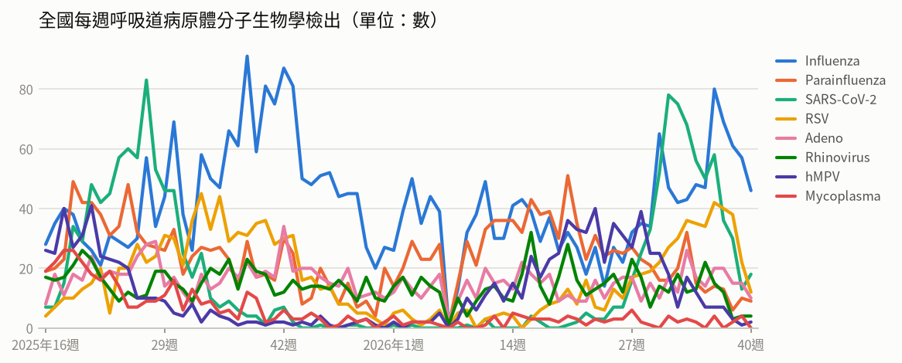

- **全國每週呼吸道病原體分子生物學檢出**（2026年第40週）：共 101，較前一週 ↓ -25（-20%）；陽性率 60.1%

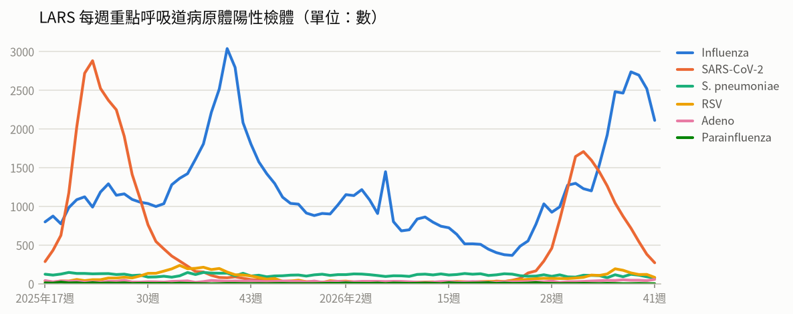

- **LARS 每週重點呼吸道病原體陽性檢體**（2026年第41週）：共 2,595，較前一週 ↓ -556（-18%）

### 新冠（COVID-19）

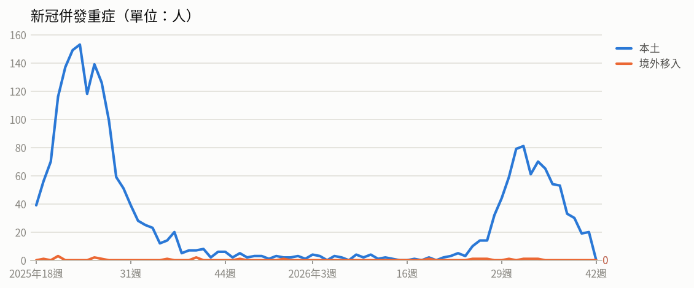

- **新冠併發重症**（2026年第40週）：共 19人（本土 19、境外移入 0），較前一週 ↓ -11（-37%）
  - 統計摘要：上週累計數 20、今年累計數 794、去年總數 1718、今年累計死亡數 176

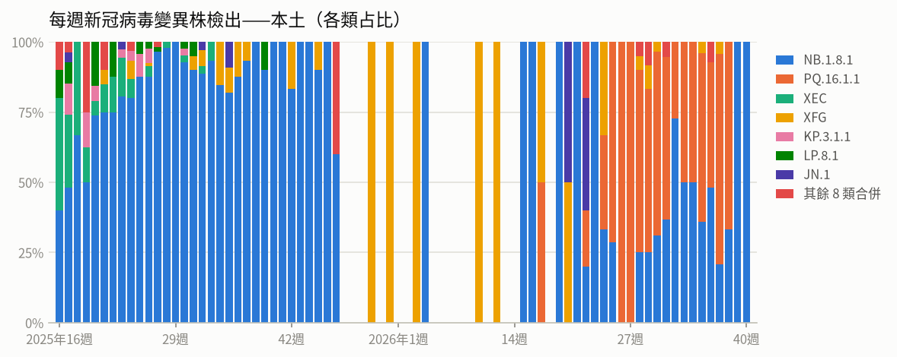

- **每週新冠病毒變異株檢出——本土**（2026年第40週）：共 1，較前一週 ↓ -1（-50%）

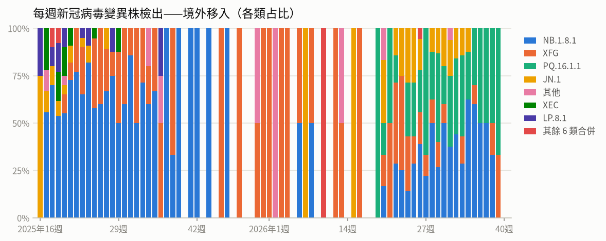

- **每週新冠病毒變異株檢出——境外移入**（2026年第39週）：共 3，較前一週 ↓ -3（-50%）

### 流感

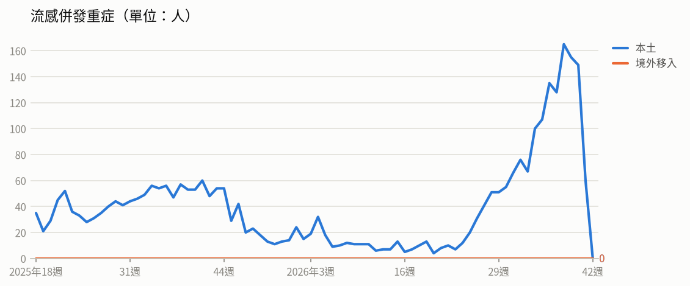

- **流感併發重症**（2026年第40週）：共 149人（本土 149、境外移入 0），較前一週 ↓ -6（-4%）
  - 統計摘要：上週累計數 60、今年累計數 1746、去年總數 2290、今年累計死亡數 377

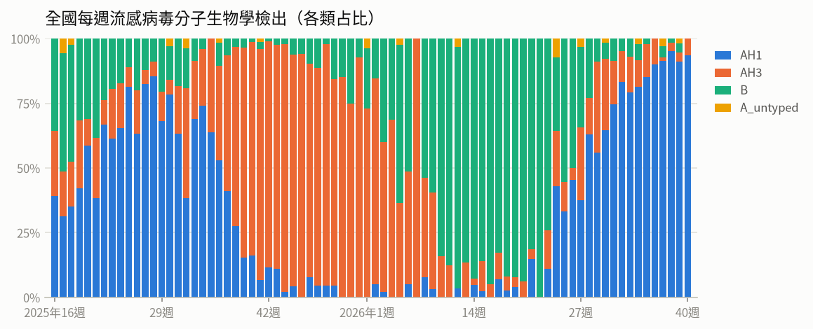

- **全國每週流感病毒分子生物學檢出**（2026年第40週）：共 46，較前一週 ↓ -11（-19%）；陽性率 27.4%

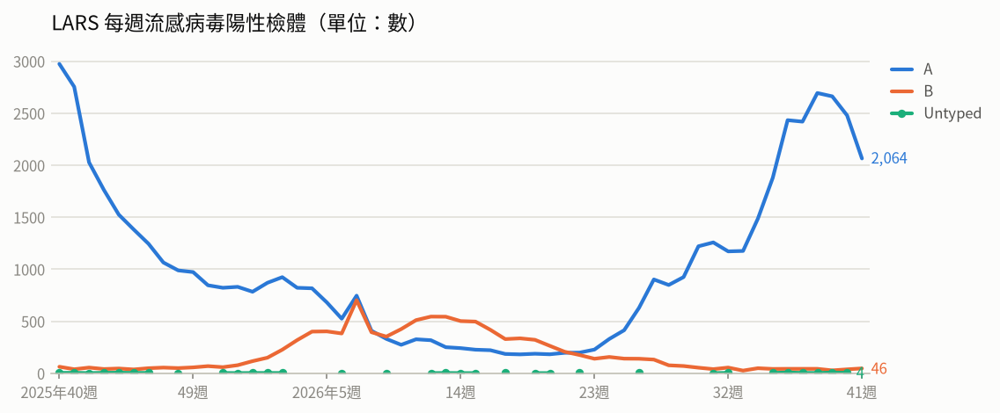

- **LARS 每週流感病毒陽性檢體**（2026年第41週）：共 2,110，較前一週 ↓ -409（-16%）

### 腸病毒

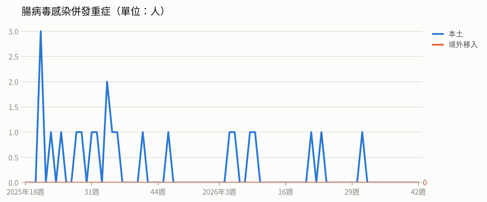

- **腸病毒感染併發重症**（2026年第40週）：共 0人（本土 0、境外移入 0）
  - 統計摘要：上週累計數 0、今年累計數 7、去年總數 19、今年累計死亡數 1

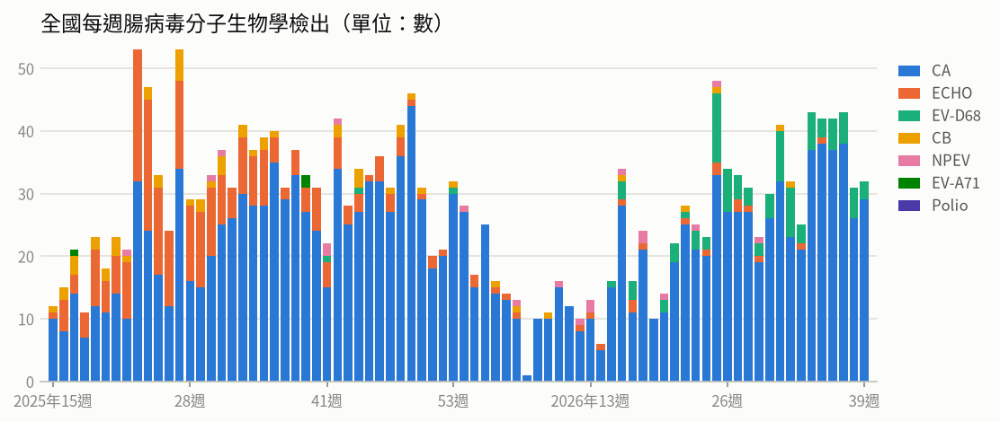

- **全國每週腸病毒分子生物學檢出**（2026年第39週）：共 32，較前一週 ↑ +1（+3%）；陽性率 13.9%

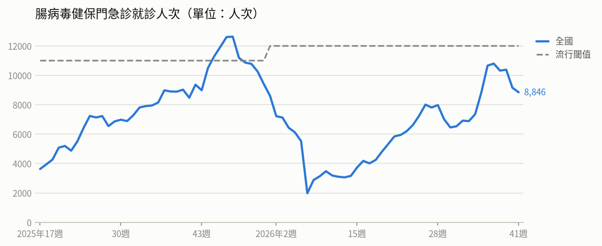

- **腸病毒健保門急診就診人次**（2026年第41週）：共 8,846人次，較前一週 ↓ -308（-3%）（流行閾值 12,000）

### 登革熱

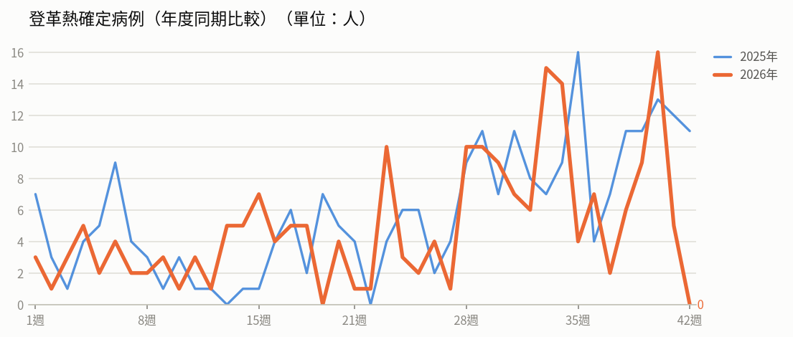

- **登革熱確定病例（年度同期比較）**（2026年第41週）：5人，2025年同期 12人
  - 統計摘要：上週累計數 5、今年累計數 207、去年總數 293、今年累計死亡數 0

> 數據取自 NIDSS（目前為 2026年第42週，統計上一完整週；定序類資料與通報有時間落後，併發重症等項目改取再前一週，以各項標示的週次為準）。最新資料可能因後續回報而變動。

## 重點速覽

- 🔴 **肯亞新增第2例伊波拉確診，剛果（金）疫情持續擴散**：肯亞第2例為首例境外移入死亡個案的近親，已於機場加強旅客篩檢；剛果民主共和國疫情遍及7省65個衛生區，累計逾9千例、致死率約48%，前往流行地區務必提高警覺。
- 🔴 **美洲麻疹病例為去年同期約4.8倍，歐洲、巴西同步升溫**：美洲區今年累計5萬5,792例確定病例、77例死亡，以瓜地馬拉、墨西哥最多；歐洲與巴西病例中多數未完整接種疫苗，出國前應確認MMR疫苗接種史。
- 🔴 **孟加拉登革熱住院病例近10萬例，古巴疫情為預期9.2倍**：孟加拉今年累計9萬9,275例住院、303例死亡，遠高於去年同期；古巴4種血清型共同流行且物資短缺，前往流行地區應加強防蚊並留意返國後症狀。
- 🟠 **流感仍處流行期，10/19起新增Novavax公費新冠疫苗可選**：上週新增144例流感併發重症、46例死亡，均為H1N1；公費疫苗接種踴躍，12歲以上公費對象自10月19日起可選擇Novavax XFG新冠疫苗，呼籲長者與慢性病患儘速接種。
- 🟠 **國內腸病毒門急診連續下降，但校園傳播風險未解**：第40週就診9,001人次較前週降12.8%，今年已有7例併發重症（含1例死亡）；社區以克沙奇A6型為主，配合世界洗手日呼籲落實肥皂洗手並留意重症前兆。鄰近中國與越南疫情則呈上升。
- 🟠 **俄羅斯鼠疫研究所員工重症肺炎死亡，WHO調查暫未見持續傳播**：約5,500次檢測未在接觸者中檢出高危險病原體，獨立調查亦未發現實驗室生物安全事件，但因缺乏確診診斷，WHO要求俄方進一步釐清病因。

## 國際重要疫情

- **孟加拉、古巴（另涉美國佛羅里達州境外移入）－登革熱**（關注程度：高）：孟加拉登革熱疫情嚴峻，目前仍有逾6,000名患者住院治療，當局指出埃及斑蚊與白線斑蚊傳播之4種血清型重覆感染，易引發出血熱與休克症候群等嚴重併發症。古巴4種血清型共同流行並以第2型為主，9月估計達4,102例；當地燃料與醫療試劑短缺，影響病媒蚊防治與患者檢測，加上10月為過往流行高峰期，疫情恐持續升溫。美國佛羅里達州今年262例境外移入病例中，有82%感染源來自古巴。
  - 旅遊防疫建議：前往孟加拉、古巴等登革熱流行地區應做好防蚊措施，穿著淺色長袖衣褲並使用政府核可的防蚊藥劑；住家應落實清除孳生源，返國後如有發燒、頭痛、後眼窩痛或肌肉關節痛等症狀，請儘速就醫並告知旅遊史。
  - [原文連結](https://www.cdc.gov.tw/TravelEpidemic/Detail/G3PSay_dafdAwjsYNm3CCA?epidemicId=IXqaJo2xrxKa4nnavTjD0w)
- **歐洲（保加利亞、瑞典、義大利、西班牙、德國等）、美洲（瓜地馬拉、墨西哥、美國、秘魯、加拿大）及巴西－麻疹**（關注程度：高）：依ECDC、PAHO及Beacon資料（2026/10/8），歐洲區今年8月有10國報告143例確定病例，以保加利亞62例、瑞典41例、義大利18例、西班牙9例及德國6例較多；近12個月30國累計2,335例，其中71.9%病例未曾接種疫苗。美洲區今年截至第39週17個國家/地區共55,792例確定病例、77例死亡，以瓜地馬拉34,355例、墨西哥13,595例、美國3,887例、秘魯2,553例及加拿大1,121例為主，合計佔99.5%。巴西今年截至10/5累計52例，主要集中於聖保羅州41例、亞馬遜州10例及里約熱內盧州1例，75%病例未曾或未完整接種疫苗，接種率不足為主因之一，該國已啟動大規模疫苗接種並持續監測，以防止擴散。
  - 旅遊防疫建議：計劃前往歐洲、美洲或巴西等流行地區前，應先確認麻疹疫苗接種史，未完整接種者建議諮詢旅遊醫學門診評估接種；返國後如出現發燒、紅疹等疑似症狀，應戴口罩儘速就醫並主動告知旅遊史。
  - [原文連結](https://www.cdc.gov.tw/TravelEpidemic/Detail/G3PSay_dafdAwjsYNm3CCA?epidemicId=oBU4OdcfgR-bqIsNoXT3OQ)
- **肯亞、剛果民主共和國－伊波拉病毒感染**（關注程度：高）：肯亞第2例個案於10/13出現發燒、疲倦及關節疼痛後立即隔離，該國已於機場設置通道，針對來自剛果民主共和國及其他相關國家旅客進行篩檢；首例患者死亡後匡列128名接觸者，已找到113人、108人在肯亞隔離，尚有15名接觸者待追蹤，肯亞衛生部表示尚無證據顯示社區廣泛傳播。剛果民主共和國疫情持續新增，10/12新增病例分布於伊圖里省（40例）、北基伍省（27例）、上韋萊省（8例）與喬波省（4例），疫情遍及7個省份、65個衛生區，以伊圖里省最為嚴峻，占全國74%病例數。
  - 旅遊防疫建議：非必要應避免前往剛果民主共和國疫區及肯亞受影響地區，當地期間勿接觸或食用野生動物，避免接觸病患體液；返國時如有發燒、疲倦、關節疼痛等症狀，應主動告知機場檢疫人員並就醫說明旅遊史。
  - [原文連結](https://www.cdc.gov.tw/TravelEpidemic/Detail/G3PSay_dafdAwjsYNm3CCA?epidemicId=VeYYI1luzJmkQaikyj9UrQ)
- **中國、越南－腸病毒**（關注程度：中）：依據中國疾控中心與越南HTV資料，中國今年截至10月4日累計報告腸病毒921,957例，其中重症179例、死亡1例，病例數較2025年同期增加22.6%，疫情自第36週低點以來連續4週上升，但尚未達2021至2023年平均值，流行型別以克沙奇A16型為主（占34.9%）。越南胡志明市今年截至10月12日累計38,500例，近1週通報逾1,700例，較前4週平均增加48%。越南已啟動腸病毒71型疫苗接種計畫，為2個月至6歲以下兒童接種。
  - 旅遊防疫建議：前往中國、越南等流行地區時應勤用肥皂洗手、避免與疑似病患接觸；返國後如出現發燒、手足口症或疱疹性咽峽炎等症狀，應儘速就醫並告知旅遊史。
  - [原文連結](https://www.cdc.gov.tw/TravelEpidemic/Detail/G3PSay_dafdAwjsYNm3CCA?epidemicId=1-z-0zA9M1Koi9ONp-A-ig)
- **俄羅斯－不明原因肺炎／鼠疫**（關注程度：中）：WHO於10/7及10/10公布，俄羅斯已就該起嚴重肺炎死亡事件展開流行病學調查並啟動防治措施，所有接觸者皆已匡列採檢，除檢出2例COVID-19、3例鼻病毒及1例流感嗜血桿菌外，均無症狀且未檢出高威脅病原體，並完成約5,500次實驗室檢測；截至10/9未在接觸者中檢出該實驗室研究範圍內的高危險病原體，已停止醫學觀察，兩項獨立調查亦顯示該研究所未發生實驗室生物安全或生物安保事件。WHO秘書長要求俄方釐清首例嚴重肺炎確切病因及第2案資訊。WHO指出因個案缺乏確診診斷，現階段無法對是否構成公眾風險作出實證結論，考量個案職業環境亦無法完全排除實驗室相關暴露風險，目前尚未發現持續傳播證據。
  - 旅遊防疫建議：前往俄羅斯相關地區者請注意個人衛生、避免接觸齧齒類動物及其跳蚤，返國後如出現發燒、咳嗽等呼吸道症狀應儘速就醫並主動告知旅遊與接觸史。
  - [原文連結](https://www.cdc.gov.tw/TravelEpidemic/Detail/G3PSay_dafdAwjsYNm3CCA?epidemicId=AlkKcsmihecMOvAsmn8M4g)
- **全球－M痘**（關注程度：中）：依WHO資料，全球M痘疫情自2022年以來累計18萬9,020例確定病例、536例死亡，分布於145國/地區。2026年8月單月有44個國家/地區通報1,867例確診及7例死亡，以馬達加斯加（426例）、安哥拉（290例）、剛果民主共和國（207例）、泰國（164例）及中國（154例）較多，56.8%病例來自非洲地區。與7月相比，全球病例數上升11.1%，其中東南亞區及西太平洋區呈上升趨勢，其餘地區下降，東地中海區則無通報病例。
  - 旅遊防疫建議：前往疫情流行地區（如非洲、東南亞等）應避免與不明健康狀況者有親密或皮膚接觸，符合條件者可依規定接種M痘疫苗；返國後如出現發燒、皮疹等症狀，應儘速就醫並告知旅遊接觸史。
  - [原文連結](https://www.cdc.gov.tw/TravelEpidemic/Detail/G3PSay_dafdAwjsYNm3CCA?epidemicId=4MCIqgDTjeoVLvRNYo6y0A)
- **全球（巴基斯坦、阿富汗、南蘇丹、剛果民主共和國、中非共和國）－小兒麻痺症（脊髓灰質炎）**（關注程度：中）：疾管署引述全球小兒麻痺根除倡議組織（GPEI）2026年10月7日資料，10月1至7日期間巴基斯坦新增1例WPV1、南蘇丹新增5例cVDPV1，另有2國共7例cVDPV2（剛果民主共和國6例、南蘇丹1例）。環境樣本方面，WPV1新增2國共9件（巴基斯坦8件、阿富汗1件），cVDPV2新增中非共和國1件。顯示野生株與疫苗衍生病毒於相關國家仍持續傳播。
  - 旅遊防疫建議：計畫前往巴基斯坦、阿富汗及非洲流行國家者，出國前應確認小兒麻痺疫苗接種是否完成並依建議追加；返國後如出現發燒、肢體無力等症狀，應儘速就醫並告知旅遊史。
  - [原文連結](https://www.cdc.gov.tw/TravelEpidemic/Detail/G3PSay_dafdAwjsYNm3CCA?epidemicId=sA7DLQGOjDRz_jpiyz7w7A)
- **全球（秘魯、挪威、澳大利亞、加拿大、英國、德國、比利時、保加利亞、宏都拉斯、巴西、智利、柬埔寨、賽普勒斯、冰島等）－新型A型流感（禽流感，含H5N1、H9N2、H5N5等）**（關注程度：中）：疾管署每週更新全球新型A型流感疫情，本週人類病例新增3例，今年全球累計47例，個案發病前多有易感動物相關暴露史。依WAHIS資料，2026/9/23-10/5期間秘魯3起、挪威1起共4起H5（N未定型）疫情；2026/10/1-9期間12國報告37起H5N1疫情，以澳大利亞17起最多，加拿大、英國各4起；2026/10/4-9期間冰島7起、英國1起共8起H5N5疫情。
  - 旅遊防疫建議：前往疫情發生國家／地區時，請避免接觸禽鳥、禽畜及其排泄物，勿食用生蛋與未煮熟禽肉，並勤洗手；返國後如出現發燒、咳嗽等症狀，應戴口罩儘速就醫並主動告知旅遊及動物接觸史。
  - [原文連結](https://www.cdc.gov.tw/TravelEpidemic/Detail/G3PSay_dafdAwjsYNm3CCA?epidemicId=sxNRPYs_zl_8aNTmTK36FA)
- **日本－流感**（關注程度：中）：依據厚生勞動省及JIHS資料，日本流感疫情持續上升，今年第40週定點醫師平均報告病例數為11.35例，高於上週7.17例，並明顯高於去年同期的1.56例。住院病例999例，較上週861例增加，其中70歲以上有487例、占49%為主。病例主要分布於沖繩縣（37.07）、埼玉縣（19.66）及千葉縣（18.72）等地，全國47個都道府縣中有44個病例數較上週增加。
  - 旅遊防疫建議：計畫前往日本旅遊者，建議提前接種流感疫苗，旅途中落實勤洗手、咳嗽禮節並視情況佩戴口罩；返國後如出現發燒、咳嗽等症狀，應就醫並告知旅遊史。
  - [原文連結](https://www.cdc.gov.tw/TravelEpidemic/Detail/G3PSay_dafdAwjsYNm3CCA?epidemicId=XEmUPEAadhP756wKhR68QA)
- **美國、奈及利亞－白喉**（關注程度：中）：疾管署引述Outbreak News Today與reliefweb（2026/10/13）資訊指出，美國紐約州伊利郡於10月通報1例旅遊相關白喉病例，當局已通知可能暴露的學校，請學生與教職員工自我觀察症狀至10月18日，並確認其疫苗接種已完成；美國過去20年僅報告10例，上一例為1997年。奈及利亞疫情嚴重，今年迄10月初26州累計逾26,000例疑似病例，其中19,000例確診、700例死亡，以包奇州、博爾諾州及卡諾州較多。人口擁擠與基本服務匱乏加劇傳播風險，雖持續推動疫苗接種與監測，但抗毒素短缺、實驗室能力有限及通報延遲仍妨礙防治。
  - 旅遊防疫建議：計畫前往奈及利亞等白喉流行地區前，應先確認白喉相關疫苗接種是否完整，並儘早至旅遊醫學門診諮詢；旅途中與返國後如出現發燒、喉嚨痛、頸部腫脹等症狀，應儘速就醫並主動告知旅遊史。
  - [原文連結](https://www.cdc.gov.tw/TravelEpidemic/Detail/G3PSay_dafdAwjsYNm3CCA?epidemicId=OuKZbFu3PtOG7mjj0_zJuQ)
- **菲律賓－急性病毒性A型肝炎**（關注程度：中）：依據BEACON 2026年10月10日資訊，菲律賓布基農省（Bukidnon）瓦倫西亞市（Valencia）發生急性病毒性A型肝炎群聚事件，10月9日通報73例疑似病例，至少16例已確診，患者以10至19歲學生為主。當地衛生當局已展開環境調查與水質採樣，初步懷疑與校園或社區水質及食品衛生污染有關。當局並要求攤販預防性禁售食品與飲料，同時派遣水車支援學校設施用水。
  - 旅遊防疫建議：前往菲律賓相關地區時，請注意飲食與飲水衛生，飲用煮沸水或瓶裝水、避免生食及來源不明的攤販食品，並勤洗手；必要時可於行前諮詢旅遊醫學門診評估接種A型肝炎疫苗。
  - [原文連結](https://www.cdc.gov.tw/TravelEpidemic/Detail/G3PSay_dafdAwjsYNm3CCA?epidemicId=WSIfDER943ubeLM3WtkakA)
- **菲律賓、多明尼加共和國－鉤端螺旋體病**（關注程度：中）：菲律賓受季風及颱風引發洪患影響，鉤端螺旋體病疫情升溫，全國今年截至9月下旬累計11,965例確定病例及至少581例死亡，其中奎松市截至10月1日累計1,037例確定病例、66例死亡，68%為21歲以上成人。多明尼加共和國第35-38週報告4例確定病例，今年累計279例確定病例、20例死亡，較去年同期增加96.5%，以普拉塔港75例、聖多明各39例及佩拉維亞17例較多；該病在當地屬地方性流行病，需立即通報並進行流行病學監測。菲律賓當局提醒民眾避免接觸洪水，並於接觸後出現症狀儘速就醫以進行預防性投藥。
  - 旅遊防疫建議：前往上述地區應避免接觸洪水或不明水域，必要時穿戴雨鞋、手套等防護裝備並維持環境清潔；若曾涉水後出現發燒、頭痛、肌肉痠痛等症狀，請儘速就醫並主動告知旅遊及接觸史。
  - [原文連結](https://www.cdc.gov.tw/TravelEpidemic/Detail/G3PSay_dafdAwjsYNm3CCA?epidemicId=qNZqYAHZh5kf-3bkQ_xJ_g)
- **全球（含中國）－COVID-19（新冠併發重症）**（關注程度：低）：疾管署引用WHO FluNet、WHO及中國疾控中心資料指出，全球新冠陽性率於2026年第37週（9/14-20）為4.21%，其中歐洲及非洲呈上升趨勢。全球近期流行變異株以XFG、NB.1.8.1、JN.1及PQ.16.1.1為主。中國疫情持續下降，第40週（9/28-10/4）門急診陽性率為4.9%，較第39週的7.2%下降。
  - 旅遊防疫建議：前往歐洲、非洲等陽性率上升地區時，應留意個人衛生、勤洗手並視情況配戴口罩；符合條件者可依建議接種新冠疫苗，出現發燒、呼吸道症狀應儘速就醫。
  - [原文連結](https://www.cdc.gov.tw/TravelEpidemic/Detail/G3PSay_dafdAwjsYNm3CCA?epidemicId=0AeLK22ZNBbSczv1KZYY9w)
- **加拿大－病毒性腸胃炎（諾羅病毒）**（關注程度：低）：疾管署引述Outbreak News Today與MSN 2026/10/12報導，加拿大魁北克省近期出現數起病毒性腸胃炎（諾羅病毒）病例，疑似感染源為自中國進口之冷凍覆盆莓。當地主管機關於10月11日發布警訊，懷疑多家連鎖烘焙業者於9月間販售之覆盆莓塔、覆盆莓丹麥麵包等產品遭受汙染。相關產品已要求下架並進行追蹤調查。
  - 旅遊防疫建議：前往加拿大魁北克地區旅遊時，應注意飲食衛生，避免食用來源不明或含生鮮莓果之即食產品，並落實勤洗手；返國後如出現嘔吐、腹瀉等症狀，應儘速就醫並告知旅遊史。
  - [原文連結](https://www.cdc.gov.tw/TravelEpidemic/Detail/G3PSay_dafdAwjsYNm3CCA?epidemicId=sQlZM5yGhWGA3ZLhD9FrCA)
- **印尼－炭疽病**（關注程度：低）：印尼日惹市(Yogyakarta)爆發炭疽病疫情，起因為當地居民宰殺並食用已死亡的山羊。調查共發現7例疑似病例，4例經PCR檢測確診，均於治療後康復，並匡列47名接觸者追蹤。當局已進行環境消毒，並為周邊地區家畜投藥及施打疫苗。
  - 旅遊防疫建議：前往印尼等炭疽疫區時，避免接觸或宰殺來路不明及病死的牛羊等家畜，不食用未經檢驗或未充分煮熟的肉品；返國後如出現皮膚潰瘍、發燒或腸胃道不適等症狀，應盡速就醫並告知旅遊接觸史。
  - [原文連結](https://www.cdc.gov.tw/TravelEpidemic/Detail/G3PSay_dafdAwjsYNm3CCA?epidemicId=Y0_bgm5fhRco0hBJ7jBrsw)

## 本週國內公告摘要

### 腸病毒

#### 響應每年10月15日為世界洗手日 又國內腸病毒疫情持續 呼籲家長及教托育機構提高警覺 落實肥皂勤洗手並注意幼兒重症前兆病徵

- **來源／關注程度／地區**：衛生福利部疾病管制署／中／全國
- **病例概況**：第40週（10月4日至10月10日）腸病毒門急診就診9,001人次，較前一週10,332人次下降12.8%，呈緩降趨勢但傳播風險持續；今年累計7例併發重症確定病例（含1例死亡）。
- **摘要**：疾管署2026年10月13日表示，國內腸病毒疫情雖近期緩降，但傳播風險持續，易在校園、安親班、托兒所、室內兒童遊戲場等人多擁擠場所流行。近四週實驗室監測社區以克沙奇A6型為多，其次為腸病毒D68型及克沙奇A16型；今年7例重症中，腸病毒D68型5例、克沙奇A4型及克沙奇A16型各1例。配合10月15日世界洗手日，呼籲家長及教托育機構提高警覺，落實肥皂勤洗手並留意幼兒重症前兆病徵。
- **防疫建議**：出入公共場所、返家或進食前，請以「濕、搓、沖、捧、擦」5步驟用肥皂正確洗手，大人摟抱或餵食嬰幼兒前也務必洗手，並定期清潔消毒幼兒常接觸的物品與玩具、保持環境通風。5歲以下幼兒若出現嗜睡、意識不清、活力不佳、手腳無力或麻痺、肌抽躍、持續嘔吐、呼吸急促或心跳加快等重症前兆，應儘速送大醫院治療。
- **原文連結**：https://www.cdc.gov.tw/Bulletin/Detail/Bc30nI9mH429MbAIJBP-2A?typeId=9

### 流感及COVID-19（疫苗接種）

#### 115年度公費流感及新冠疫苗接種踴躍 提醒符合資格民眾儘早接種 還可獲得健康幣 另10月19日起新增提供不同製程之Novavax公費新冠疫苗

- **來源／關注程度／地區**：衛生福利部疾病管制署／中／全國
- **病例概況**：第40週（10/4-10/10）類流感門急診128,847人次較前週降8.9%，新冠門急診5,261人次降35.2%，但流感仍處流行期，上週新增144例流感併發重症與46例死亡（均H1N1）。
- **摘要**：115年度公費流感及新冠疫苗自10月1日開打，截至10月12日流感疫苗接種約226.7萬人次（為去年同期1.16倍）、新冠疫苗逾78.1萬人次（為去年同期1.5倍），接種踴躍。自10月19日起新增提供Novavax XFG公費新冠疫苗供滿12歲以上公費對象選擇，滿6個月至11歲者僅能接種Moderna XFG；疾管署另增購17.4萬劑Novavax及加訂20萬劑公費流感疫苗。國內流感以A型H1N1為主（占91.8%），新冠近4週本土變異株以PQ.16.1.1及NB.1.8.1為多；過去流感與新冠重症多為65歲以上長者及慢性病患，且多數未接種當季疫苗。滿18歲民眾完成接種可獲健康幣（新冠900、流感450、肺炎鏈球菌600）。
- **防疫建議**：65歲以上長者、幼兒及慢性病等高風險族群請儘速接種本季流感與新冠疫苗，在流行高峰前取得保護力；平時落實勤洗手與咳嗽禮節，出現呼吸急促、胸痛、意識改變等危險徵兆應立即就醫。
- **原文連結**：https://www.cdc.gov.tw/Bulletin/Detail/qCnfUYmbvj-LcuzLkB2GZg?typeId=9
