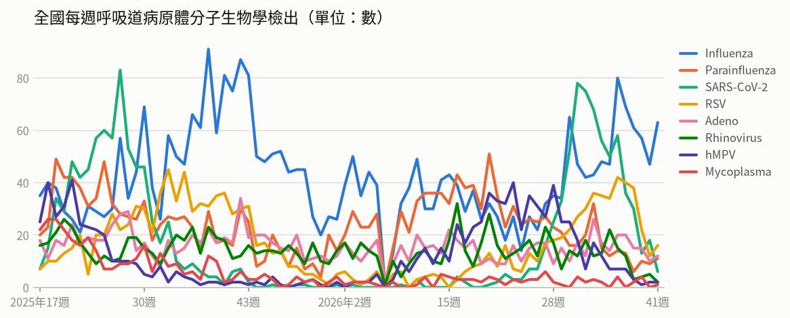
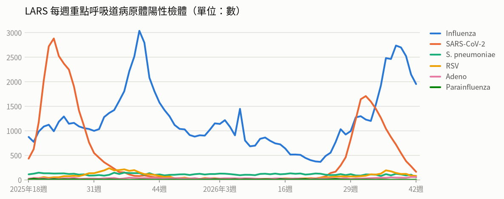
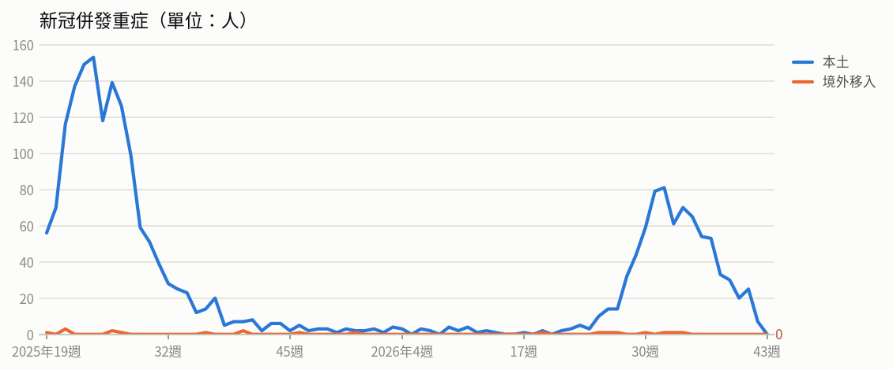
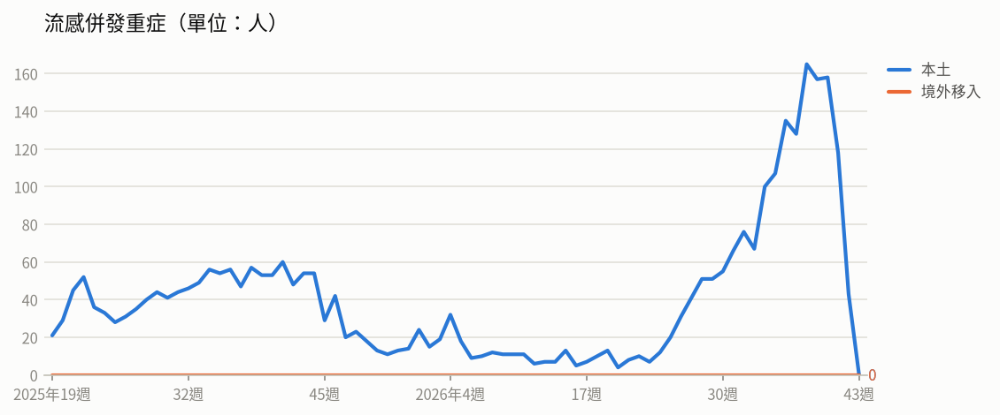
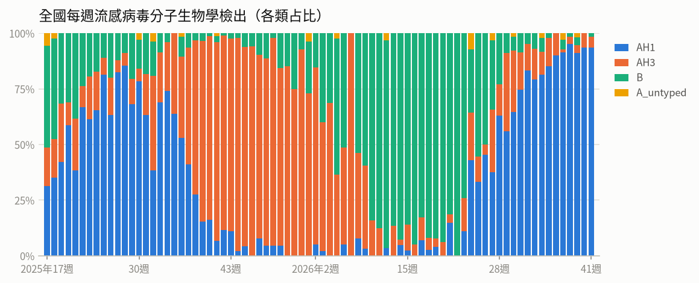
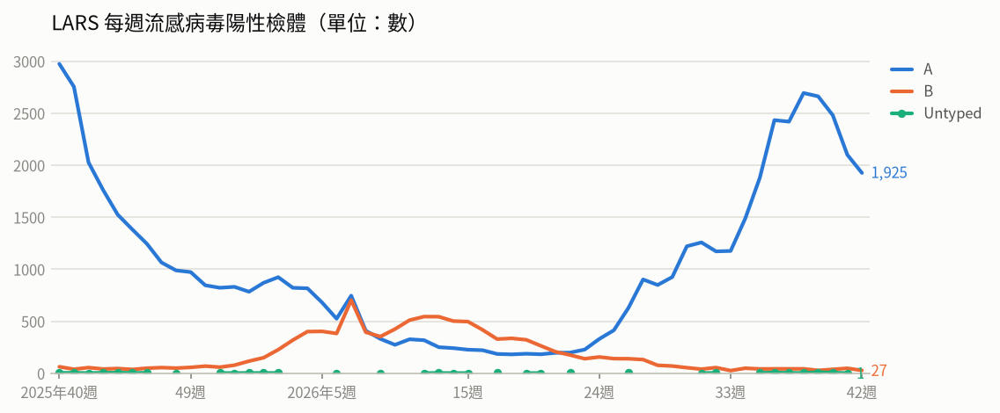
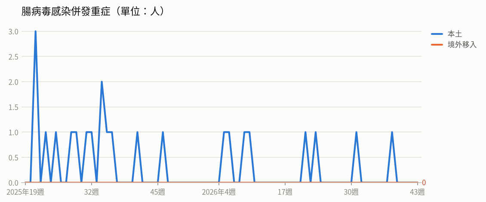
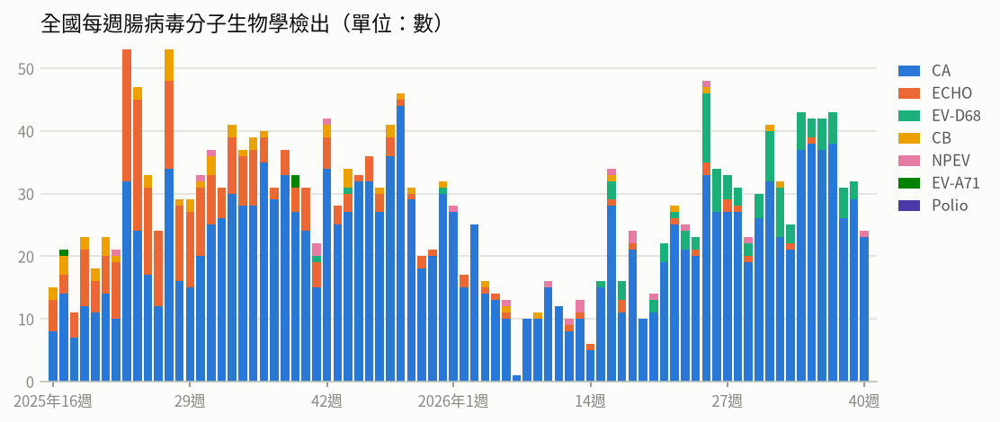
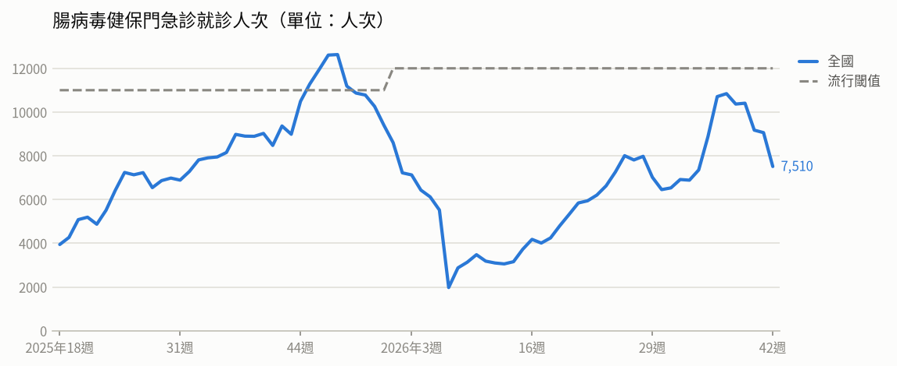
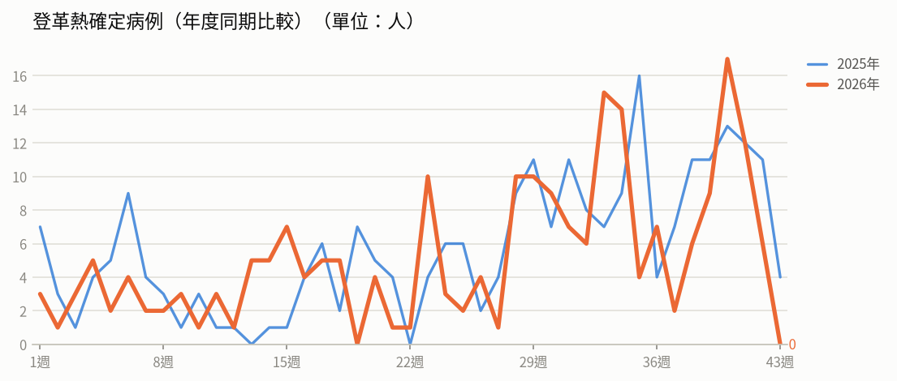

# 疫情週報 2026-W43

涵蓋期間：2026-10-19 ~ 2026-10-25

> 本報告由 AI 自動產生，內容以疾管署原文為準。

## 監測數據

### 呼吸道病原體（整體）

- **全國每週呼吸道病原體分子生物學檢出**（2026年第41週）：共 113，較前一週 ↑ +10（+10%）；陽性率 54.3%

- **LARS 每週重點呼吸道病原體陽性檢體**（2026年第42週）：共 2,305，較前一週 ↓ -368（-14%）

### 新冠（COVID-19）

- **新冠併發重症**（2026年第41週）：共 25人（本土 25、境外移入 0），較前一週 ↑ +5（+25%）
  - 統計摘要：上週累計數 7、今年累計數 807、去年總數 1718、今年累計死亡數 181

- **每週新冠病毒變異株檢出——本土**（2026年第40週）：共 1，較前一週 ↓ -1（-50%）

- **每週新冠病毒變異株檢出——境外移入**（2026年第39週）：共 3，較前一週 ↓ -3（-50%）

### 流感

- **流感併發重症**（2026年第41週）：共 118人（本土 118、境外移入 0），較前一週 ↓ -40（-25%）
  - 統計摘要：上週累計數 43、今年累計數 1858、去年總數 2290、今年累計死亡數 406

- **全國每週流感病毒分子生物學檢出**（2026年第41週）：共 63，較前一週 ↑ +16（+34%）；陽性率 30.3%

- **LARS 每週流感病毒陽性檢體**（2026年第42週）：共 1,952，較前一週 ↓ -195（-9%）

### 腸病毒

- **腸病毒感染併發重症**（2026年第38週）：共 1人（本土 1、境外移入 0）
  - 統計摘要：上週累計數 0、今年累計數 8、去年總數 19、今年累計死亡數 1

- **全國每週腸病毒分子生物學檢出**（2026年第40週）：共 24，較前一週 ↓ -8（-25%）；陽性率 13.7%

- **腸病毒健保門急診就診人次**（2026年第42週）：共 7,510人次，較前一週 ↓ -1,549（-17%）（流行閾值 12,000）

### 登革熱

- **登革熱確定病例（年度同期比較）**（2026年第42週）：6人，2025年同期 11人
  - 統計摘要：上週累計數 6、今年累計數 221、去年總數 293、今年累計死亡數 0

> 數據取自 NIDSS（目前為 2026年第43週，統計上一完整週；定序類資料與通報有時間落後，併發重症等項目改取再前一週，以各項標示的週次為準）。最新資料可能因後續回報而變動。

## 重點速覽

- 🔴 **奈及利亞現首例境外移入，疫情國增至5國**：剛果民主共和國疫情持續擴大至8省、致死率約48%，維持第三級警告；肯亞9例均為隔離中之接觸者，疾管署評估對我國風險仍低。
- 🔴 **10月確診18例創近兩年單月新高，多為Ib型**：今年累計52例，其中16例10月個案為Ib型、皆有不安全性行為且僅2人曾接種疫苗；現行疫苗與Tecovirimat對Ib型同樣有效，呼籲完成2劑接種。
- 🔴 **孟加拉疫情持續延燒，確診逾2.3萬例**：自3月起累計23,122例實驗室確診、104例死亡，以達卡最嚴重，疫苗覆蓋率下降為主因；瑞典音樂節相關疫情已於10/14宣布結束。
- 🟠 **國內疫情緩降仍在流行期，公費抗病毒藥延長至11/15**：上週類流感門急診12.3萬人次、新增159例重症與44例死亡，社區以A型H1N1為主；高傳播族群有類流感症狀者免快篩即可用公費克流感、易剋冒。
- 🟠 **國內新冠已脫離流行期，公費疫苗新增Novavax可選**：門急診連續兩週低於流行閾值，近7日新增25例本土重症、5例死亡；12歲以上尚未接種本季疫苗者可擇Moderna或Novavax任一廠牌。
- 🟠 **歐洲本土病例明顯高於往年，15國累計近1,900例**：以義大利、希臘、法國最多，影響範圍擴及比利時等新增國家，赴歐旅遊應加強防蚊措施。

## 國際重要疫情

- **孟加拉、瑞典－麻疹**（關注程度：高）：疾管署引述Reuters、reliefweb、DGHS等來源指出，孟加拉麻疹疫情持續且嚴峻，以首都達卡最多（14,488例確診、67例死亡），其次為吉大港3,366例與錫爾赫特1,114例；因疫苗覆蓋率下降，當局自9月起提供疫苗補接種以控制疫情。瑞典自9/9起未再出現音樂節相關個案，10/14宣布該起疫情結束，累計40例確診（28例為音樂節期間感染、12例為後續接觸感染），分布於10個地區，以斯德哥爾摩12例、西博滕省7例較多，並有1例跨境傳播至芬蘭。受影響者以學齡兒童及成人為主，多數未曾接種疫苗。
  - 旅遊防疫建議：計畫前往孟加拉等麻疹流行地區者，出發前應確認已完成麻疹疫苗接種；返國後如出現發燒、紅疹等症狀，應戴口罩speedily就醫並主動告知旅遊史。
  - [原文連結](https://www.cdc.gov.tw/TravelEpidemic/Detail/G3PSay_dafdAwjsYNm3CCA?epidemicId=YA7Pz7N5fXIIZ4WOIPTupQ)
- **肯亞、剛果民主共和國－國際重要疫情（原文未載明病原名稱）**（關注程度：高）：肯亞自10/6報告首例境外移入死亡個案後，10/14、10/16各新增1例確診，均為該死亡個案近親且發病時已在隔離中；10/17再新增4例確診，包含1例已死亡的男性近親（10/6起隔離）及3名曾照護首例個案的醫護人員（10/9起隔離），年齡29至32歲，該國衛生部表示個案出現症狀及確診時均處隔離狀態，目前尚無證據顯示疫情已在社區廣泛傳播，當局已匡列130名接觸者、其中128人接受隔離。剛果民主共和國疫情持續，10/15單日新增71例確診、14例死亡，分布於伊圖里省（41例）、北基伍省（22例）、喬波省（7例）及上韋萊省（1例）。該國疫情涵蓋7個省份、65個衛生區，以伊圖里省最為嚴峻，占全國病例數73.2%。
  - 旅遊防疫建議：計畫前往肯亞或剛果民主共和國者，應留意當地疫情發展並做好個人防護，避免接觸疑似病患及其體液；返國時如有不適請主動告知機場檢疫人員，返國後如出現疑似症狀應立即就醫並說明旅遊史，或撥打防疫專線1922諮詢。
  - [原文連結](https://www.cdc.gov.tw/TravelEpidemic/Detail/G3PSay_dafdAwjsYNm3CCA?epidemicId=edIMG7euT0RAUhHzlM1j9A)
- **全球（含中國、丹麥、塞爾維亞、秘魯、臺灣、冰島、挪威、英國）－新型A型流感（H5N1、H9N2等禽流感）**（關注程度：中）：疾管署每週更新全球新型A型流感疫情。人類病例本週無新增，今年全球累計47例，個案發病前多有易感動物相關暴露史。動物疫情部分，依WAHIS資料，中國於2026/10/10通報1起H5（N未定型）疫情；丹麥、塞爾維亞、秘魯及臺灣於10/12-16各通報1起H5N1；冰島、挪威及英國於10/13-14各通報1起H5N5。
  - 旅遊防疫建議：請避免接觸禽鳥、禽畜糞便及其分泌物，不生食禽肉與蛋類，並落實勤洗手；如出現發燒、咳嗽等症狀，就醫時應主動告知禽畜接觸史與旅遊史。
  - [原文連結](https://www.cdc.gov.tw/TravelEpidemic/Detail/G3PSay_dafdAwjsYNm3CCA?epidemicId=q4t5UGMjmp4P-sOzWGvrWQ)
- **剛果民主共和國、肯亞、奈及利亞（另涉烏干達）－伊波拉病毒感染症**（關注程度：中）：疾管署2026年10月21日表示，肯亞與奈及利亞均首度出現邦迪布焦型伊波拉病毒（BVD）境外移入病例。奈及利亞個案為女性、具烏干達旅遊史，10月7日發病、10月20日檢驗確診，已匡列44名接觸者追蹤；肯亞首例具剛果民主共和國旅遊史，後續8例均與首例有明確流行病學關聯且於隔離檢疫期間發病，尚無證據顯示擴散至已知接觸者以外社區。剛果民主共和國疫情持續擴大，新增北烏班吉省受影響，因與中非共和國接壤，跨境傳播風險需密切監測。疾管署評估此波疫情對我國威脅風險仍低，暫不調升肯亞、奈及利亞旅遊疫情建議等級，但維持剛果民主共和國第三級警告（Warning）。
  - 旅遊防疫建議：民眾應避免前往剛果民主共和國所有非必要旅遊，前往非洲相關地區時避免接觸疑似感染者、野生動物及其生肉製品；返國後如出現發燒、嘔吐、腹瀉或出血等症狀，請戴口罩儘速就醫並主動告知旅遊接觸史。
  - [原文連結](https://www.cdc.gov.tw/Subscription/EpaperPreview?epaperId=103159&typeid=5)
- **奈及利亞－伊波拉病毒感染（邦迪布焦型，BVD）**（關注程度：中）：WHO於2026年10月20日公布，奈及利亞報告首例邦迪布焦伊波拉病毒感染（BVD）病例。個案為女性，10月3日抵達奈及利亞後，10月7日發病，10月11日至首都阿布加一間私人醫療機構就醫，10月20日經實驗室檢驗確認感染，目前隔離治療中。個案可能感染來源、完整旅遊史及暴露史仍持續調查，當局已匡列44名接觸者進行健康監測追蹤，並加強相關醫療機構感染預防與控制措施。
  - 旅遊防疫建議：前往奈及利亞等伊波拉疫情流行地區時，應避免接觸疑似病患的血液或體液及野生動物；返國後如出現發燒等不適症狀，請儘速就醫並主動告知旅遊接觸史。
  - [原文連結](https://www.cdc.gov.tw/TravelEpidemic/Detail/G3PSay_dafdAwjsYNm3CCA?epidemicId=mDex8Z_M0urfGHS9nMCgBg)
- **孟加拉、菲律賓－登革熱**（關注程度：中）：疾管署引述Outbreak News Today、WHO及菲律賓通訊社2026/10/19資訊指出，孟加拉登革熱疫情嚴峻，今年累計11萬2,400例住院病例、348例死亡，目前仍有逾6,000名患者住院中，疫情集中於達卡等人口密度高的區域。菲律賓今年累計19萬2,112例，低於警戒值，死亡率（CFR 0.39）較去年同期下降23%，近兩週疫情呈下降趨勢。
  - 旅遊防疫建議：前往孟加拉、菲律賓等登革熱流行地區應全程做好防蚊措施，穿著淺色長袖衣褲並使用政府核可的防蚊藥劑；返國後如出現發燒、頭痛、後眼窩痛或出疹等症狀，應儘速就醫並主動告知旅遊史。
  - [原文連結](https://www.cdc.gov.tw/TravelEpidemic/Detail/G3PSay_dafdAwjsYNm3CCA?epidemicId=6kThzK6afGaD0NgF9s8YrA)
- **日本、英國－流感**（關注程度：中）：日本流感疫情持續上升，第41週住院1,123例（前週998例），其中70歲以上551例占49%，以沖繩縣(31.34)、神奈川縣(21.6)及埼玉縣(20.99)較高，全國47個都道府縣中有39個病例數較上週增加。英國第41週陽性率6.5%，住院率每10萬人1.88例，以85歲以上每10萬人9.43例最高；當局10月8日表示活動度雖仍處基線值，但9月已高於過去4個冬季同期，顯示有提早流行趨勢，主因為成人病例增加。
  - 旅遊防疫建議：前往日本、英國旅遊應落實勤洗手、咳嗽禮節並視需要佩戴口罩，符合資格者（尤其長者等高風險族群）建議提早接種流感疫苗；返國後如有發燒、咳嗽等症狀應戴口罩就醫並告知旅遊史。
  - [原文連結](https://www.cdc.gov.tw/TravelEpidemic/Detail/G3PSay_dafdAwjsYNm3CCA?epidemicId=BpKfgucjHBW31lRGA89Jjg)
- **歐洲（義大利、希臘、法國、比利時等15國）－西尼羅熱**（關注程度：中）：依據ECDC及Outbreak News Today 2026/10/16資料，歐洲今年西尼羅熱本土人類病例數顯著超過往年同期，共15國累計1,926例，以義大利、希臘、法國為主要疫情國。受影響區域持續擴大，如比利時等新增國家。惟目前尚無證據顯示疾病嚴重度隨之增加。
  - 旅遊防疫建議：前往歐洲疫區旅遊時應加強防蚊措施，穿著淺色長袖衣褲並使用政府核可的防蚊藥劑；返國後如出現發燒、頭痛、肌肉痠痛等症狀，應儘速就醫並主動告知旅遊史。
  - [原文連結](https://www.cdc.gov.tw/TravelEpidemic/Detail/G3PSay_dafdAwjsYNm3CCA?epidemicId=TmhSQkZF_XlUJ1ytiBr_Tg)
- **蘇丹－急性病毒性E型肝炎**（關注程度：中）：依據BEACON 2026年10月16日資料，蘇丹南達爾富爾州（South Darfur）自7/25至10/2累計通報273例急性病毒性E型肝炎疑似病例，並有1例死亡。疫情多發生於阿爾薩拉姆（Al Salam）等難民營及周邊社區，因當地缺乏衛生飲水設施，飲用水遭受污染。當局已宣布疫情爆發，並與相關組織合作推動水質氯化、供水管網修復及緊急醫療轉診。
  - 旅遊防疫建議：前往蘇丹等衛生條件不佳地區時，應落實勤洗手、飲用煮沸或經消毒處理的水並食用熟食；返國後如出現發燒、噁心、腹痛或黃疸等症狀，應儘速就醫並告知旅遊史。
  - [原文連結](https://www.cdc.gov.tw/TravelEpidemic/Detail/G3PSay_dafdAwjsYNm3CCA?epidemicId=00vD7vCxojxtw67R4i3c6A)
- **非洲（奈及利亞、尼日、幾內亞、塞內加爾、摩洛哥等9國）－白喉**（關注程度：中）：非洲區白喉疫情持續擴散，今年初截至10月已有9個國家通報，奈及利亞病例與死亡數最多，尼日、幾內亞及塞內加爾次之，其中塞內加爾為逾20年來首次通報病例且疫情快速擴散。摩洛哥15例確定病例主要集中於卡薩布蘭卡-塞塔特大區及蘇斯-馬塞大區，個案病情穩定，當局持續進行接觸者匡列與防治措施。ECDC評估多數歐洲國家疫苗接種覆蓋率高，一般民眾風險低；美國駐摩洛哥大使館於10/15發布健康警示，惟因當地接種率高，評估感染風險為低。
  - 旅遊防疫建議：計畫前往疫區者應於行前確實完成白喉疫苗完整接種；返國後如出現發燒、喉嚨痛等疑似症狀，請儘速就醫並主動告知旅遊史。
  - [原文連結](https://www.cdc.gov.tw/TravelEpidemic/Detail/G3PSay_dafdAwjsYNm3CCA?epidemicId=U23IPsMnjtZcL4BZ7L_Dcw)
- **全球（含中國、香港、韓國）－COVID-19（新冠併發重症）**（關注程度：低）：疾管署引用WHO FluNet、WHO、中國疾控中心、香港衛生防護中心及KCDA資料指出，全球第38週新冠陽性率4.58%，非洲、歐洲及東地中海區上升，流行變異株以XFG、JN.1、NB.1.8.1、PQ.16.1.1及BA.3.2為主。中國第41週門急診陽性率由前一週4.9%降至3.4%；香港降至低點，陽性率0.33%，污水監測變異株以PQ.16.1.1（81.7%）、NB.1.8.1（17.7%）為主；韓國陽性率8.7%，以PQ.16.1.1（59.7%）、NB.1.8.1（31.9%）、BA.3.2（3.5%）及RF.5（1.9%）為主。
  - 旅遊防疫建議：計畫前往鄰近國家或疫情上升地區者，建議依規定完成新冠疫苗接種，並於旅途中落實勤洗手、適時配戴口罩等個人衛生措施；出現發燒、呼吸道症狀時應就醫並告知旅遊史。
  - [原文連結](https://www.cdc.gov.tw/TravelEpidemic/Detail/G3PSay_dafdAwjsYNm3CCA?epidemicId=Z79RTqSPocsbjNoBy2_s2g)
- **全球（阿富汗、巴基斯坦、馬達加斯加、南蘇丹、剛果民主共和國、馬利、奈及利亞、索馬利亞）－小兒麻痺症（脊髓灰質炎）**（關注程度：低）：疾管署引述全球小兒麻痺根除倡議組織（GPEI）2026/10/14資料，10/8-14期間WPV1新增阿富汗與巴基斯坦各1例；cVDPV1新增馬達加斯加2例、南蘇丹1例；cVDPV2新增剛果民主共和國7例、馬利2例；cVDPV3新增奈及利亞1例。環境樣本部分，WPV1於阿富汗新增1件，cVDPV2於索馬利亞新增4件、剛果民主共和國1件。顯示野生株與疫苗衍生病毒株在非洲及南亞部分國家仍持續傳播。
  - 旅遊防疫建議：計劃前往上述流行地區者，應於出國前確認小兒麻痺疫苗接種是否完整並依建議追加，旅途中注意手部衛生與飲食衛生；返國後如出現肢體無力等症狀應儘速就醫並告知旅遊史。
  - [原文連結](https://www.cdc.gov.tw/TravelEpidemic/Detail/G3PSay_dafdAwjsYNm3CCA?epidemicId=89PRC7QlZ4iIv0hrE02_DA)
- **菲律賓－急性病毒性A型肝炎**（關注程度：低）：疾管署引述MSN與Inquirer Net 2026年10月17日報導，菲律賓布基農省（Bukidnon）瓦倫西亞市（Valencia City）發生急性病毒性A型肝炎疫情，10月8日通報73例疑似病例，至10月12日累計31例確診，病例多為10至19歲學生。當地已於校園及社區環境採檢，因檢測結果符合標準，已解除流動攤販禁售食物的禁令。當局持續加強校園飲水衛生與飲水安全監測。
  - 旅遊防疫建議：前往當地旅遊應注意手部衛生、飲食衛生，只喝瓶裝水或煮沸的水，避免生食；可視需要於出國前諮詢旅遊醫學門診評估接種A型肝炎疫苗。
  - [原文連結](https://www.cdc.gov.tw/TravelEpidemic/Detail/G3PSay_dafdAwjsYNm3CCA?epidemicId=b8b_7IG77ks5hESxh4cg_A)

## 本週國內公告摘要

### 流感

#### 疾病管制署延長擴大公費流感抗病毒藥劑使用對象「有類流感症狀，且具下列身分之流感高傳播族群」之適用期限至115年11月15日止，籲請醫師善用公費藥劑，共同防治流感(疾病管制署致醫界通函第617號)

- **來源／關注程度／地區**：衛生福利部疾病管制署／中／全國
- **病例概況**：國內流感疫情呈下降趨勢，惟仍處於流行期，且即將進入呼吸道傳染病流行季節。
- **摘要**：疾管署於2026年10月20日發布致醫界通函第617號，宣布延長擴大公費流感抗病毒藥劑使用對象之適用期限至115年11月15日止，適用於「有類流感症狀且屬流感高傳播族群」者，包括醫事單位防疫相關人員、安養及長照機構受照顧者與工作人員、幼兒園與托育人員、幼兒園至五專三年級學生、與流感重症高風險族群同住或照顧者、禽畜養殖與動物防疫相關人員，以及軍營等人口密集機構人員。全國約4千家合約醫療機構配置克流感及易剋冒，符合條件者不需流感快篩即可開立公費藥劑，並請於用藥後儘速至SMIS系統回報。疾管署亦提醒醫師提高對呼吸急促、呼吸困難、發紺、血痰、胸痛、意識改變、低血壓等流感危險徵兆的警覺。
- **防疫建議**：如出現類流感症狀且屬上述高傳播族群，可儘速至合約醫療機構就醫評估公費抗病毒藥劑；平時落實勤洗手、佩戴口罩、咳嗽禮節及生病在家休息，避免前往人潮擁擠、空氣不流通的場所。
- **原文連結**：https://www.cdc.gov.tw/Bulletin/Detail/0htRoySn4Y2h9MuSX8wBHg?typeId=48

#### 因應流感疫情仍處流行期，公費流感抗病毒藥劑擴大用藥條件將延長至2026年11月15日止

- **來源／關注程度／地區**：衛生福利部疾病管制署／中／全國
- **病例概況**：監測資料顯示國內流感疫情呈下降趨勢，惟仍處於流行期。
- **摘要**：疾管署2026年10月20日宣布，因國內流感疫情雖下降但仍處流行期，且時序將進入呼吸道傳染病流行季節，公費流感抗病毒藥劑擴大用藥條件（具類流感症狀之流感高傳播族群，含醫事防疫人員、長照機構住民與工作人員、幼兒園及托育人員、幼兒園至高中職及五專1至3年級學生、與重症高風險者同住或照顧者、禽畜養殖與動物防疫相關人員、軍營等人口密集機構人員）延長適用至2026年11月15日止。公費藥劑（克流感、易剋冒）配置於全國約4千家合約醫療機構，符合條件者不需流感快篩即可開立。因抗病毒藥劑未納入健保給付，公費用藥時機與必要性仍由醫師依臨床專業判斷。
- **防疫建議**：民眾應勤洗手、注意咳嗽禮節，有呼吸道症狀時佩戴口罩並與他人保持1公尺以上距離；出現類流感症狀應儘速就近就醫並充分休息，若有呼吸急促、呼吸困難、發紺、血痰、胸痛、意識改變或低血壓等危險徵兆須立即就醫。
- **原文連結**：https://www.cdc.gov.tw/Bulletin/Detail/xftynOgE-N_oMXU2RQo76g?typeId=9

### M痘（猴痘）

#### 國內M痘Ib病毒株病例顯著增加，疾管署呼籲風險族群儘速完成接種2劑疫苗

- **來源／關注程度／地區**：衛生福利部疾病管制署／高／全國
- **病例概況**：今年截至10月19日新增52例M痘確定病例（41例本土、11例境外移入），10月單月已確診18例創2024年10月以來新高，其中16例為Ib型病毒株。
- **摘要**：疾管署表示，我國自今年5月出現首例M痘Ib病毒株病例以來，已檢出30例Ib型（22例本土、8例境外移入，境外感染地以泰國6例最多、香港2例次之），近三個月確診者多為Ib型。10月18例個案中16例為Ib型，年齡介於20多歲至40多歲，皆曾有不安全性行為，僅2人曾接種M痘疫苗。Ib型全身性皮疹分布較廣、較易在家戶內傳播，但與II型症狀相似、致死率相近，現行疫苗與抗病毒藥物Tecovirimat對Ib型同樣有效。國內已有112,774人接種至少1劑疫苗，其中31,927人（28%）尚未完成第2劑。
- **防疫建議**：符合公費接種條件者（近1年有風險性行為、曾罹患性病或性接觸對象有上述情形）應儘速至全國327家合作院所完成2劑M痘疫苗接種，完整接種可達9成保護力；如出現皮疹、水泡、膿疱或發燒、淋巴結腫大等症狀，應戴口罩儘速就醫並主動告知旅遊史與接觸史。
- **原文連結**：https://www.cdc.gov.tw/Bulletin/Detail/WRYbuXJOF_tHjXPtZ49t7w?typeId=9

### 伊波拉病毒感染症

#### 近期肯亞及奈及利亞均確診境外移入相關伊波拉病毒感染症病例，疾管署持續監測疫情發展，並維持剛果民主共和國旅遊警示等級第三級警告(Warning)

- **來源／關注程度／地區**：衛生福利部疾病管制署／中／剛果民主共和國、肯亞、奈及利亞
- **病例概況**：剛果民主共和國截至10月18日累計9,552例確定病例、4,602例死亡（致死率48.2%），疫情擴及8省66個衛生區；肯亞自10月6日首例境外移入後截至10月20日累計9例，奈及利亞出現1例境外移入確診。
- **摘要**：疾管署表示，肯亞及奈及利亞分別出現首起邦迪布焦伊波拉病毒（BVD）境外移入病例，奈及利亞個案為具烏干達旅遊史的女性，已匡列44名接觸者追蹤；肯亞9例均與首例具明確流行病學關聯，且於隔離檢疫期間發病，尚無證據顯示擴散至已知接觸者以外社區。剛果民主共和國疫情持續擴大，近期新增北烏班吉省受影響，因與中非共和國接壤，跨境傳播風險需密切監測。疾管署評估此波疫情對我國威脅風險仍低，暫不調升肯亞與奈及利亞旅遊疫情建議等級，但維持剛果民主共和國第三級警告（Warning）。
- **防疫建議**：民眾應避免前往剛果民主共和國所有非必要旅遊；自流行地區返國後如出現發燒、嘔吐、腹瀉、出血等症狀，應儘速就醫並主動告知旅遊接觸史。
- **原文連結**：https://www.cdc.gov.tw/Bulletin/Detail/FtPgGTu4k3dFSlt0P-AvXA?typeId=9

### 流感、COVID-19（疫苗接種宣導）

#### 連假將至 籲請符合流感及新冠疫苗公費接種資格民眾儘早接種 增加保護力 還可獲得健康幣

- **來源／關注程度／地區**：衛生福利部疾病管制署／中／全國
- **病例概況**：第41週（10/11-10/17）類流感門急診123,820人次，較前週下降5.4%，疫情緩降仍處流行期；新冠門急診3,873人次，下降27.7%，已連續兩週低於流行閾值而脫離流行期。
- **摘要**：115年度公費流感及新冠疫苗自10月1日開打，截至10月19日流感疫苗接種約340萬人次（為去年同期1.1倍）、新冠疫苗逾107萬人次（為去年同期1.4倍）；10月19日起新增Novavax新冠疫苗，滿12歲以上尚未接種本季新冠疫苗的公費對象可擇Moderna或Novavax任一廠牌。流感疫情緩降仍高，上週新增159例流感併發重症與44例死亡，社區流行病毒以A型H1N1為主（占92.7%），本流感季累計307例重症、42例死亡。新冠近7日新增25例本土重症與5例本土死亡，本季累計56例本土重症（6例死亡），近4週變異株以PQ.16.1.1為多，其次為NB.1.8.1。
- **防疫建議**：連假出遊與聚會增加傳播風險，65歲以上長者及慢性病等重症高風險族群應儘速至合約院所或社區接種站完成本季流感及新冠疫苗接種（18歲以上接種可獲健康幣）；平時勤洗手、有發燒咳嗽等症狀戴口罩並在家休息，出現呼吸急促、呼吸困難、發紺、血痰、胸痛、意識改變或低血壓等危險徵兆應儘速就醫。
- **原文連結**：https://www.cdc.gov.tw/Bulletin/Detail/NmSGjiosphPs1mla9qRq6Q?typeId=9
