# 疫情週報 2026-W44

涵蓋期間：2026-10-26 ~ 2026-11-01

> 本報告由 AI 自動產生，內容以疾管署原文為準。

## 監測數據

### 呼吸道病原體（整體）

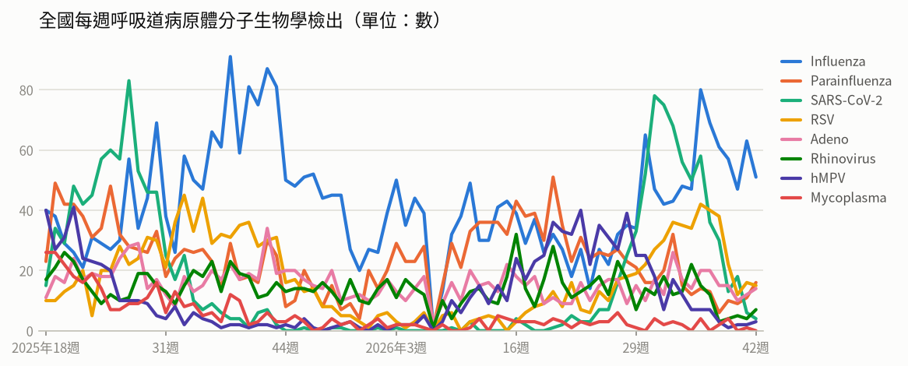

- **全國每週呼吸道病原體分子生物學檢出**（2026年第42週）：共 110，較前一週 ↓ -5（-4%）；陽性率 57.9%

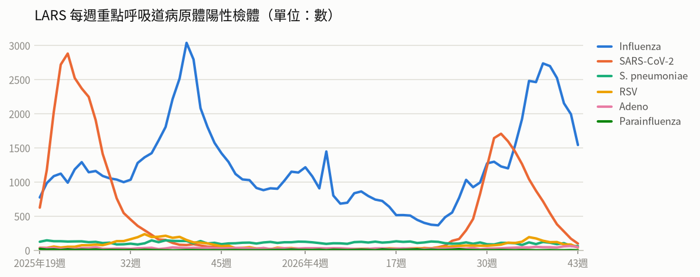

- **LARS 每週重點呼吸道病原體陽性檢體**（2026年第43週）：共 1,787，較前一週 ↓ -591（-25%）

### 新冠（COVID-19）

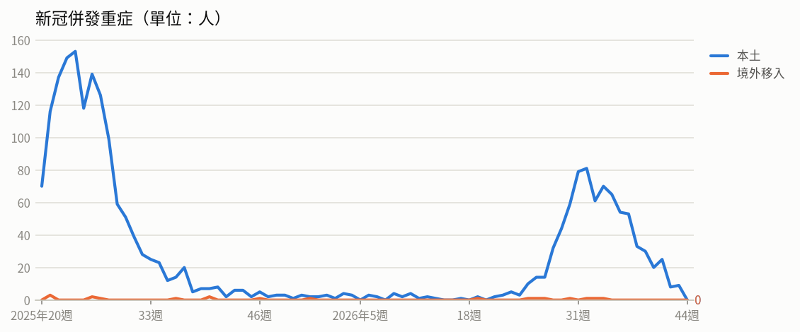

- **新冠併發重症**（2026年第42週）：共 8人（本土 8、境外移入 0），較前一週 ↓ -17（-68%）
  - 統計摘要：上週累計數 9、今年累計數 817、去年總數 1718、今年累計死亡數 184

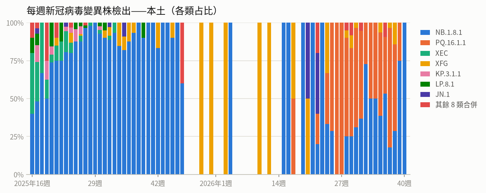

- **每週新冠病毒變異株檢出——本土**（2026年第40週）：共 3，較前一週 ↓ -1（-25%）

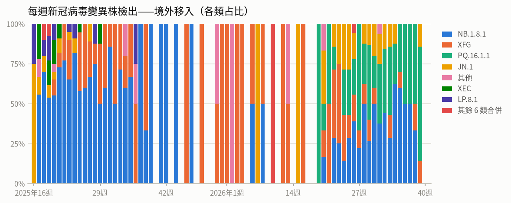

- **每週新冠病毒變異株檢出——境外移入**（2026年第39週）：共 7，較前一週 ↑ +1（+17%）

### 流感

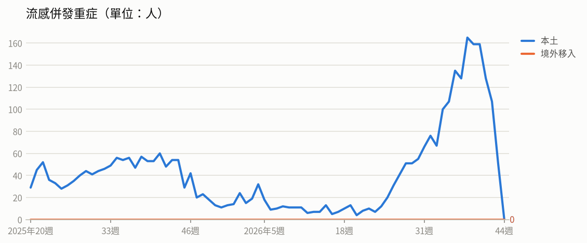

- **流感併發重症**（2026年第42週）：共 107人（本土 107、境外移入 0），較前一週 ↓ -21（-16%）
  - 統計摘要：上週累計數 51、今年累計數 1986、去年總數 2290、今年累計死亡數 452

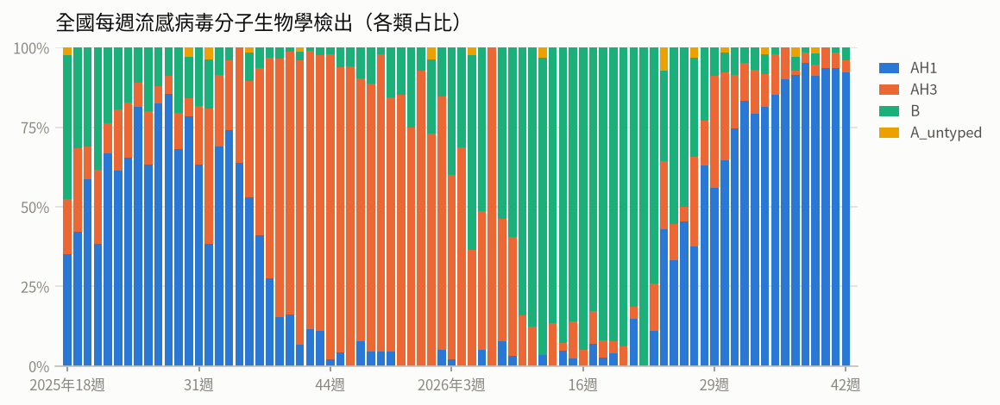

- **全國每週流感病毒分子生物學檢出**（2026年第42週）：共 51，較前一週 ↓ -12（-19%）；陽性率 26.8%

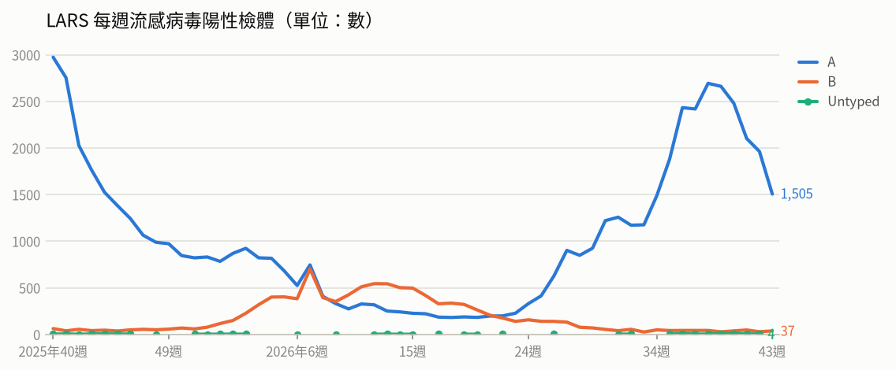

- **LARS 每週流感病毒陽性檢體**（2026年第43週）：共 1,542，較前一週 ↓ -452（-23%）

### 腸病毒

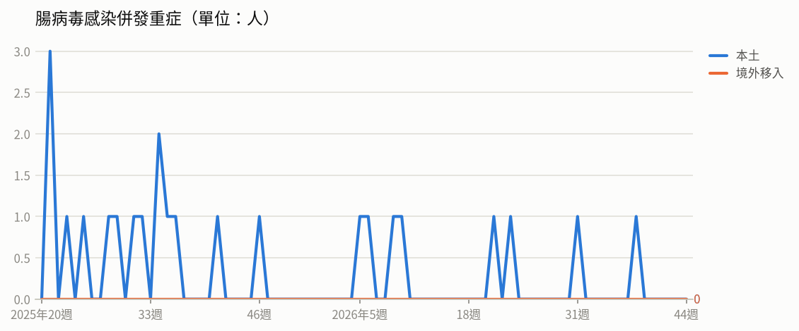

- **腸病毒感染併發重症**（2026年第38週）：共 1人（本土 1、境外移入 0）
  - 統計摘要：上週累計數 0、今年累計數 8、去年總數 19、今年累計死亡數 1

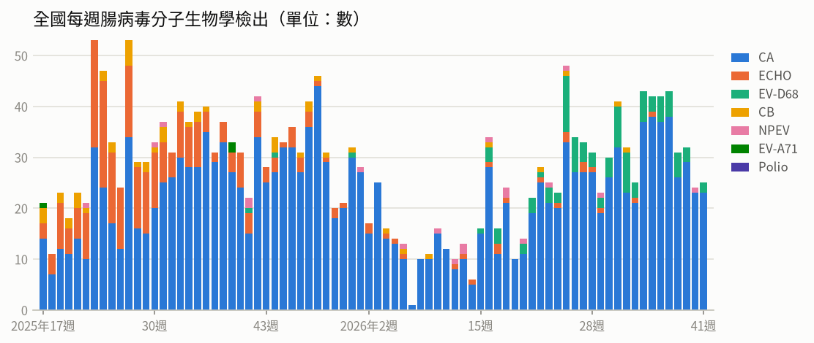

- **全國每週腸病毒分子生物學檢出**（2026年第41週）：共 25，較前一週 ↑ +1（+4%）；陽性率 11.2%

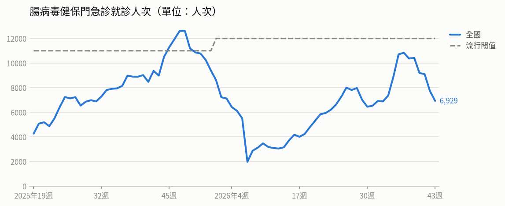

- **腸病毒健保門急診就診人次**（2026年第43週）：共 6,929人次，較前一週 ↓ -817（-11%）（流行閾值 12,000）

### 登革熱

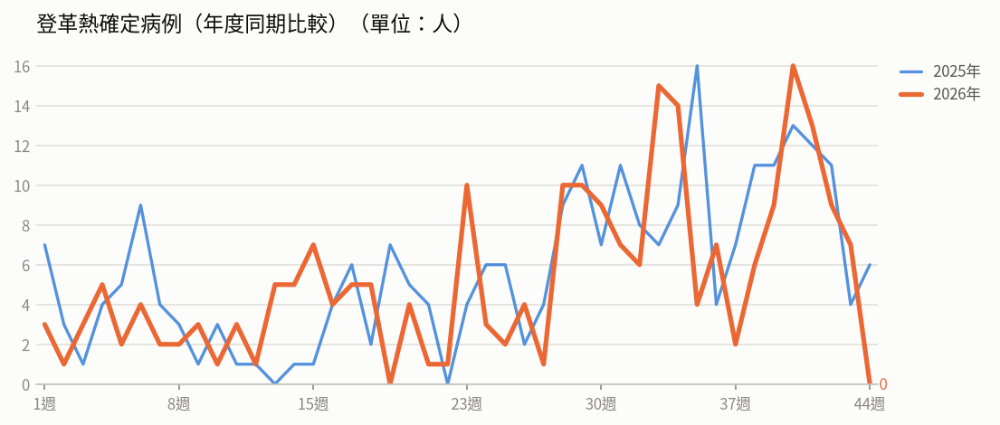

- **登革熱確定病例（年度同期比較）**（2026年第43週）：7人，2025年同期 4人
  - 統計摘要：上週累計數 7、今年累計數 231、去年總數 293、今年累計死亡數 0

> 數據取自 NIDSS（目前為 2026年第44週，統計上一完整週；定序類資料與通報有時間落後，併發重症等項目改取再前一週，以各項標示的週次為準）。最新資料可能因後續回報而變動。

## 重點速覽

- 🔴 **剛果民主共和國伊波拉破萬例，肯亞、奈及利亞現關聯病例**：DRC截至10/27累計10,193例確定病例、4,960例死亡（致死率48.7%），疫情遍及8省66個衛生區；肯亞9例同一群聚、奈及利亞1例境外相關個案，病毒與DRC屬同一基因群，前往非洲疫區應避免接觸疑似病患及野生動物。
- 🔴 **英美麻疹疫情破紀錄，英國今年已超越去年全年**：英國截至10/12累計1,030例（去年全年958例），以倫敦最多；美國截至10/22累計4,588例為去年2倍，賓州另發布孕產婦及先天性麻疹健康警示；出國前應確認MMR疫苗接種史。
- 🔴 **尚比亞霍亂擴及6省，首都路沙卡占半數以上**：尚比亞自7/28宣布疫情以來至10/26累計1,488例（219例確診、29例死亡），路沙卡845例占57%；剛果民主共和國自今年1月以來疑似個案逾5萬例，前往當地務必注意飲水與食物衛生。
- 🟠 **國內流感仍處流行期，H1N1為主、重症多為長者**：第42週類流感門急診101,746人次（受颱風休診影響較前週降18.8%），上週新增85例重症、28例死亡，本季累計391例重症、57例死亡；重症者99.7%未接種本季疫苗，第二階段公費對象50-64歲無高風險慢性病成人11/2開打。
- 🟠 **再增1例腸病毒重症，今年累計8例**：北部未滿10歲女童感染克沙奇A6型併發重症，已出院；今年8例重症含1例死亡，近四週社區以克沙奇A6型為多，門急診人次雖因颱風休診下降，社區傳播風險仍在，請落實正確洗手。

## 國際重要疫情

- **剛果民主共和國、奈及利亞、肯亞－伊波拉病毒感染**（關注程度：高）：奈及利亞與肯亞近期檢出之伊波拉病毒，與剛果民主共和國（DRC）現行疫情病例屬相同基因群及病毒譜系，惟奈國個案感染來源仍待釐清；兩名個案皆曾於10/3出現在烏干達恩德培機場，但未檢出與烏干達今年5至6月病例相關之病毒標記。肯亞9例確診均屬同一群聚，確診日期介於10/6-19，至10/26已連續7日無新增病例，首批20名接觸者完成21日健康監測且均無症狀。奈及利亞個案為烏干達籍女性、瑞士駐阿布加外交官之妻，10/7發病、10/20檢驗陽性，10/26後送至瑞士日內瓦大學醫院治療，接觸者由44人增至54人。DRC疫情分布於8省66個衛生區，以伊圖里省最嚴峻（占全國71.4%病例），且約80%病例來自已知傳播鏈以外，顯示傳播仍持續。
  - 旅遊防疫建議：前往剛果民主共和國等疫情流行地區應避免接觸疑似病患、其血液與體液，以及野生動物或其生肉；返國後如出現發燒、嘔吐、腹瀉、出血等症狀，應主動向機場檢疫人員或醫師告知旅遊接觸史。
  - [原文連結](https://www.cdc.gov.tw/TravelEpidemic/Detail/G3PSay_dafdAwjsYNm3CCA?epidemicId=MuhW81vlLAk_dQ6mjHW6Sg)
- **剛果民主共和國、肯亞、奈及利亞（非洲地區）－伊波拉病毒感染（Ebola，含Bundibugyo病毒）**（關注程度：高）：肯亞9例確定病例均與首例個案具明確流行病學關聯，包含4名近親、3名醫療照護人員及1名清潔人員，且皆於隔離檢疫期間發病，目前無證據顯示疫情擴散至已知接觸者以外社區，當局已匡列追蹤135名接觸者。奈及利亞NCDC與救贖主大學IGH分析指出其病例檢出之Bundibugyo病毒與肯亞病例具基因關聯性，但尚無法證實兩國個案間有直接傳播關係。剛果民主共和國疫情持續活躍，分布於8省66個衛生區，以伊圖里省最嚴峻（占全國72%病例），近期新增與中非共和國接壤的北烏班吉省，跨境傳播風險需密切監測。WHO維持DRC為極高風險、鄰國為高風險、其他非洲國家及全球為低風險，並因肯亞、奈及利亞陸續出現病例而重新評估風險等級。
  - 旅遊防疫建議：計劃前往剛果民主共和國、肯亞、奈及利亞等疫情國家的民眾應審慎評估行程，當地避免接觸野生動物、病患及其體液，並勤洗手；自流行地區返國後21天內如出現發燒、嘔吐、腹瀉或不明原因出血等症狀，應立即撥打1922並主動告知旅遊史與接觸史。
  - [原文連結](https://www.cdc.gov.tw/TravelEpidemic/Detail/G3PSay_dafdAwjsYNm3CCA?epidemicId=i8C4A3SVT2n7X2TRJx4kkQ)
- **尚比亞、剛果民主共和國－霍亂**（關注程度：高）：疾管署引述Outbreak News Today與Reliefweb（2026/10/27）資料指出，尚比亞霍亂疫情自2026年7月28日宣布爆發後持續擴散，6個省累計1,488例個案，其中219例為確定病例並有29例死亡，疫情集中於首都路沙卡。剛果民主共和國則因供水與衛生設施不足，自今年1月以來疑似個案已逾5萬例，坦噶尼喀省情況尤為嚴重。聯合國及人道組織正提供治療與醫療用品，但仍需更多資源以改善安全飲用水與環境衛生。
  - 旅遊防疫建議：前往上述國家旅遊或工作時，應落實勤洗手、只飲用煮沸或瓶裝水、食物充分煮熟，避免生食及來路不明的飲水與冰品；若返國後出現嚴重水瀉、嘔吐等症狀，請儘速就醫並主動告知旅遊史。
  - [原文連結](https://www.cdc.gov.tw/TravelEpidemic/Detail/G3PSay_dafdAwjsYNm3CCA?epidemicId=18TRQwVezeeit4K4o6LDUA)
- **英國、美國、加拿大－麻疹**（關注程度：高）：英國麻疹疫情以倫敦520例（50%）最多，其次為西米德蘭茲郡162例（16%）及西北地區111例（11%）。美國病例分布於47個行政區，其中賓州累計1,360例確定病例、258例住院，並於10/19發布「孕產婦及先天性麻疹健康警示指南」；紐約州截至10/17累計162例、肯塔基州截至10/22累計194例，疫情呈上升趨勢。加拿大曼尼托巴省自去年2月爆發以來累計1,038例（含931例確定、107例極可能病例），其中87%為未接種疫苗或接種史不明。
  - 旅遊防疫建議：計畫前往英國、美國等麻疹流行地區前，應先確認MMR疫苗接種史，必要時依醫師建議完成接種；返國後如出現發燒、紅疹等症狀，請戴口罩儘速就醫並主動告知旅遊史。
  - [原文連結](https://www.cdc.gov.tw/TravelEpidemic/Detail/G3PSay_dafdAwjsYNm3CCA?epidemicId=1793jnQ-D19Ph_0cVf2oGA)
- **全球（中國、香港、韓國）－新冠肺炎（COVID-19，新冠併發重症）**（關注程度：中）：依WHO FluNet、WHO、中國疾控中心、香港衛生防護中心及KCDA資料，全球第39週陽性率4.7%，非洲、歐洲及東地中海區上升，流行變異株以XFG、JN.1、NB.1.8.1、PQ.16.1.1及BA.3.2為主。中國第42週（10/12-18）門急診陽性率2.9%，較第41週3.4%下降；香港第42週陽性率0.17%降至低點，污水監測以PQ.16.1.1（81.7%）為主，其次為NB.1.8.1（17.7%）。韓國第42週陽性率上升至9.6%（前週8.7%），變異株以PQ.16.1.1（59.7%）為主，其次為NB.1.8.1（31.9%）、BA.3.2（3.5%）及RF.5（1.9%）。
  - 旅遊防疫建議：前往韓國等疫情上升地區旅遊時，應留意個人衛生、勤洗手並於人潮擁擠處配戴口罩；出現發燒、呼吸道症狀時儘速就醫並告知旅遊史。
  - [原文連結](https://www.cdc.gov.tw/TravelEpidemic/Detail/G3PSay_dafdAwjsYNm3CCA?epidemicId=oTsd9HCVjHHKsyKDAjnMzg)
- **全球（阿富汗、南蘇丹、剛果民主共和國、查德、多哥、奈及利亞、馬達加斯加）－小兒麻痺症**（關注程度：中）：全球小兒麻痺根除倡議組織(GPEI)公布10/15-21期間疫情，WPV1新增阿富汗6例；cVDPV1新增南蘇丹2例；cVDPV2新增3國共8例，分別為剛果民主共和國6例、查德及多哥各1例；cVDPV3新增奈及利亞1例。環境樣本方面，WPV1於阿富汗新增1件，cVDPV1於馬達加斯加新增1件，cVDPV2於查德新增1件，cVDPV3於奈及利亞新增2件。
  - 旅遊防疫建議：計劃前往阿富汗、南蘇丹、剛果民主共和國、查德、多哥、奈及利亞、馬達加斯加等疫情流行地區者，建議出發前確認小兒麻痺疫苗接種史並視需要補接種；返國後如出現肢體無力等症狀應儘速就醫並告知旅遊史。
  - [原文連結](https://www.cdc.gov.tw/TravelEpidemic/Detail/G3PSay_dafdAwjsYNm3CCA?epidemicId=CU8-SmKaUPZgpYTzDi24_A)
- **安哥拉－M痘**（關注程度：中）：依據Beacon、allafrica及WHO資料（2026/10/21），安哥拉今年截至10/20共通報92例M痘確定病例，北隆達省近日出現首例確定病例，為27歲女性，曾接觸北廣薩省個案，目前病況穩定並接受隔離。當局已啟動接觸者匡列及21天健康監測等防治措施。該國自2024年以來累計796例確定病例、2例死亡；截至10/15全國已有64,047名高風險族群完成M痘疫苗接種。
  - 旅遊防疫建議：前往安哥拉等M痘流行地區應避免與不明人士發生性行為或親密接觸，並避免接觸疑似感染者及齧齒類等野生動物；返國後如出現發燒、皮疹等症狀，請戴口罩儘速就醫並主動告知旅遊接觸史。
  - [原文連結](https://www.cdc.gov.tw/TravelEpidemic/Detail/G3PSay_dafdAwjsYNm3CCA?epidemicId=Upvdz1adCQm1_3bpIJ_WHQ)
- **巴基斯坦－M痘（猴痘）**（關注程度：中）：依據Outbreak news today 2026/10/29報導，巴基斯坦M痘疫情持續，東南部信德省卡拉奇市近1週新增7例病例，其中1名為嬰幼兒。部分個案無國外旅遊史，顯示當地已有本土傳播情形。今年截至目前累計98例確定病例，其中12例死亡。
  - 旅遊防疫建議：前往巴基斯坦等疫情流行地區應避免與不特定人士親密接觸或接觸疑似病患及其污染物品，並落實勤洗手；返國後如出現發燒、皮疹等疑似症狀，應戴口罩儘速就醫並主動告知旅遊接觸史。
  - [原文連結](https://www.cdc.gov.tw/TravelEpidemic/Detail/G3PSay_dafdAwjsYNm3CCA?epidemicId=BVrxmCyVJ8hQcsPw7DxMVQ)
- **日本－流感**（關注程度：中）：依厚生勞動省及JIHS資料，日本第42週流感定點平均報告數為9.08例，較上週12.81例下降，惟仍高於去年同期3.26例。住院個案共983例，以70歲以上長者506例（占51.5%）為主。病例主要分布於沖繩縣（19.68）、埼玉縣（15.39）及北海道（12.32）等地；全國47個都道府縣中有5個較上週增加，其餘42個則較上週減少。
  - 旅遊防疫建議：計畫前往日本者，建議提前接種流感疫苗，並於旅途中落實勤洗手、咳嗽禮節及適時佩戴口罩；返國後如出現發燒、咳嗽等類流感症狀，應戴口罩儘速就醫並告知旅遊史。
  - [原文連結](https://www.cdc.gov.tw/TravelEpidemic/Detail/G3PSay_dafdAwjsYNm3CCA?epidemicId=WcACyildL_g6RfmNm-FnxA)
- **美國、義大利（含德國、奧地利等歐洲地區）－沙門氏菌感染症**（關注程度：中）：美國發生食用生蠔相關之沙門氏菌群聚事件，12州共報告27例確定病例、5例住院，以賓州8例、紐約州4例及維吉尼亞州3例為主；個案發病日介於5月29日至9月14日間，77%個案發病前曾食用生蠔，當局已主動召回產品並預防性關閉相關捕撈區作業。義大利艾米利亞-羅馬涅大區則發生與櫻桃番茄相關之群聚事件，當局禁止學校、醫院及護理之家使用未經烹飪的櫻桃番茄。歐洲自今年7月迄今累計報告逾160例疑似與番茄相關之確定病例，分布於德國（39例）、奧地利（21例確定及8例極可能病例）等地。
  - 旅遊防疫建議：前往美國或歐洲旅遊時，應避免生食生蠔及未經清洗烹調的生鮮蔬果，食物務必徹底煮熟並勤洗手；若返國後出現腹瀉、腹痛、發燒等症狀，應儘速就醫並告知旅遊及飲食史。
  - [原文連結](https://www.cdc.gov.tw/TravelEpidemic/Detail/G3PSay_dafdAwjsYNm3CCA?epidemicId=L7_pDO4KPHNK98c3mZ5Dhg)
- **越南（胡志明市）－流行性腦脊髓膜炎**（關注程度：中）：疾管署引述Beacon（2026/10/18）資訊指出，越南胡志明市一所中學出現流行性腦脊髓膜炎校園群聚，短期內累計4例確定病例並有1例死亡。當地衛生當局已展開流行病學調查與接觸者追蹤，並加強校園環境清潔、消毒及通風改善等防治措施。
  - 旅遊防疫建議：前往越南胡志明市等流行地區時，應留意個人衛生、避免長時間待在人潮擁擠密閉空間；如出現發燒、劇烈頭痛、頸部僵硬、出血性皮疹等症狀，應儘速就醫並告知旅遊史。
  - [原文連結](https://www.cdc.gov.tw/TravelEpidemic/Detail/G3PSay_dafdAwjsYNm3CCA?epidemicId=Tn6Eh7zYRoawCDr-S2Mu0A)
- **全球（美國、加拿大、英國、丹麥、挪威、拉脫維亞、荷蘭、保加利亞、比利時、義大利、阿爾巴尼亞等）－新型A型流感（禽流感）**（關注程度：低）：疾管署每週更新全球新型A型流感動物疫情，資料來源為世界動物衛生組織WAHIS。今年截至目前，全球71個國家/地區已通報4,280起高／低病原性禽流感疫情。2026/10/16-23一週內，美國19起、加拿大5起、英國4起、丹麥與挪威各3起、拉脫維亞與荷蘭各2起、保加利亞、比利時、義大利、阿爾巴尼亞各1起，合計42起H5N1疫情；另加拿大於10/15通報1起H5N5、拉脫維亞於10/22通報2起H5（N亞型未定）疫情。
  - 旅遊防疫建議：前往有禽流感疫情國家時，請避免接觸禽鳥、進入禽畜養殖場或生禽market，注意勤洗手並確認禽肉蛋類徹底煮熟；返國後如出現發燒、咳嗽等呼吸道症狀，應戴口罩就醫並主動告知旅遊及禽鳥接觸史。
  - [原文連結](https://www.cdc.gov.tw/TravelEpidemic/Detail/G3PSay_dafdAwjsYNm3CCA?epidemicId=uIrapRLjPL498MkzmSCFOQ)

## 本週國內公告摘要

### 流感

#### 健康幣帶動公、自費流感、新冠、肺炎鏈球菌疫苗打氣 實施後接種數全面成長 呼籲符合接種資格民眾儘速打疫苗 一起「顧健康」又「賺飽幣」

- **來源／關注程度／地區**：衛生福利部疾病管制署／中／全國
- **病例概況**：第42週類流感門急診就診101,746人次較前週下降18.8%（受颱風休診影響），上週新增85例流感併發重症及28例死亡；本流感季累計391例重症、57例死亡，以H1N1為主。
- **摘要**：疾管署表示，自2026年10月1日「健康幣政策」上路，18歲以上民眾接種流感、新冠、肺炎鏈球菌疫苗可分別獲得450、900、600健康幣，帶動接種數全面成長：18歲以上公自費流感、新冠疫苗較去年同期增加約11%-35%，肺鏈疫苗為政策實施前的2.4-3.5倍。公費流感疫苗開打至10月26日全對象累計接種約400.8萬人次，新冠疫苗逾118萬人次，分別為去年同期的1.04倍與1.3倍。國內流感處流行期，社區流行病毒以A型H1N1為主（占93.4%），重症以65歲以上長者（69.1%）及有慢性病史者（85.2%）居多，且99.7%未接種本季流感疫苗；新冠疫情雖持續下降，仍有重症及死亡發生，近4週本土變異株以PQ.16.1.1為多。第二階段公費對象50至64歲無高風險慢性病成人將於11月2日開打。
- **防疫建議**：符合接種資格的民眾請儘速至合約院所或社區接種站接種流感、新冠及肺炎鏈球菌疫苗，並落實勤洗手、適時戴口罩、生病在家休息；若出現呼吸急促、呼吸困難、發紺、血痰、胸痛、意識改變或低血壓等危險徵兆應立即就醫。
- **原文連結**：https://www.cdc.gov.tw/Bulletin/Detail/bducEkV6VKgqlJ2iaiFxiA?typeId=9

### 腸病毒

#### 國內新增1例腸病毒感染併發重症病例 籲請家長及教托育機構人員留意學幼童健康情形 出現重症前兆病徵儘速就醫

- **來源／關注程度／地區**：衛生福利部疾病管制署／中／全國
- **病例概況**：國內新增1例腸病毒感染併發重症（北部未滿10歲女童，感染克沙奇A6型，已出院），今年累計8例重症確定病例含1例死亡。
- **摘要**：疾管署於2026年10月27日公布新增1例腸病毒重症病例，為北部1名未滿10歲女童，9月下旬發燒就醫後反覆發燒並出現排尿困難、腹痛及下肢無力，確認為克沙奇A6型併發重症，現已出院。今年累計8例重症（含1例死亡），其中腸病毒D68型5例，克沙奇A4型、A6型、A16型各1例。第42週（10/18-10/24）門急診就診7,618人次，較前一週9,061人次下降15.9%，主要受颱風放假休診影響，社區傳播風險仍持續；近四週社區流行以克沙奇A6型為多，其次為腸病毒D68型及克沙奇A16型。
- **防疫建議**：請落實「濕、搓、沖、捧、擦」正確洗手步驟，教托育機構加強環境通風並以500 ppm含氯漂白水消毒孩童常接觸物品及玩具；5歲以下幼兒為重症高危險群，若出現嗜睡、意識不清、活力不佳、手腳無力、肌抽躍、持續嘔吐、呼吸急促或心跳加快等重症前兆，應儘速送大醫院治療。
- **原文連結**：https://www.cdc.gov.tw/Bulletin/Detail/Tll3Ml65fE-L7yckw9ttxA?typeId=9
