# 疫情週報 2026-W45

涵蓋期間：2026-11-02 ~ 2026-11-08

> 本報告由 AI 自動產生，內容以疾管署原文為準。

## 監測數據

### 呼吸道病原體（整體）

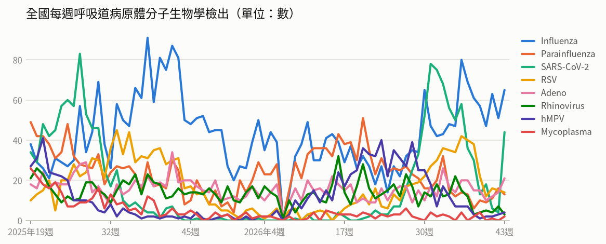

- **全國每週呼吸道病原體分子生物學檢出**（2026年第43週）：共 166，較前一週 ↑ +56（+51%）；陽性率 61.7%

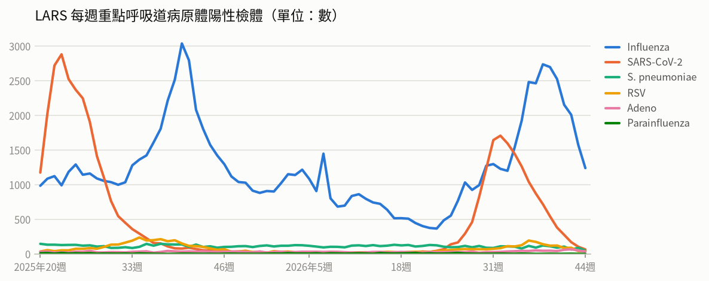

- **LARS 每週重點呼吸道病原體陽性檢體**（2026年第44週）：共 1,423，較前一週 ↓ -435（-23%）

### 新冠（COVID-19）

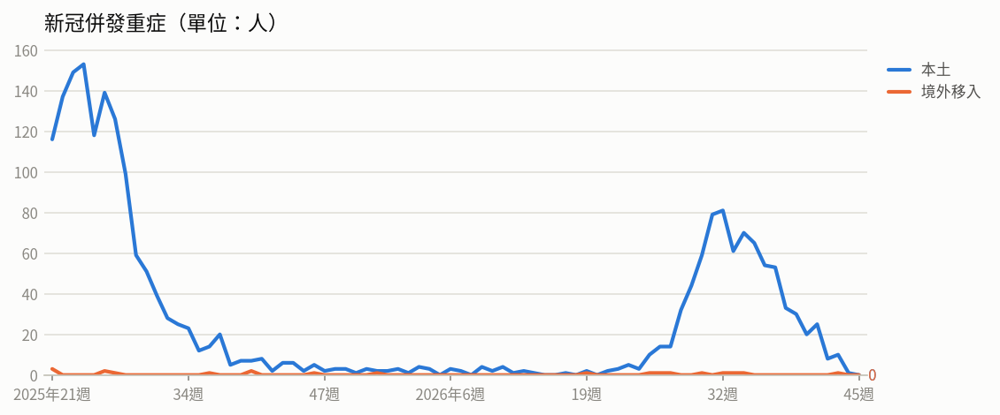

- **新冠併發重症**（2026年第43週）：共 11人（本土 10、境外移入 1），較前一週 ↑ +3（+38%）
  - 統計摘要：上週累計數 1、今年累計數 820、去年總數 1718、今年累計死亡數 185

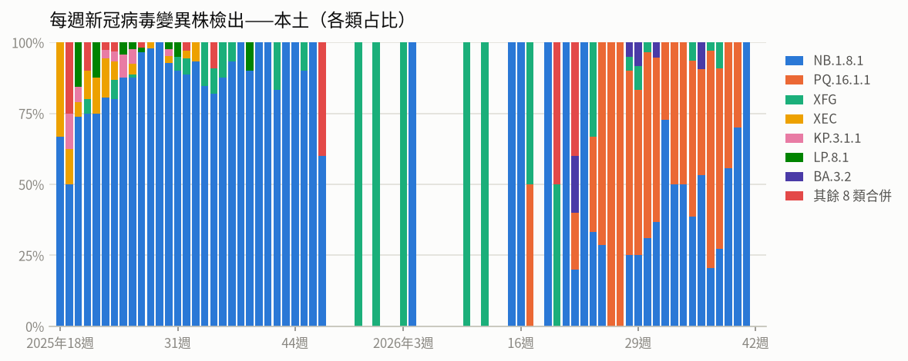

- **每週新冠病毒變異株檢出——本土**（2026年第41週）：共 3，較前一週 ↓ -7（-70%）

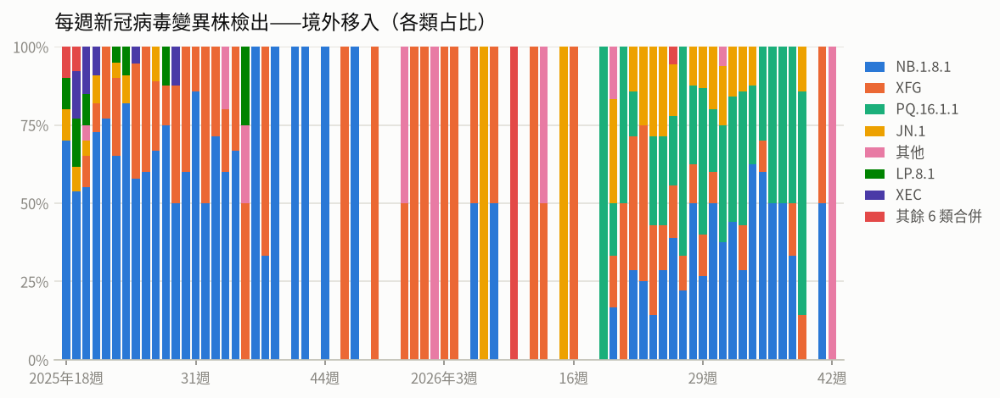

- **每週新冠病毒變異株檢出——境外移入**（2026年第42週）：共 1，較前一週 ↓ -1（-50%）

### 流感

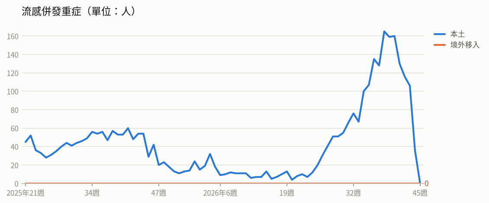

- **流感併發重症**（2026年第43週）：共 106人（本土 106、境外移入 0），較前一週 ↓ -10（-9%）
  - 統計摘要：上週累計數 36、今年累計數 2089、去年總數 2290、今年累計死亡數 491

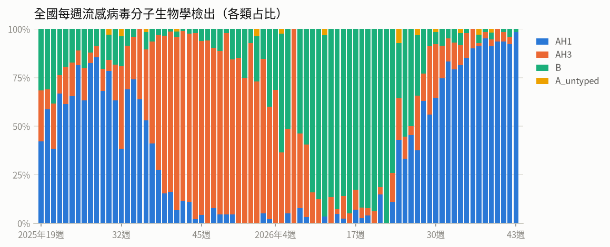

- **全國每週流感病毒分子生物學檢出**（2026年第43週）：共 65，較前一週 ↑ +14（+27%）；陽性率 24.2%

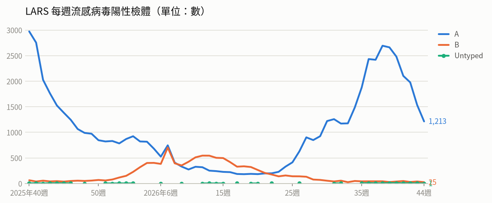

- **LARS 每週流感病毒陽性檢體**（2026年第44週）：共 1,239，較前一週 ↓ -335（-21%）

### 腸病毒

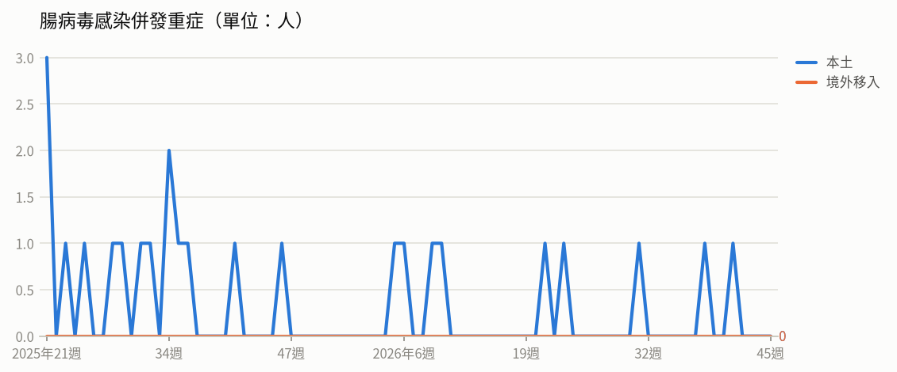

- **腸病毒感染併發重症**（2026年第41週）：共 1人（本土 1、境外移入 0）
  - 統計摘要：上週累計數 0、今年累計數 9、去年總數 19、今年累計死亡數 1

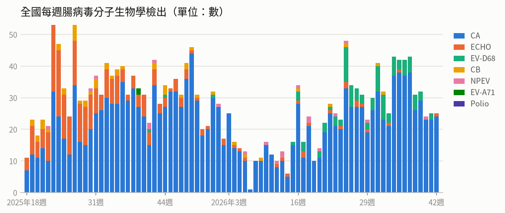

- **全國每週腸病毒分子生物學檢出**（2026年第42週）：共 25，較前一週 → +0（+0%）；陽性率 13%

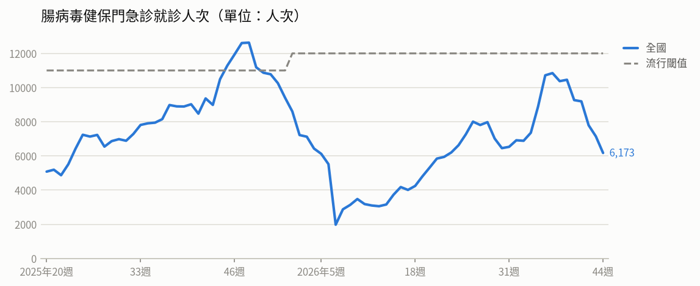

- **腸病毒健保門急診就診人次**（2026年第44週）：共 6,173人次，較前一週 ↓ -972（-14%）（流行閾值 12,000）

### 登革熱

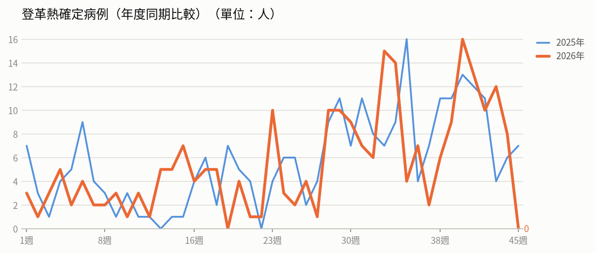

- **登革熱確定病例（年度同期比較）**（2026年第44週）：8人，2025年同期 6人
  - 統計摘要：上週累計數 8、今年累計數 245、去年總數 293、今年累計死亡數 0

> 數據取自 NIDSS（目前為 2026年第45週，統計上一完整週；定序類資料與通報有時間落後，併發重症等項目改取再前一週，以各項標示的週次為準）。最新資料可能因後續回報而變動。

## 重點速覽

- 🔴 **剛果民主共和國疫情持續擴大，累計逾萬例確診**：截至11/3累計10,668例確診、5,198例死亡，致死率近五成，以伊圖里省最嚴峻；肯亞則趨緩、自10/19起無新增，奈及利亞另有2例疑似病例，前往疫區應避免接觸病患與野生動物。
- 🔴 **美洲區今年確診逾5.6萬例，較去年同期增4.8倍**：截至10/17已有17國報告56,753例確定病例、81例死亡，以瓜地馬拉、墨西哥、美國為主；美國紐約州出現30多年來首例麻疹死亡兒童，出國前應確認MMR疫苗接種完整。
- 🟠 **美國華盛頓州出現H5N1人類病例死亡**：雅基馬郡今年累計3例人類確定病例、1例死亡，均有乳牛暴露史，全州34間乳牛場檢出B3.13基因型病毒；目前無人傳人證據，一般民眾風險評估為低。
- 🟠 **國內疫情雖下降仍在流行期，第二階段疫苗開打**：第43週類流感門急診95,916人次、較前週降7.3%，本季累計542例重症、95例死亡，98.3%重症者未接種本季疫苗；11/2起擴大至50至64歲無慢性病成人，幼兒接種率49.4%略低於去年同期。
- 🟠 **國內新冠門急診續降，重症者全為未接種**：第43週門急診1,834人次、較前週降28.7%，本季累計75例本土重症、13例死亡，近4週變異株以PQ.16.1.1為主；公費新冠疫苗已升級新一代疫苗，高風險族群宜儘速接種。
- 🟠 **西非與委內瑞拉疫情延燒，出國前10天應接種疫苗**：WHO指非洲區今年截至10/12有9國累計67例確定病例、18例死亡，以象牙海岸最嚴重；委內瑞拉截至10/17累計14例、6例死亡，當局要求前往4州旅客行前至少10天接種疫苗並防蚊。

## 國際重要疫情

- **剛果民主共和國、奈及利亞－伊波拉病毒感染**（關注程度：高）：依據剛果民主共和國INSP及Outbreaknews資料（2026/11/1），該國伊波拉疫情持續擴大，10/30單日新增63例確定病例、32例死亡，分布於伊圖里省（34例）、北基伍省（25例）及上韋萊省（4例）。全國累計10,414例確定病例、5,372例死亡、2,803例康復，致死率達51.6%，疫情橫跨8個省份、67個衛生區，以伊圖里省最為嚴峻，占全國病例數70.9%。奈及利亞東北部則發現2例疑似病例，患者皆已隔離，密切接觸者追蹤與實驗室檢測持續進行中。
  - 旅遊防疫建議：民眾應避免前往疫情流行地區，如必要前往須避免接觸疑似病患、其血液或體液及野生動物（含果蝠、靈長類）與其生肉；返國時如有發燒、嘔吐、腹瀉或出血等症狀，應主動告知機場檢疫人員，並儘速就醫並告知旅遊接觸史。
  - [原文連結](https://www.cdc.gov.tw/TravelEpidemic/Detail/G3PSay_dafdAwjsYNm3CCA?epidemicId=9mKs3-wXYMHVbjqUA_Jmvg)
- **美洲地區（瓜地馬拉、墨西哥、美國、秘魯、加拿大等17個國家/地區）－麻疹**（關注程度：高）：美洲區麻疹疫情持續，今年截至10/17累計56,753例確定病例與81例死亡，其中瓜地馬拉34,535例、墨西哥13,691例、美國4,410例、秘魯2,698例及加拿大1,124例，合計占確定病例99.5%。第39、40週6個國家/地區新增643例，較第37-38週下降32%。美國紐約州西北部劉易斯郡於10/2報告1例與麻疹相關的兒童死亡，為該州30多年來首例麻疹死亡個案，該州上月已發布緊急狀態，截至10/24累計178例確定病例。
  - 旅遊防疫建議：計畫前往美洲地區者，建議出國前確認麻疹疫苗接種史，必要時至旅遊醫學門診諮詢並完成接種；返國後如出現發燒、紅疹等症狀，應戴口罩儘速就醫並主動告知旅遊史。
  - [原文連結](https://www.cdc.gov.tw/TravelEpidemic/Detail/G3PSay_dafdAwjsYNm3CCA?epidemicId=aZr-MqM5CS5i_UJB208OQA)
- **肯亞、剛果民主共和國（DRC）－伊波拉病毒感染**（關注程度：高）：依據肯亞衛生部官方X、Beacon及DRC INSP於2026/11/3的資料，肯亞疫情趨緩，9例確診中5例康復出院、2例住院治療中，均與首例境外移入病例相關群聚有關，尚無社區傳播證據，接觸者66人已解除隔離、52人持續監測。剛果民主共和國則持續新增病例，疫情分布於8個省份（67個衛生區），新增病例發生於伊圖里省（23例）、北基伍省（36例）及上韋萊省（3例）。其中伊圖里省最為嚴峻，占全國病例數70.1%；北基伍省占當日新增病例58.1%，致死率54.8%高於全國平均。
  - 旅遊防疫建議：民眾前往肯亞、剛果民主共和國等疫區應避免接觸疑似病患、其血液或體液，以及野生動物與其生食；返國後如有發燒、頭痛、肌肉痠痛、腹瀉或出血等症狀，應主動告知機場檢疫人員或撥打1922，並於就醫時告知旅遊史。
  - [原文連結](https://www.cdc.gov.tw/TravelEpidemic/Detail/G3PSay_dafdAwjsYNm3CCA?epidemicId=Avtmc1Oastb3Zc4yTo54LA)
- **印尼－沙門氏菌感染症**（關注程度：中）：依Beacon 2026年10月27日資訊，印尼中爪哇省自10月13日起發生疑似食品媒介疫情，共251人在食用水果冰（es buah）後出現症狀。當局於10月23日發布報告，證實個案檢體中檢出沙門氏菌。目前已全面暫停販售該類水果冰，並持續進行流行病學調查以釐清確切污染源。
  - 旅遊防疫建議：前往印尼旅遊應避免食用來路不明的冰品、生冷食物及未經處理的飲水，並落實勤洗手；若返國後出現發燒、腹瀉、腹痛等症狀，應儘速就醫並告知旅遊與飲食史。
  - [原文連結](https://www.cdc.gov.tw/TravelEpidemic/Detail/G3PSay_dafdAwjsYNm3CCA?epidemicId=j7o9oWxJEmdnv31844blrQ)
- **委內瑞拉－黃熱病**（關注程度：中）：依Beacon 2026/11/1資料，委內瑞拉黃熱病疫情主要分布於6個州，以巴里納斯州（Barinas）4例最多。當局於10/31啟動旅行者協議，要求前往巴里納斯州、阿拉瓜州（Aragua）、拉臘州（Lara）及波圖格薩州（Portuguesa）的旅客，需於旅行前至少10天接種1劑疫苗、穿戴防護服並使用防蚊液，同時呼籲居民清除病媒蚊孳生源。
  - 旅遊防疫建議：計劃前往委內瑞拉相關州別者，請於出發前至少10天完成1劑黃熱病疫苗接種；旅途中落實防蚊措施，如穿著淺色長袖衣褲與使用防蚊藥劑。
  - [原文連結](https://www.cdc.gov.tw/TravelEpidemic/Detail/G3PSay_dafdAwjsYNm3CCA?epidemicId=AGifOubUvKTVmHcb0lIVIg)
- **宏都拉斯、越南（胡志明市）－登革熱**（關注程度：中）：疾管署引述Beacon及Outbreak News Today（2026/11/1）資訊指出，宏都拉斯登革熱疫情持續，今年截至第42週（10/8-24）累計1萬2,281例及4例死亡，病毒型別以第3型為主，部分地區亦檢出第2型；自第25週（6/22）至10/24新增7,217例，以奧蘭喬省（Olancho）發病率每10萬人131例最為嚴峻，其次為中央區（Central District）86例。越南胡志明市疫情上升，10/19-25報告1,785例，較前4週平均增加9.7%，今年迄今累計逾4萬2,500例及11例死亡。
  - 旅遊防疫建議：前往宏都拉斯、越南等登革熱流行地區請全程使用政府核可的防蚊藥劑、穿著淺色長袖衣褲並住宿有紗窗或空調的房舍；返國時如有發燒、頭痛、肌肉痠痛或出疹等症狀，應主動告知機場檢疫人員並儘速就醫，告知旅遊史。
  - [原文連結](https://www.cdc.gov.tw/TravelEpidemic/Detail/G3PSay_dafdAwjsYNm3CCA?epidemicId=NY_gKBoyBxiVwWQaF_ak7A)
- **巴基斯坦、剛果民主共和國、尼日、奈及利亞、索馬利亞－小兒麻痺症（脊髓灰質炎）**（關注程度：中）：根據全球小兒麻痺根除倡議組織（GPEI）與Outbreak News於2026/11/4公布資料，10/22-28期間巴基斯坦新增1例WPV1、剛果民主共和國新增7例cVDPV2、尼日與奈及利亞各新增1例cVDPV3，索馬利亞另驗出1件cVDPV2環境樣本。巴基斯坦於11/4確認今年第8例病例，個案為開伯爾-普赫圖赫瓦省（KP）13個月大女嬰，亦為該省今年通報的第6例。顯示南亞及非洲部分國家仍有野生株與疫苗衍生病毒持續傳播。
  - 旅遊防疫建議：計畫前往巴基斯坦、剛果民主共和國、尼日、奈及利亞、索馬利亞等疫情流行地區者，應於出國前確認小兒麻痺疫苗接種完整，必要時至旅遊醫學門診諮詢追加接種；返國後如出現發燒或肢體無力等症狀，應儘速就醫並告知旅遊史。
  - [原文連結](https://www.cdc.gov.tw/TravelEpidemic/Detail/G3PSay_dafdAwjsYNm3CCA?epidemicId=R8AOrip683cglQtDwya07g)
- **巴西（聖保羅州）－漢他病毒症候群**（關注程度：中）：依Beacon與agenciasp.sp.gov於2026年10月28日資料，巴西聖保羅州今年截至9月累計4例漢他病毒症候群確定病例並有1例死亡。該州自2007年以來共199例確定病例、101例死亡，致死率約51%，高於巴西全國46.5%。當局已於10月26日發布警示，並強化疫情監測與環境清潔等相關措施。
  - 旅遊防疫建議：前往巴西等流行地區應避免接觸野生囓齒動物及其排泄物或出沒痕跡；若曾有相關接觸史並出現疑似症狀，請立即就醫並主動告知接觸與旅遊史。
  - [原文連結](https://www.cdc.gov.tw/TravelEpidemic/Detail/G3PSay_dafdAwjsYNm3CCA?epidemicId=Ruhf44YFUWyoI-j0DrAbXA)
- **日本、美國（洛杉磯郡）－流感**（關注程度：中）：依厚生勞動省、JIHS、lacounty.gov及Outbreak News Today資料（2026/10/28），日本今年第43週流感定點醫師平均報告9.49例，高於上週與去年同期，住院931例（較上週984例減少），其中70歲以上479例佔51.5%，以愛媛縣、沖繩縣及兵庫縣較高，47個都道府縣中有27個病例數較上週增加。美國洛杉磯郡於10/22報告2例流感相關死亡，均為具潛在疾病長者，1人本季未接種疫苗、1人於發病前一週接種，當局指出基線值高於去年同期；截至10/10實驗室檢測陽性率7.9%、類流感就診比率4.2%，住院由115例增至144例。
  - 旅遊防疫建議：前往日本、美國等流感流行地區前，建議及早完成流感疫苗接種（美國當局呼籲6個月以上民眾儘速接種），旅途中落實勤洗手、咳嗽禮節並視情況配戴口罩；長者及慢性病患等高風險族群如出現發燒、咳嗽等類流感症狀應儘速就醫並告知旅遊史。
  - [原文連結](https://www.cdc.gov.tw/TravelEpidemic/Detail/G3PSay_dafdAwjsYNm3CCA?epidemicId=ziFqhiEuz1ZLU68OTslFEQ)
- **美國（華盛頓州雅基馬郡）－H5N1新型A型流感（禽流感）**（關注程度：中）：美國華盛頓州近期發生乳牛H5N1禽流感疫情，10/8首次於雅基馬郡2處乳牛場檢出，截至10/29全州累計34間乳牛場確診，病毒屬B3.13基因型，與2024年以來該國乳牛間流行的病毒株有關聯。該郡10/15通報首例人類感染，10/31新增1例重症住院並於11/1宣布死亡，同日另增1例輕症，今年累計3例人類確定病例、1例死亡。3例均有乳牛暴露史，目前尚無人傳人證據，當局持續追蹤接觸者與監測乳牛場工作人員健康，評估一般民眾感染風險為低。
  - 旅遊防疫建議：前往疫情地區時應避免接觸禽鳥、乳牛等動物及其分泌物、排泄物與生乳，落實勤洗手並食用熟食；返國後如出現發燒、咳嗽等症狀，應戴口罩儘速就醫並主動告知旅遊及動物接觸史。
  - [原文連結](https://www.cdc.gov.tw/TravelEpidemic/Detail/G3PSay_dafdAwjsYNm3CCA?epidemicId=ODktmdtam9ln2vOhKUVhMw)
- **越南－腸病毒**（關注程度：中）：越南腸病毒疫情持續上升，胡志明市每週新增病例連續數週超過1,400例，並高於該市5年平均值；全國病例中5歲以下兒童佔87%，預期11至12月疫情仍將持續。該國前次大規模流行發生於2018年，造成逾13萬人住院、17人死亡。越南當局已於今年9月26日核准EV-A71疫苗用於2個月至6歲以下兒童。
  - 旅遊防疫建議：前往越南旅遊或探親時，應落實勤洗手、避免讓幼童接觸生病者；返國後如幼童出現發燒、手足口部位水泡或疹子、嗜睡、肌躍型抽搐等症狀，應儘速就醫並告知旅遊史。
  - [原文連結](https://www.cdc.gov.tw/TravelEpidemic/Detail/G3PSay_dafdAwjsYNm3CCA?epidemicId=1qald_RS8P11HFV9xJzaHw)
- **非洲（西非為主，包含象牙海岸、布吉納法索、迦納、賴比瑞亞）－黃熱病**（關注程度：中）：WHO於10月30日公布非洲區黃熱病快速風險評估報告。今年疫情以西非為主，象牙海岸截至9/23累計30例確定病例、10例死亡（致死率33%），布吉納法索截至第34週累計15例確定病例、3例死亡，迦納自8/30起累計88例疑似病例，賴比瑞亞有1例實驗室檢驗確定病例。疫情傳播與高風險族群（如農業、採礦人員）未接種或未完整接種疫苗、邊境人口流動頻繁及部分地區免疫缺口有關。該區雖具備監測系統、區域實驗室網絡及常規與反應性疫苗接種等應變量能，但面臨檢體送驗延遲、資金限制與其他突發公衛事件並行等挑戰，整體公共衛生風險評估為中，全球風險維持為低。
  - 旅遊防疫建議：計劃前往非洲（尤其西非）黃熱病流行地區的民眾，建議於出國前至少10天至旅遊醫學門診接種黃熱病疫苗並諮詢防蚊措施；旅途中落實防蚊，返國後如出現發燒、黃疸等不適應儘速就醫並告知旅遊史。
  - [原文連結](https://www.cdc.gov.tw/TravelEpidemic/Detail/G3PSay_dafdAwjsYNm3CCA?epidemicId=_JCXRxEfvCmPNlDPpUwlbA)
- **俄羅斯－M痘（猴痘）**（關注程度：低）：依Beacon及Outbreak news today 2026年11月3日資訊，俄羅斯於11月1日公布莫斯科州新增1例M痘確定病例，個案為38歲男性，因發燒、皮疹及淋巴結腫大等症狀就醫，經實驗室檢驗確診，目前住院治療且病況穩定。收治該名個案的醫院近1個月共收治3例確定病例，近2年累計8例。當局正進行流行病學調查，以釐清感染來源並追蹤接觸者。
  - 旅遊防疫建議：前往疫情流行地區應避免與不特定人士進行親密接觸，並注意手部衛生；返國後如出現發燒、皮疹或淋巴結腫大等症狀，應盡速就醫並主動告知旅遊接觸史。
  - [原文連結](https://www.cdc.gov.tw/TravelEpidemic/Detail/G3PSay_dafdAwjsYNm3CCA?epidemicId=QuNTIvVuMWw0WunQJ5mLGg)
- **全球（主要為奈及利亞、剛果民主共和國、南蘇丹、喀麥隆、蒲隆地等非洲國家）－霍亂**（關注程度：低）：依ECDC資料，今年全球霍亂累計報告291,272例確定病例、2,471例死亡，低於去年同期。近一個月（9/28-10/27）新增病例以奈及利亞20,263例最多，其次為剛果民主共和國9,236例、南蘇丹7,226例、喀麥隆2,381例及蒲隆地737例。ECDC評估前往流行區之旅客感染可能性低，惟歐洲仍可能出現零星境外移入個案。
  - 旅遊防疫建議：前往霍亂流行地區時應注意飲食與手部衛生等預防性衛生措施，飲用安全water、食物充分煮熟；感染風險較高者（如可能直接接觸病例的救援人員）應考慮接種霍亂疫苗。
  - [原文連結](https://www.cdc.gov.tw/TravelEpidemic/Detail/G3PSay_dafdAwjsYNm3CCA?epidemicId=EFSrUa5-qkbof6X8beTzhA)
- **全球（含中國、香港、韓國）－COVID-19（新冠肺炎）**（關注程度：低）：疾管署每週更新全球新冠疫情監測資料顯示，第40週全球陽性率4.82%，其中非洲及歐洲區呈上升趨勢，近期流行變異株以XFG、JN.1、NB.1.8.1、PQ.16.1.1及BA.3.2為主。中國第43週門急診陽性率降至1.9%（第42週為2.9%）；香港降至低點，第43週陽性率0.09%（第42週0.17%），污水監測以JN.1占48.7%最多。韓國疫情上升，第43週陽性率9.7%（第42週9.6%），變異株以PQ.16.1.1占59.7%為主。
  - 旅遊防疫建議：計畫前往疫情上升地區（如韓國、歐洲、非洲）的民眾，建議行前完成建議之新冠疫苗接種，旅途中落實手部衛生、於人潮擁擠或密閉場所配戴口罩；返國後如有發燒、咳嗽等呼吸道症狀應戴口罩就醫並告知旅遊史。
  - [原文連結](https://www.cdc.gov.tw/TravelEpidemic/Detail/G3PSay_dafdAwjsYNm3CCA?epidemicId=4TuNSg73FKTf5wmoU5J3GQ)
- **全球（含丹麥、秘魯、美國、荷蘭、加拿大、德國、波多黎各、羅馬尼亞、義大利、愛沙尼亞、比利時、立陶宛、英國、挪威及臺灣）－新型A型流感（禽流感，含H5N1、H9N2等）**（關注程度：低）：疾管署依WAHIS資料更新全球新型A型流感疫情：人類病例本週無新增，今年累計50例，個案發病前多具易感動物暴露史。動物疫情方面，2026/10/23-30期間共14國報告57起H5N1疫情，以丹麥與秘魯各13起、美國9起、荷蘭6起較多，臺灣亦通報1起；另挪威於10/27通報1起H5N5疫情。
  - 旅遊防疫建議：避免接觸禽鳥、禽畜及其排泄物，禽肉與蛋類應充分煮熟並勤洗手；如曾赴疫情地區並出現發燒、咳嗽等症狀，就醫時應主動告知旅遊與動物接觸史。
  - [原文連結](https://www.cdc.gov.tw/TravelEpidemic/Detail/G3PSay_dafdAwjsYNm3CCA?epidemicId=vqnhRkwknDGL9JUO3YYNwQ)
- **美國（華盛頓州）－新型A型流感（H5N1禽流感）**（關注程度：低）：美國農業部動植物檢疫局（APHIS）於2026年11月4日公布華盛頓州乳牛群H5N1禽流感病毒全基因體定序結果，確認為B3.13基因型，與2023年底起在美國乳牛間傳播的病毒株相同。基因分析顯示病毒可能隨牛隻移動自愛達荷州傳入華盛頓州，目前持續對受影響牧場周邊及全州乳牛群進行監測。美國CDC評估H5N1對一般民眾的公共衛生風險仍為低，迄今無證據顯示該病毒具持續性人傳人能力。
  - 旅遊防疫建議：前往疫情發生地區時，避免接觸禽畜、生乳及其分泌物排泄物，勤洗手並避免food生食禽畜產品；返國後如出現發燒、咳嗽等症狀，應戴口罩就醫並主動告知旅遊及接觸史。
  - [原文連結](https://www.cdc.gov.tw/TravelEpidemic/Detail/G3PSay_dafdAwjsYNm3CCA?epidemicId=B-B9QfGi-23CM37GtYhsog)

## 本週國內公告摘要

### 流感

#### 幼兒為流感重症高風險群 學齡前「首打族」和未滿3歲「再打族」幼兒，建議間隔28天以上才完整

- **來源／關注程度／地區**：衛生福利部疾病管制署／中／全國
- **病例概況**：本則新聞未提供流感病例數，重點為疫苗接種進度：10月1日至11月2日幼兒公費流感疫苗（至少一劑）累計接種37.5萬人次，接種率49.4%，較去年同期49.8%下降0.4%，另約6.5萬名幼兒待接種第二劑、37萬名幼兒尚未接種。
- **摘要**：疾管署2026年11月3日指出，學齡前幼兒為流感重症高風險群，感染後可能併發中耳炎、肺炎甚至腦炎。依ACIP建議，滿6個月以上尚未入小學且今年10月前從未接種流感疫苗的「首打族」，以及滿6個月至未滿3歲、過去僅接種過一劑的「再打族」，今年需再接種第二劑，與前一劑間隔至少28天。幼兒公費新冠疫苗部分，自11月5日起開放「今年10月開打前僅接種過一劑新冠疫苗」的6個月以上至未滿5歲幼兒公費接種一劑本季疫苗；幼兒僅可接種莫德納新冠疫苗，每劑0.25毫升，10月1日至11月2日累計接種9,809人次。
- **防疫建議**：家長請先確認孩子過往接種紀錄與今年應接種劑次，並與醫護人員確認後儘速安排接種，已預約第二劑者務必依時完成接種。可透過地方衛生局網頁、疾管署疫苗地圖、疾管家或1922查詢鄰近合約院所並事先致電確認，家中符合公費資格的成員也可一同接種。
- **原文連結**：https://www.cdc.gov.tw/Bulletin/Detail/mXGXp81PJ_IN6eJ__i5Y3A?typeId=9

### 流感、COVID-19（新冠）

#### 疾管署全聯「聯守」防疫10周年，「左流右新 護肺顧心」公費流感、新冠疫苗第二階段接種開跑

- **來源／關注程度／地區**：衛生福利部疾病管制署／不適用／全國
- **病例概況**：本則新聞為疫苗接種政策宣導，未提供病例數或疫情趨勢數據。
- **摘要**：疾管署於2026年11月2日與全聯合作舉辦「左流右新 護肺顧心」記者會，宣布公費流感及新冠疫苗第二階段接種開跑，並慶祝雙方自2017年起合作推廣疫苗滿10年。第二階段除第一階段的長者、幼兒、孕婦及慢性病患者等高風險族群仍可持續接種外，擴大至50至64歲無高風險慢性病成人。全臺共有120家全聯門市（全聯106家、大全聯14家）供地方衛生局設置疫苗接種站，接種可累積1,350健康幣並獲「水果加倍」健康禮。疾管署提醒流感與新冠病毒會隨時間變異，每年接種當季最新型疫苗才能更新保護力。
- **防疫建議**：符合第一、二階段公費資格的民眾（含50至64歲無高風險慢性病成人）應及早同時接種流感與新冠疫苗，可就近至合約院所或全聯指定門市接種站施打。建議先透過地方衛生局網站、疾管署「流感新冠肺鏈疫苗及流感藥劑地圖」、疾管家或1922專線查詢並電話預約，以節省等候時間。
- **原文連結**：https://www.cdc.gov.tw/Bulletin/Detail/HGWcz7qahX4V2DxoqL-vXA?typeId=9

### 流感及COVID-19（疫苗接種宣導）

#### 流感及新冠疫苗第二階段開打 疾管署攜手萬家福、樂家康推動一站式防疫 接種疫苗再賺健康幣 健康投資一次到位

- **來源／關注程度／地區**：衛生福利部疾病管制署／不適用／全國
- **病例概況**：本則為公費疫苗接種宣導，未公布病例數或疫情趨勢數據。
- **摘要**：115年度公費流感及新冠疫苗第二階段自2026年11月2日開打，疾管署與萬家福、樂家康合作於量販及超市通路設置接種站，提供一站式接種服務，並舉辦「左流右新 護肺顧心」記者會。今年流感與新冠疫苗均採用最新疫苗株，新冠疫苗升級為新一代疫苗。年滿18歲民眾完成接種可累積健康幣，流感疫苗450幣、新冠疫苗900幣，同時接種共1,350幣。全國約有4,000家合作院所提供接種服務。
- **防疫建議**：符合公費接種資格者請儘速接種，並可依現場醫療團隊評估同時接種流感及新冠疫苗；秋冬期間仍應勤洗手、於空氣不流通之公共場所佩戴口罩，接種前可透過衛生局網站、疾管署官網、「疾管家」或1922查詢並預約鄰近院所。
- **原文連結**：https://www.cdc.gov.tw/Bulletin/Detail/ku4WPcnJo-Aa9BGG8xbTdw?typeId=9

### 流感及新冠肺炎（COVID-19）

#### 公費流感及新冠疫苗接種踴躍 11月2日起公費對象將開放至50歲以上成人 呼籲符合資格民眾儘速接種

- **來源／關注程度／地區**：衛生福利部疾病管制署／中／全國
- **病例概況**：流感疫情雖下降但仍處流行期，第43週類流感門急診95,916人次（較前週降7.3%），上週新增151例流感併發重症、46例死亡；新冠疫情持續下降，第43週門急診1,834人次（降28.7%），上週新增11例本土重症、3例死亡。
- **摘要**：疾管署表示公費流感及新冠疫苗自10月1日開打，在健康幣政策與疫情提前流行影響下接種踴躍，截至11月2日流感疫苗逾474.7萬人次、新冠疫苗逾134.4萬人次，分別為去年同期1.02倍及1.3倍；11月2日起進入第二階段，開放50至64歲無高風險慢性病成人等公費對象接種。本季流感累計542例重症、95例死亡，社區以A型H1N1為主（占92.7%），重症以65歲以上長者（69.0%）與具慢性病史者（85.4%）為多，98.3%未接種本季流感疫苗；新冠本季累計75例本土重症、13例死亡，重症者皆未接種本季新冠疫苗，近4週變異株以PQ.16.1.1為多，其次為NB.1.8.1。
- **防疫建議**：符合公費資格且尚未接種者，尤其65歲以上長者、慢性病患及新開放的50至64歲成人，應儘速至合約院所接種流感及新冠疫苗；並落實勤洗手、有發燒咳嗽等症狀戴口罩、生病在家休息，若出現呼吸困難、發紺、血痰、胸痛、意識改變等危險徵兆應立即就醫。
- **原文連結**：https://www.cdc.gov.tw/Bulletin/Detail/57M9H7NQtbjNyO5ygCgNiA?typeId=9
