# 疫情週報 2026-W46

涵蓋期間：2026-11-09 ~ 2026-11-15

> 本報告由 AI 自動產生，內容以疾管署原文為準。

## 監測數據

### 呼吸道病原體（整體）

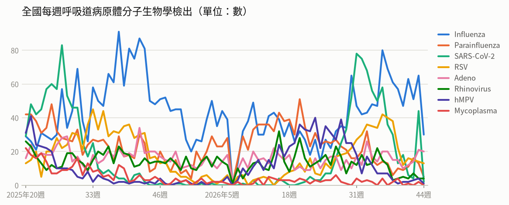

- **全國每週呼吸道病原體分子生物學檢出**（2026年第44週）：共 75，較前一週 ↓ -92（-55%）；陽性率 46.9%

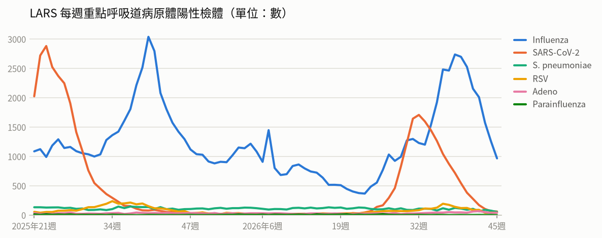

- **LARS 每週重點呼吸道病原體陽性檢體**（2026年第45週）：共 1,161，較前一週 ↓ -317（-21%）

### 新冠（COVID-19）

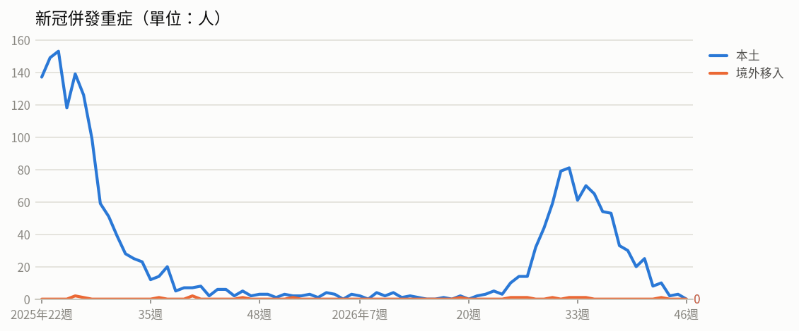

- **新冠併發重症**（2026年第44週）：共 2人（本土 2、境外移入 0），較前一週 ↓ -9（-82%）
  - 統計摘要：上週累計數 3、今年累計數 824、去年總數 1718、今年累計死亡數 187

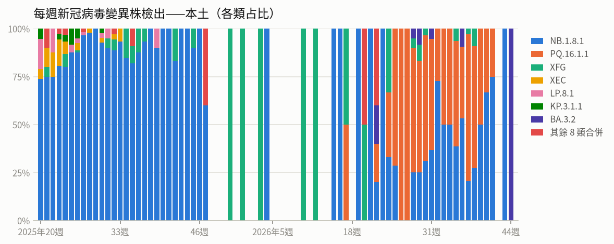

- **每週新冠病毒變異株檢出——本土**（2026年第44週）：共 1，較前一週 → +0（+0%）

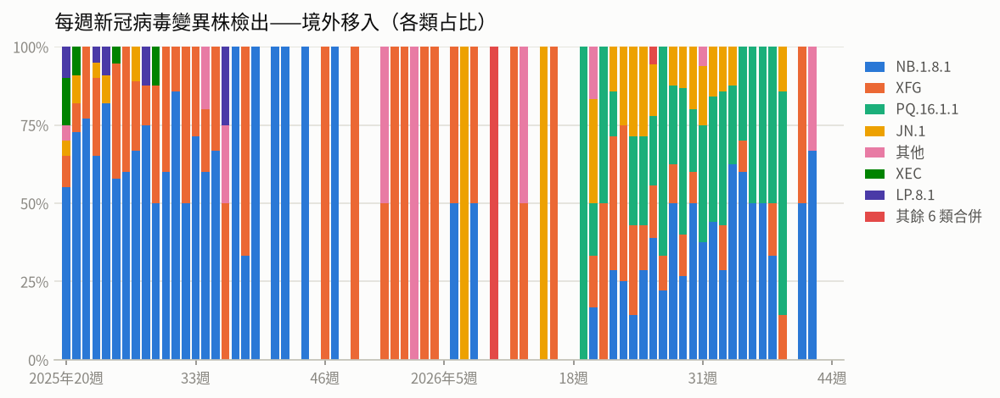

- **每週新冠病毒變異株檢出——境外移入**（2026年第42週）：共 3，較前一週 ↑ +1（+50%）

### 流感

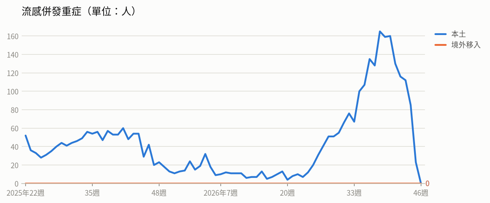

- **流感併發重症**（2026年第44週）：共 85人（本土 85、境外移入 0），較前一週 ↓ -27（-24%）
  - 統計摘要：上週累計數 23、今年累計數 2167、去年總數 2290、今年累計死亡數 528

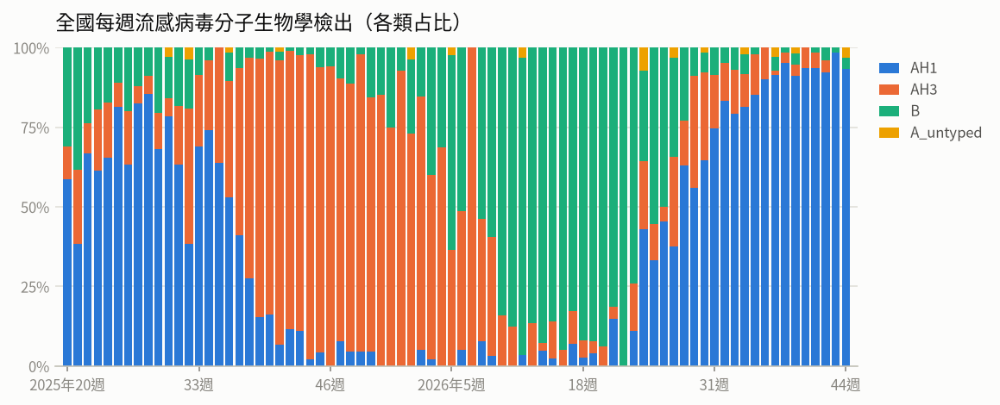

- **全國每週流感病毒分子生物學檢出**（2026年第44週）：共 30，較前一週 ↓ -35（-54%）；陽性率 18.8%

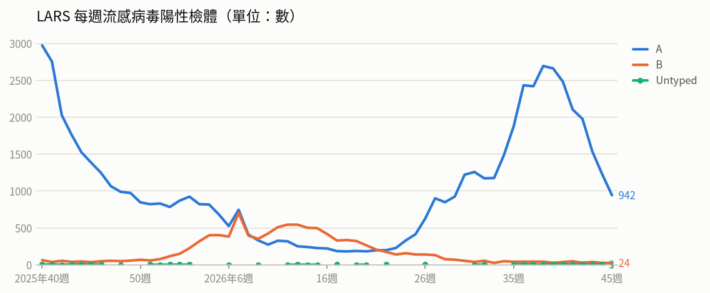

- **LARS 每週流感病毒陽性檢體**（2026年第45週）：共 966，較前一週 ↓ -290（-23%）

### 腸病毒

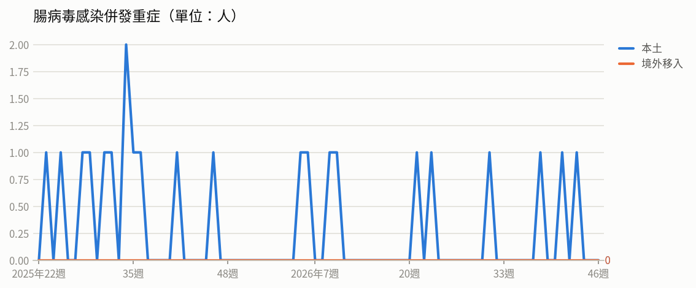

- **腸病毒感染併發重症**（2026年第43週）：共 1人（本土 1、境外移入 0）
  - 統計摘要：上週累計數 0、今年累計數 10、去年總數 19、今年累計死亡數 1

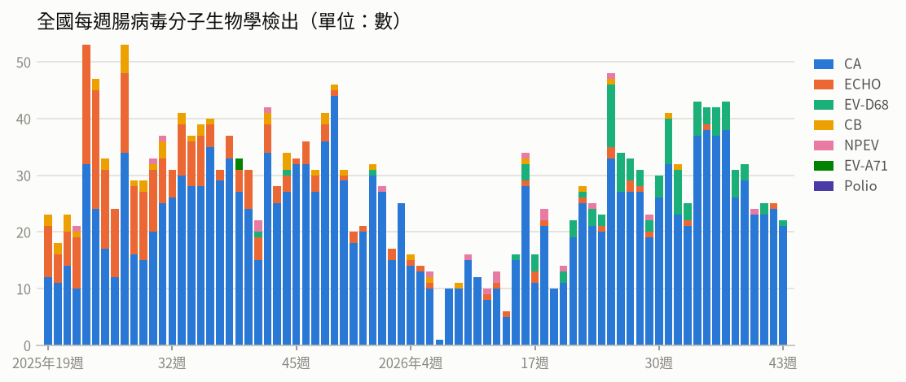

- **全國每週腸病毒分子生物學檢出**（2026年第43週）：共 22，較前一週 ↓ -3（-12%）；陽性率 7.9%

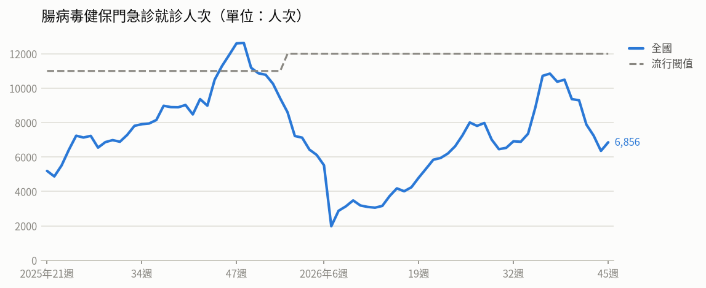

- **腸病毒健保門急診就診人次**（2026年第45週）：共 6,856人次，較前一週 ↑ +502（+8%）（流行閾值 12,000）

### 登革熱

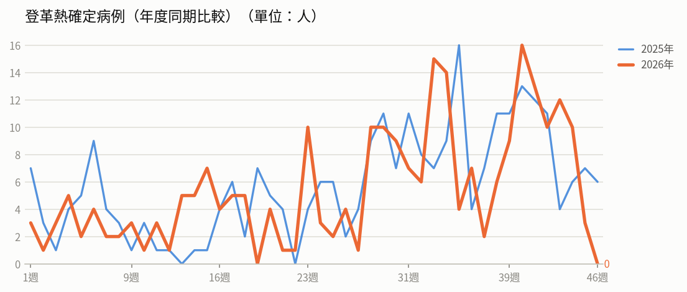

- **登革熱確定病例（年度同期比較）**（2026年第45週）：3人，2025年同期 7人
  - 統計摘要：上週累計數 3、今年累計數 250、去年總數 293、今年累計死亡數 0

> 數據取自 NIDSS（目前為 2026年第46週，統計上一完整週；定序類資料與通報有時間落後，併發重症等項目改取再前一週，以各項標示的週次為準）。最新資料可能因後續回報而變動。

## 重點速覽

- 🔴 **剛果民主共和國疫情持續擴大，肯亞將進入監測倒數**：剛果民主共和國累計逾1萬例確定病例、致死率約49%，疫情涵蓋8省；肯亞最後1名患者已康復出院，11/12起進入42天監測期，另英國通報1例自剛果後送之確定病例，對當地民眾風險評估為低。
- 🔴 **美國麻疹連13週每週破百例，消除認證資格面臨審查**：美國今年累計5,182例，96%為未接種或接種史不明；墨西哥累計13,796例、50例死亡。PAHO於11/10-13召開會議審查美、墨是否仍符合麻疹消除認證，提醒出國前確認MMR疫苗接種史。
- 🔴 **剛果民主共和國北基伍省霍亂單週新增病例明顯上升**：第43週新增273例、17例死亡，高於前一週的167例，今年累計989例疑似病例、61例死亡；當地同時應變伊波拉疫情並受雨季洪水影響，預估疫情可能持續擴散。
- 🟠 **國內疫情下降但重症死亡仍高，公費抗病毒藥延長至11/30**：第44週類流感門急診較前週降6.4%，上週仍新增103例重症、38例死亡，重症者97.1%未接種本季疫苗；疾管署延長擴大公費流感抗病毒藥劑對象適用期限，符合條件者免快篩即可開立。
- 🟠 **新北市新莊區新增1例本土登革熱，感染源待釐清**：個案為40多歲女性，無國外旅遊史，同住者無症狀，已進行孳生源清除與化學防治；今年累計245例（本土18例、境外移入227例），另有越南富國島旅行團境外移入群聚2例。
- 🟠 **瑞士出現首次本土傳播，歐洲本土病例以法國為多**：瑞士提契諾州4例本土確定病例均無流行地區旅遊史，研判經當地白線斑蚊傳播；今年歐洲累計212例本土病例（法國207例、瑞士4例、義大利1例），當局評估氣溫下降後傳播風險極低。

## 國際重要疫情

- **剛果民主共和國－霍亂**（關注程度：高）：據Beacon 2026/11/3資料，剛果民主共和國北基伍省霍亂疫情升溫，第43週新增273例、17例死亡，高於前一週的167例；今年累計989例疑似病例、61例死亡，其中以Lukaraba的421例最多。當地實驗室檢驗量偏低，難以完整掌握疫情全貌。北基伍省同時須應變伊波拉疫情，加上雨季洪水影響，預估疫情可能持續擴散。
  - 旅遊防疫建議：前往剛果民主共和國等霍亂流行地區應注意飲食與飲水衛生，只喝煮沸或瓶裝水、食物充分煮熟並勤洗手；返國後如出現腹瀉等症狀，應儘速就醫並主動告知旅遊史。
  - [原文連結](https://www.cdc.gov.tw/TravelEpidemic/Detail/G3PSay_dafdAwjsYNm3CCA?epidemicId=tRB9MflptHcQ62rG08RE5w)
- **美洲（美國、墨西哥、加拿大）－麻疹**（關注程度：高）：美國麻疹疫情持續於多州傳播，累計5,182例，59%為19歲以下族群、96%為未接種疫苗或接種史不明，紐約州、威斯康辛州及賓州均通報死亡個案，今年迄今僅5州未通報病例；2025-26學年幼兒園學童MMR疫苗涵蓋率降至92.4%，低於95%目標。PAHO麻疹消除審查委員會於11月10至13日召開會議，審查美國（自2025/1/20起）與墨西哥（自2025/2/1起）是否有同一基因型不間斷傳播滿12個月及疫苗接種覆蓋率等證據，以研判兩國是否仍符合麻疹消除認證資格。目前加拿大是該地區唯一被列為麻疹地方流行的國家。
  - 旅遊防疫建議：計劃前往美洲地區者，請於出發前確認是否完成MMR疫苗接種；返國後如出現發燒、出疹等症狀，應戴口罩儘速就醫並主動告知旅遊史。
  - [原文連結](https://www.cdc.gov.tw/TravelEpidemic/Detail/G3PSay_dafdAwjsYNm3CCA?epidemicId=9bT7mRtTGSyXlUPnQ2z4WA)
- **肯亞、剛果民主共和國（DRC）－伊波拉病毒感染**（關注程度：高）：WHO於11/11公布，肯亞最後1名患者已於11/11康復出院，自11/12起進入42天疫情監測期，若期間無新增確定病例，預計12/23宣布疫情結束；該國共匡列135名接觸者並完成健康監測。剛果民主共和國疫情則持續延燒，11/3單日新增62例確定病例、34例死亡，分布於伊圖里省（23例）、北基伍省（36例）及上韋萊省（3例）。目前疫情涵蓋8個省份、67個衛生區，以伊圖里省最為嚴峻，占全國病例數70.1%；北基伍省致死率達54.8%，高於全國平均。
  - 旅遊防疫建議：計劃前往剛果民主共和國等疫情地區者應審慎評估行程，避免接觸疑似病患、其體液及野生動物；返國後如出現發燒、嘔吐、腹瀉或出血等症狀，應主動告知檢疫人員並儘速就醫、說明旅遊史。
  - [原文連結](https://www.cdc.gov.tw/TravelEpidemic/Detail/G3PSay_dafdAwjsYNm3CCA?epidemicId=X4d8RO11E1JqAuM8PtR5nw)
- **俄羅斯－漢他病毒症候群**（關注程度：中）：根據Outbreak News Today與Beacon於2026年11月4日報導，俄羅斯今年截至10月累計1,512例漢他病毒症候群確定病例，較去年同期增加1.5倍，病例集中於烏德穆爾特、巴什科爾托斯坦及下諾夫哥羅德等地。該國自1978年以來每年均有病例，平均每3至5年為一個流行周期。當局指出此波疫情上升與特定地區齧齒類動物的繁殖週期有關。
  - 旅遊防疫建議：前往俄羅斯流行地區時應避免接觸齧齒動物及其排泄物，尤其從事農業、狩獵等高風險活動者更應加強防護；返國後如有不適請儘速就醫並告知旅遊史。
  - [原文連結](https://www.cdc.gov.tw/TravelEpidemic/Detail/G3PSay_dafdAwjsYNm3CCA?epidemicId=hFaiu4Sj0F4sd4qNCP6i7w)
- **全國（本土病例位於新北市新莊區）－登革熱**（關注程度：中）：疾管署於2026年11月9日公布新增1例登革熱本土病例，為新北市新莊區40多歲女性，潛伏期間無國外旅遊史，感染源待釐清，同住者均無症狀。上週另新增10例境外移入病例，其中2例為同一旅行團赴越南富國島旅遊後確診的群聚事件，衛生單位已進行孳生源清除與化學防治，並追蹤同團成員至12月6日。本土病例今年以高雄市13例最多，境外移入感染地以越南、菲律賓、印尼為主；全球疫情主要集中美洲，馬來西亞、孟加拉疫情上升或處高點。
  - 旅遊防疫建議：請持續落實住家內外積水容器巡倒清刷，雨後加強巡檢；前往越南、菲律賓、印尼等流行地區或戶外活動時穿著淺色長袖衣褲並使用含DEET、Picaridin或IR-3535之防蚊藥劑，如出現發燒、頭痛、後眼窩痛、肌肉關節痛或出疹等症狀應儘速就醫並告知旅遊活動史。
  - [原文連結](https://www.cdc.gov.tw/Subscription/EpaperPreview?epaperId=104196&typeid=5)
- **全球（含荷蘭、美國、英國、奧地利、比利時、義大利、匈牙利、德國、挪威、智利、墨西哥、愛沙尼亞、韓國等）－新型A型流感（禽流感，含H5N1、H9N2等）**（關注程度：中）：疾管署引用WAHIS資料指出，全球本週無新增新型A型流感人類病例，今年累計50例，個案發病前多有易感動物相關暴露史。動物疫情持續擴散，2026/11/2-11/7期間共12國通報76起H5N1疫情，以荷蘭29起、美國12起、英國6起居多；另有德國、挪威、英國各1起H5N5疫情，韓國於11/6通報1起H5N9疫情。
  - 旅遊防疫建議：前往疫情流行國家應避免接觸禽鳥、生鮮禽肉與蛋類及出入禽畜養殖場、傳統市場等高風險場所，落實勤洗手；返國後如出現發燒、咳嗽等症狀，請戴口罩儘速就醫並主動告知旅遊及接觸史。
  - [原文連結](https://www.cdc.gov.tw/TravelEpidemic/Detail/G3PSay_dafdAwjsYNm3CCA?epidemicId=UDs0Xyop0CgqWe8E_uwFiw)
- **全球（阿富汗、巴基斯坦、衣索比亞、剛果民主共和國、烏干達、索馬利亞、敘利亞）－小兒麻痺症（脊髓灰質炎）**（關注程度：中）：全球小兒麻痺根除倡議組織（GPEI）公布9/28-10/4期間疫情，野生型脊髓灰質炎病毒第1型（WPV1）新增阿富汗8例、巴基斯坦1例；疫苗衍生病毒cVDPV1新增衣索比亞2例、cVDPV2新增剛果民主共和國9例。環境樣本方面，阿富汗16件、巴基斯坦11件檢出WPV1，烏干達2件、索馬利亞1件檢出cVDPV2。敘利亞東北部代爾祖爾邁亞丁地區有2名6至13個月大兒童檢出病毒，當局偕同WHO及UNICEF啟動加強監測、實地調查與加速疫苗接種，已有超過34,000名5歲以下兒童完成接種。
  - 旅遊防疫建議：前往阿富汗、巴基斯坦等小兒麻痺流行地區前，應確認幼兒已依時程完成小兒麻痺疫苗接種，成人可視需要諮詢旅遊醫學門診評估追加劑；返國後如出現發燒合併肢體無力症狀，應儘速就醫並告知旅遊史。
  - [原文連結](https://www.cdc.gov.tw/TravelEpidemic/Detail/G3PSay_dafdAwjsYNm3CCA?epidemicId=s4OdW83Zov-8BCXHNqDLWg)
- **巴西、泰國－M痘（猴痘）**（關注程度：中）：疾管署引述Beacon、udn資訊指出，巴西M痘疫情上升，今年截至10月累計報告665例確定病例，疫情以首都里約熱內盧為主，該區自今年1月至11月3日累計269例，約為去年全年119例的2倍。泰國今年截至10月31日累計470例確定病例、3例死亡，呈現持續、低強度之地方性傳播，並擴大到以前未報告過病例的省份，孕婦、幼兒及免疫功能低下患者的嚴重病例有增加情形。泰國當局指出目前整體風險評估為中。
  - 旅遊防疫建議：前往或居住於疫情地區者，應避免與他人密切接觸、不與他人共用個人物品；若出現不明原因的皮疹、水泡或潰瘍，應儘速就醫並告知旅遊接觸史。
  - [原文連結](https://www.cdc.gov.tw/TravelEpidemic/Detail/G3PSay_dafdAwjsYNm3CCA?epidemicId=TJSwad3nGTEWwIMe4gUByg)
- **德國－瘧疾**（關注程度：中）：個案包括6名機場工作人員及2名鄰近地區居民，均無流行地區旅遊史或輸血史。全基因體定序顯示8例可分為3個基因型不同之群聚，分別發生於7至9月，研判為3起獨立境外移入事件，病原體可能源自西非並透過受感染瘧蚊隨航空運輸傳入，確切傳入途徑仍待釐清。ECDC於11月6日評估對一般民眾之感染風險仍極低。
  - 旅遊防疫建議：德國當局提醒醫療人員，對出現不明原因發燒且可能與機場或其周邊地區有關聯者，即使無流行地區旅遊史，仍應考慮瘧疾可能性；民眾前往瘧疾流行地區應做好防蚊措施並諮詢旅遊醫學門診。
  - [原文連結](https://www.cdc.gov.tw/TravelEpidemic/Detail/G3PSay_dafdAwjsYNm3CCA?epidemicId=9g-lshv1V5zqXyN_zEeJ9Q)
- **日本、韓國－流感**（關注程度：中）：日本第44週定點平均報告數上升至10.26例，住院918例較前週932例減少，其中70歲以上462例占50.3%；地區以愛媛縣(27.89)、北海道(21.90)及岩手縣(17.17)較高，全國47個都道府縣中有33個病例數較上週增加。韓國第44週類流感門診就診率每千人22.8，以7至12歲占60.9%為多，病毒株以A(H1N1)為主。截至11月5日，韓國65歲以上疫苗接種率71.1%、兒童56.1%，當局呼籲高風險族群儘速接種疫苗。
  - 旅遊防疫建議：計劃前往日本、韓國的民眾，建議出發前完成流感疫苗接種，旅途中落實勤洗手、咳嗽禮節並視情況佩戴口罩；返國後如出現發燒、咳嗽等症狀應就醫並告知旅遊史。
  - [原文連結](https://www.cdc.gov.tw/TravelEpidemic/Detail/G3PSay_dafdAwjsYNm3CCA?epidemicId=FTBJQoXmNqy3weBaz0radw)
- **澳洲北領地－鉤端螺旋體病**（關注程度：中）：澳洲北領地1名患有潛在疾病的30多歲女性在狩獵時感染鉤端螺旋體病，就醫後病情惡化死亡，同行者均已康復出院。當局統計該地區今年迄今已累計報告11例確定病例，約為去年全年（6例）的近2倍。當局呼籲任何可能接觸動物的族群提高警覺。
  - 旅遊防疫建議：前往疫區或可能接觸動物者，應避免涉水通過可能受污染的水源，做好防護措施；若出現疑似症狀應立即就醫並告知活動史。
  - [原文連結](https://www.cdc.gov.tw/TravelEpidemic/Detail/G3PSay_dafdAwjsYNm3CCA?epidemicId=R7VqK94_NaOZ232Asww-xA)
- **瑞士、法國、義大利－屈公病**（關注程度：中）：瑞士提契諾州(Ticino)出現4例屈公病本土確定病例，為該國首次本土傳播疫情，個案近期均無流行地區旅遊史，研判可能經由當地白線斑蚊傳播，感染來源及病例間關聯仍待釐清。當局已加強病媒蚊防治，並評估隨氣溫下降，後續傳播風險極低。ECDC監測顯示今年歐洲共有法國207例、瑞士4例及義大利1例本土病例。
  - 旅遊防疫建議：前往歐洲上述疫情地區時，應做好防蚊措施，如穿著淺色長袖衣褲、使用政府核可的防蚊藥劑；返國後如出現發燒、關節痛、紅疹等症狀，應儘速就醫並主動告知旅遊史。
  - [原文連結](https://www.cdc.gov.tw/TravelEpidemic/Detail/G3PSay_dafdAwjsYNm3CCA?epidemicId=NKEUQ7x6ZR5uk58aLPWmgw)
- **美國、查德－登革熱**（關注程度：中）：美國佛羅里達州本土登革熱疫情持續，第43週（10/25–31）新增39例本土確定病例，今年累計524例、分布於12個郡，以希爾斯伯勒郡407例（占77.7%）最多，發病月份以9月263例最多；已完成血清型別鑑定的480例中，478例為第二型（DENV-2）、2例為第三型（DENV-3），當局持續加強病媒蚊監測及防治。查德疫情持續擴大，今年截至11/3累計6,275例疑似病例、353例實驗室確診、18例死亡，較10/30增加704例疑似病例及4例死亡；該國今年7月於東部瓦迪菲拉省庫農古難民營出現首例，疫情已擴及首都恩加美納及東部多個省分。
  - 旅遊防疫建議：前往上述流行地區應做好防蚊措施，穿著淺色長袖衣褲並使用政府核可的防蚊藥劑；返國後如出現發燒、頭痛、後眼窩痛、肌肉與關節痛或出疹等症狀，應盡速就醫並主動告知旅遊史。
  - [原文連結](https://www.cdc.gov.tw/TravelEpidemic/Detail/G3PSay_dafdAwjsYNm3CCA?epidemicId=R6H5X_SsQMGEzxkGHDuu7A)
- **美洲（美國、墨西哥）－麻疹**（關注程度：中）：疾管署引述美國CDC、墨西哥衛生部及Outbreak News Today（2026/11/9）資料指出，美洲區麻疹疫情持續。美國今年截至11月6日累計47州共5,182例確定病例，病例分布以賓州為多。墨西哥今年截至11月5日累計13,796例確定病例，以1至4歲（2,760例）及5至9歲（2,422例）為多，自去年爆發疫情以來所有行政區皆已通報病例，以哈利斯科州最多，迄今累計50例死亡。
  - 旅遊防疫建議：計劃前往美洲地區者，建議出發前確認麻疹疫苗接種史並完成建議接種；返國後如出現發燒、紅疹等疑似症狀，應戴口罩儘速就醫並主動告知旅遊史。
  - [原文連結](https://www.cdc.gov.tw/TravelEpidemic/Detail/G3PSay_dafdAwjsYNm3CCA?epidemicId=2EeBJCB6aMA7zxqtrPvjYw)
- **非洲（象牙海岸、布吉納法索、喀麥隆、迦納、奈及利亞、中非共和國、賴比瑞亞、幾內亞及多哥）－黃熱病**（關注程度：中）：依WHO於2026年11月6日公布資料，今年截至10月12日，非洲共9國（象牙海岸、布吉納法索、喀麥隆、迦納、奈及利亞、中非共和國、賴比瑞亞、幾內亞及多哥）累計67例黃熱病確定病例，其中18例死亡，致死率26.9%。近期疫情主要集中於布吉納法索、象牙海岸、迦納及賴比瑞亞。WHO於10月27日評估非洲區域傳播風險為中，全球風險仍為低。
  - 旅遊防疫建議：計劃前往非洲黃熱病流行地區者，建議出國前至少10天至旅遊醫學門診接種黃熱病疫苗並諮詢防蚊措施；旅途中落實防蚊叮咬，返國後如有發燒等不適應儘速就醫並告知旅遊史。
  - [原文連結](https://www.cdc.gov.tw/TravelEpidemic/Detail/G3PSay_dafdAwjsYNm3CCA?epidemicId=yfZ_ZMld8JiEWxji7L5_UQ)
- **全球（含中國、香港、韓國）－COVID-19（新冠併發重症）**（關注程度：低）：疾管署引用WHO FluNet、WHO、中國疾控中心、香港衛生防護中心及KDCA資料更新全球新冠疫情，全球近期流行變異株以XFG、JN.1、NB.1.8.1、PQ.16.1.1及BA.3.2為主。中國疫情處低點，變異株以PQ.16.1.1及其亞分支為主；香港污水監測顯示以JN.1（48.7%）為主，其次為PQ.16.1.1（36.7%）、NB.1.8.1（36.7%）及XFG（13.8%）。韓國疫情下降，變異株以PQ.16.1.1（59.7%）為主，其次為NB.1.8.1（31.9%）、BA.3.2（3.5%）及RF.5（1.9%）。
  - 旅遊防疫建議：民眾前往非洲、美洲、歐洲及東地中海等陽性率上升地區時，應留意個人衛生與手部清潔；符合接種條件者可依建議接種新冠疫苗，出現發燒、呼吸道症狀時儘速就醫並告知旅遊史。
  - [原文連結](https://www.cdc.gov.tw/TravelEpidemic/Detail/G3PSay_dafdAwjsYNm3CCA?epidemicId=R_nl-TPz1ssW1SH5iYP1Ug)
- **印度－A型肝炎**（關注程度：低）：疾管署引用Beacon（2026/11/5）資訊指出，印度奧里薩邦一所學校出現急性病毒性A型肝炎群聚，已有2名確診個案住院治療，截至11月4日共12件檢體檢驗呈陽性。校方為防堵疫情已展開大規模篩檢，並關閉校內餐飲攤位、禁止外食攤販入校，感染源仍在調查中。
  - 旅遊防疫建議：前往印度等A型肝炎流行地區前，建議先評估接種A型肝炎疫苗；旅途中落實勤洗手、飲用煮沸過的水並食用熟食，避免生食及來路不明的飲食。
  - [原文連結](https://www.cdc.gov.tw/TravelEpidemic/Detail/G3PSay_dafdAwjsYNm3CCA?epidemicId=fSSL0RizIQ28P1Qh882FKw)
- **紐西蘭－百日咳**（關注程度：低）：疾管署引述phfscience、Beacon及Outbreak News Today（2026/11/4）資料指出，紐西蘭百日咳疫情上升，今年截至10/30累計報告1,537例；奧克蘭過去3週報告37例確定病例，涉及21所學校，較9月的4所增加。該國自2024/10/19起爆發疫情，並於2026/8/25宣布結束，期間共通報5,012例確診／疑似病例，惟今年10月開學後疫情再度上升。當局評估整體風險低，仍需密切監測以防疫情擴散。
  - 旅遊防疫建議：計劃前往紐西蘭者應確認百日咳相關疫苗接種是否完整，尤其嬰幼兒、孕婦及其照顧者；旅途中注意咳嗽禮節與手部衛生，返國後如出現持續咳嗽等症狀應儘速就醫並告知旅遊史。
  - [原文連結](https://www.cdc.gov.tw/TravelEpidemic/Detail/G3PSay_dafdAwjsYNm3CCA?epidemicId=TMlzw4rJf9PbOuTpEj0nhA)
- **英國－伊波拉病毒感染**（關注程度：低）：WHO於11/6公布，英國11/5通報1例確定病例，個案為英國籍醫療照護工作者，先前在剛果民主共和國北基伍省貝尼市參與疫情應變工作，11/5經醫療專機後送英國，現於倫敦皇家自由醫院隔離治療，病況穩定。英國健康安全署表示醫療後送與收治過程均採嚴格感染管制措施，評估對一般民眾傳播風險為低。個案確切感染來源及暴露情形仍待調查釐清。
  - 旅遊防疫建議：前往伊波拉病毒流行地區應避免接觸疑似病患、其血液或體液及野生動物；返國後如出現發燒等不適，請主動告知檢疫人員或就醫時說明旅遊接觸史。
  - [原文連結](https://www.cdc.gov.tw/TravelEpidemic/Detail/G3PSay_dafdAwjsYNm3CCA?epidemicId=HgtQuifAnkh6S8KP_moOsg)

## 本週國內公告摘要

### 登革熱

#### 國內持續有登革熱境外移入病例 並新增1例本土病例 籲請民眾加強戶內外積水容器清除 出國或外出落實防蚊措施 有疑似症狀儘速就醫

- **來源／關注程度／地區**：衛生福利部疾病管制署／中／全國（本土病例為新北市新莊區）
- **病例概況**：今年累計245例登革熱確定病例，含18例本土（高雄市13例、彰化縣及屏東縣各2例、新北市1例）及227例境外移入，上週新增10例境外移入（含越南群聚2例）及1例新北市新莊區本土病例，病例數與2025年同期相當。
- **摘要**：疾管署於2026年11月9日公布新增1例本土登革熱病例，為新北市新莊區40多歲女性，10月下旬出現發燒、倦怠，無國外旅遊史，感染源待釐清，同住者無症狀，衛生單位已進行孳生源清除與化學防治。另新增一起越南富國島境外移入群聚（2例，同一旅行團，1男1女，40至60多歲），將追蹤同團成員至12月6日。境外移入感染地以越南、菲律賓、印尼為主；全球今年截至9月累計逾251萬例，以美洲約占69%，馬來西亞、孟加拉疫情高於去年同期。因近期降雨且白天氣溫適合病媒蚊活動，流行風險仍高。
- **防疫建議**：請落實住家內外巡倒清刷、清除積水容器，雨後加強巡檢；前往越南、菲律賓、印尼等流行地區或從事戶外活動時，穿著淺色長袖衣褲並使用含DEET、Picaridin或IR-3535的核可防蚊藥劑，如出現發燒、頭痛、後眼窩痛、肌肉關節痛或出疹等症狀應儘速就醫並告知旅遊活動史。
- **原文連結**：https://www.cdc.gov.tw/Bulletin/Detail/2mi2li9PETT6m3FtutKJxA?typeId=9

### 流感

#### 國內流感疫情下降 但重症死亡數仍高且大多數未接種疫苗 呼籲民眾儘速接種

- **來源／關注程度／地區**：衛生福利部疾病管制署／中／全國
- **病例概況**：第44週類流感門急診91,879人次較前週降6.4%，但上週仍新增103例流感併發重症與38例死亡，本季累計645例重症、124例死亡。
- **摘要**：疾管署表示國內流感疫情呈下降趨勢，但併發重症與死亡數仍高，重症以65歲以上長者（69.6%）及慢性病患者（85.1%）為主，且97.1%未接種本季流感疫苗；社區流行病毒以H1N1占94.7%為主。新冠疫情已於10月中旬脫離流行期並持續下降，上週新增2例本土重症及1例死亡，本季累計77例本土重症、14例死亡，98.7%未接種本季新冠疫苗。公費流感及新冠疫苗自10月1日開打，截至11月4日流感疫苗已逾550.4萬人次、新冠疫苗逾161萬人次接種。
- **防疫建議**：符合公費接種資格者，尤其65歲以上長者及慢性病患者，應儘速接種流感及新冠疫苗；平時落實勤洗手、咳嗽禮節與生病在家休息，若出現呼吸困難、發紺、血痰、胸痛或意識改變等危險徵兆應立即就醫。
- **原文連結**：https://www.cdc.gov.tw/Bulletin/Detail/HHbAdjZ5sQg8nHVyP5QXSQ?typeId=9

#### 疾病管制署延長擴大公費流感抗病毒藥劑使用對象「有類流感症狀，且具下列身分之流感高傳播族群」之適用期限至115年11月30日止，籲請醫師善用公費藥劑，共同防治流感(疾病管制署致醫界通函第618號)

- **來源／關注程度／地區**：衛生福利部疾病管制署／中／全國
- **病例概況**：依疫情監測資料，國內流感疫情呈下降趨勢，惟重症死亡數仍高。
- **摘要**：疾管署於115年11月11日發布致醫界通函第618號，宣布延長擴大公費流感抗病毒藥劑使用對象「有類流感症狀，且具流感高傳播族群身分者」之適用期限至115年11月30日止。適用對象包含醫事單位防疫相關人員、安養及長照機構受照顧者與工作人員、幼兒園及托育機構工作人員與保母、幼兒園至高中職及五專1至3年級學生、與流感重症高風險族群同住或其照顧者、禽畜養殖等相關行業及動物防疫人員，以及軍營等人口密集機構易群聚人員。公費藥劑（克流感、易剋冒）配置於全國約4千家合約醫療機構，符合條件者不需流感快篩即可開立，並應於用藥後儘速至SMIS系統回報。
- **防疫建議**：如出現類流感症狀且符合公費藥劑使用對象，請儘速至合約醫療機構就醫評估用藥；平時落實勤洗手、戴口罩、咳嗽禮節及生病在家休息，避免出入人潮擁擠、空氣不流通的場所。
- **原文連結**：https://www.cdc.gov.tw/Bulletin/Detail/wZrXfOLOLOe_Zt7Cr3LSwQ?typeId=48

#### 疾病管制署延長擴大公費流感抗病毒藥劑使用對象「有類流感症狀，且具下列身分之流感高傳播族群」之適用期限至115年11月30日止，籲請醫師善用公費藥劑，共同防治流感(疾病管制署致醫界通函第618號)

- **來源／關注程度／地區**：衛生福利部疾病管制署／中／全國
- **病例概況**：依疫情監測資料，國內流感疫情呈下降趨勢，惟重症死亡數仍高。
- **摘要**：疾管署於115年11月11日發布致醫界通函第618號，宣布延長擴大公費流感抗病毒藥劑使用對象「有類流感症狀，且具流感高傳播族群身分者」之適用期限至115年11月30日止。適用對象包括醫事單位防疫相關人員、安養及長照機構受照顧者與工作人員、幼兒園及托育機構人員、幼兒園至高中職與五專1至3年級學生、與流感重症高風險族群同住或其照顧者、禽畜養殖等相關行業與動物防疫人員，以及軍營等人口密集機構易發生群聚之人員。全國約4千家合約醫療機構配置克流感及易剋冒，符合條件者不需流感快篩即可開立公費藥劑，並請醫師於用藥後儘速至SMIS系統回報。
- **防疫建議**：如出現類流感症狀且符合公費用藥身分，請儘速至合約醫療機構就醫評估；平時落實勤洗手、佩戴口罩、咳嗽禮節與生病在家休息，避免出入人潮擁擠、空氣不流通場所。
- **原文連結**：https://www.cdc.gov.tw/Bulletin/Detail/C9hSE6TzHkGgE6WdjmoUaQ?typeId=48

### 侵襲性肺炎鏈球菌感染症（IPD）

#### 長者公費肺炎鏈球菌疫苗政策奏效 今年個案數和死亡雙創新低 「世界肺炎日」籲6成未接種長者儘速接種

- **來源／關注程度／地區**：衛生福利部疾病管制署／低／全國
- **病例概況**：今年截至11月9日累計239例IPD確定病例，較去年同期下降約2成，為3年來同期新低，30例死亡亦為4年同期新低。
- **摘要**：疾管署於「世界肺炎日」前夕表示，肺炎為國人第三大死因，我國今年起陸續實施成人肺炎鏈球菌疫苗轉換政策，公費提供65歲以上長者、55-64歲原住民及19-64歲IPD高風險對象接種1劑PCV20或PCV21。監測顯示今年IPD病例數239例與死亡30例雙創新低，65歲以上約占病例5成。65歲以上長者接種完成率已由32%提升至40.9%，提前達成今年度40%目標，並朝2027年底45%邁進；自10月1日起18歲以上民眾接種肺炎鏈球菌疫苗（公自費皆可）可獲600健康幣，實施後接種人數為先前同期約2.5-3.5倍。
- **防疫建議**：65歲以上尚未完整接種者仍約290萬人，曾接種PCV13/15或PPV23、或從未接種者，仍可再接種1劑PCV20或PCV21；符合公費資格民眾請儘速至合約院所或社區接種站完成接種。
- **原文連結**：https://www.cdc.gov.tw/Bulletin/Detail/WbcJELHHghLEXDcmoH9ixQ?typeId=9
