# 疫情週報 2026-W47

涵蓋期間：2026-11-16 ~ 2026-11-22

> 本報告由 AI 自動產生，內容以疾管署原文為準。

## 監測數據

### 呼吸道病原體（整體）

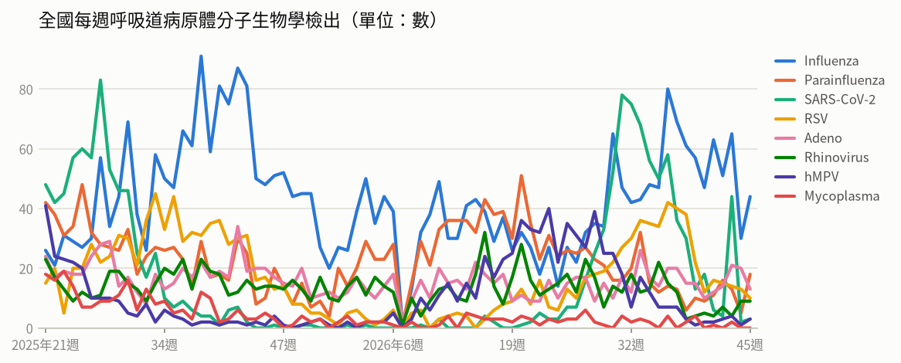

- **全國每週呼吸道病原體分子生物學檢出**（2026年第45週）：共 100，較前一週 ↑ +20（+25%）；陽性率 54.1%

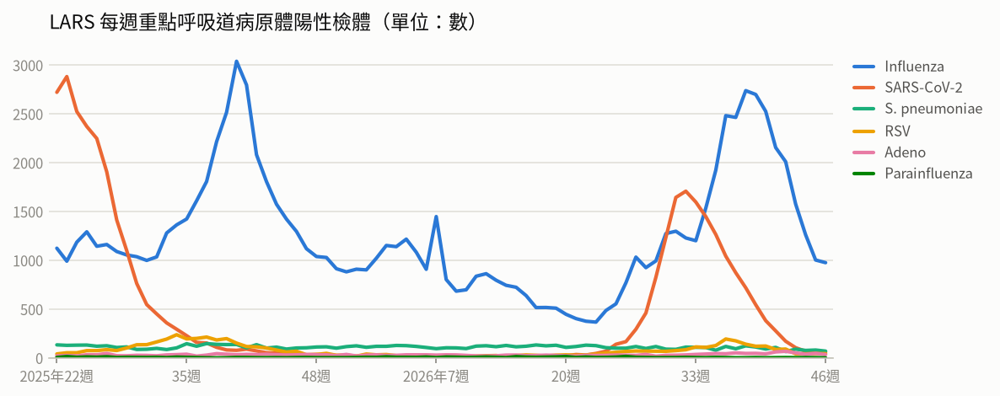

- **LARS 每週重點呼吸道病原體陽性檢體**（2026年第46週）：共 1,179，較前一週 ↓ -66（-5%）

### 新冠（COVID-19）

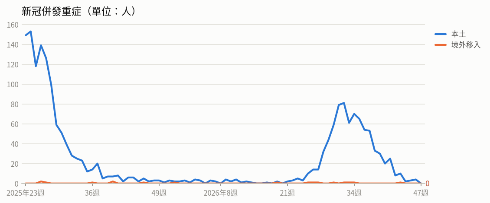

- **新冠併發重症**（2026年第45週）：共 3人（本土 3、境外移入 0），較前一週 ↑ +1（+50%）
  - 統計摘要：上週累計數 4、今年累計數 828、去年總數 1718、今年累計死亡數 187

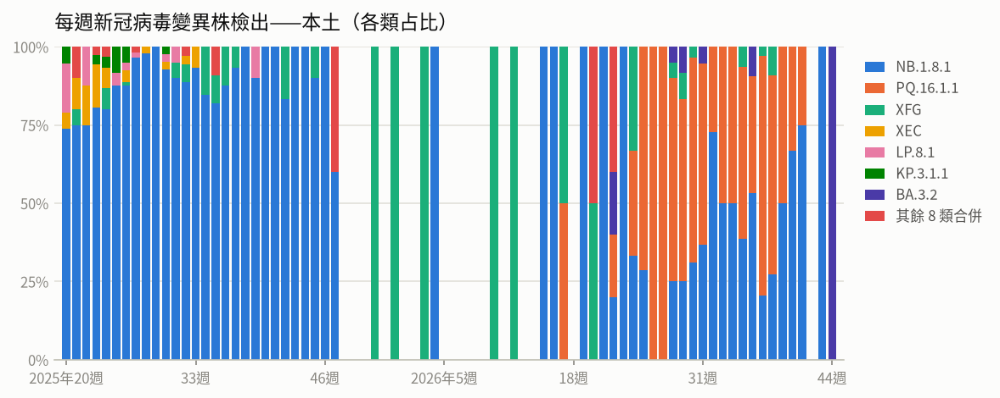

- **每週新冠病毒變異株檢出——本土**（2026年第44週）：共 1，較前一週 → +0（+0%）

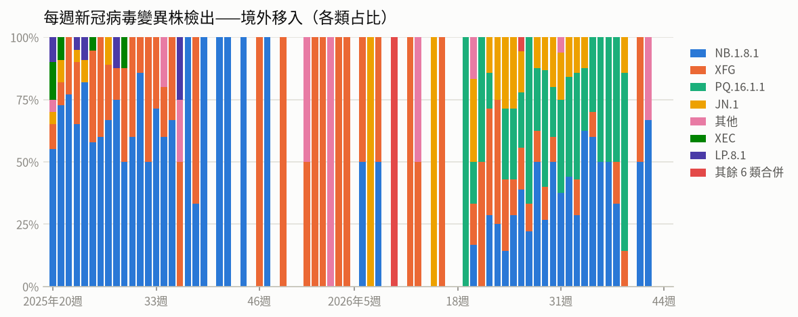

- **每週新冠病毒變異株檢出——境外移入**（2026年第42週）：共 3，較前一週 ↑ +1（+50%）

### 流感

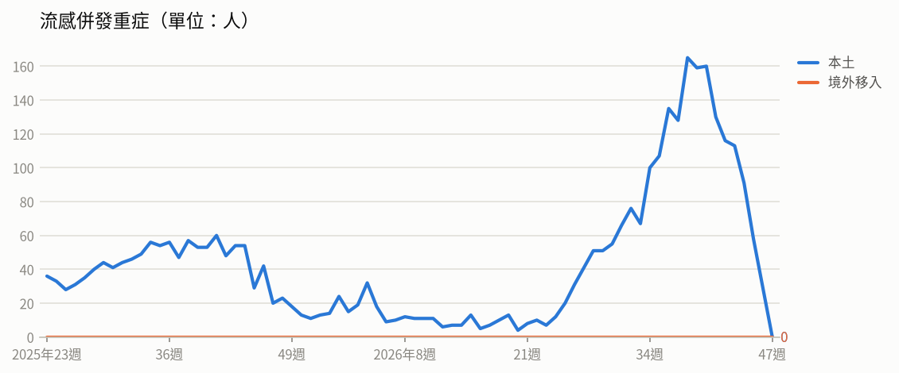

- **流感併發重症**（2026年第45週）：共 58人（本土 58、境外移入 0），較前一週 ↓ -33（-36%）
  - 統計摘要：上週累計數 29、今年累計數 2238、去年總數 2290、今年累計死亡數 551

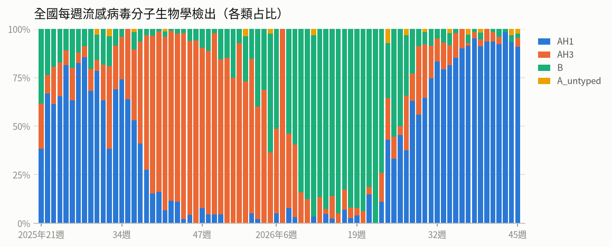

- **全國每週流感病毒分子生物學檢出**（2026年第45週）：共 44，較前一週 ↑ +14（+47%）；陽性率 23.8%

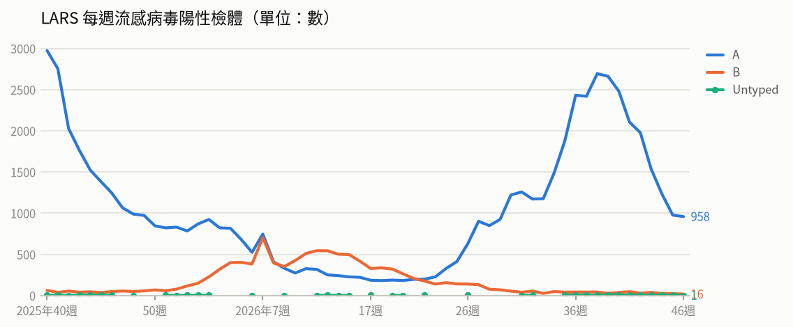

- **LARS 每週流感病毒陽性檢體**（2026年第46週）：共 975，較前一週 ↓ -27（-3%）

### 腸病毒

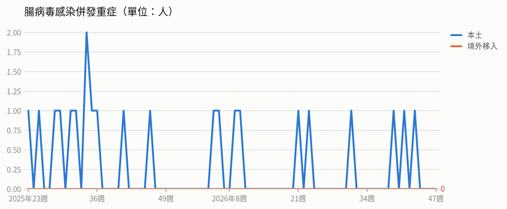

- **腸病毒感染併發重症**（2026年第43週）：共 1人（本土 1、境外移入 0）
  - 統計摘要：上週累計數 0、今年累計數 10、去年總數 19、今年累計死亡數 1

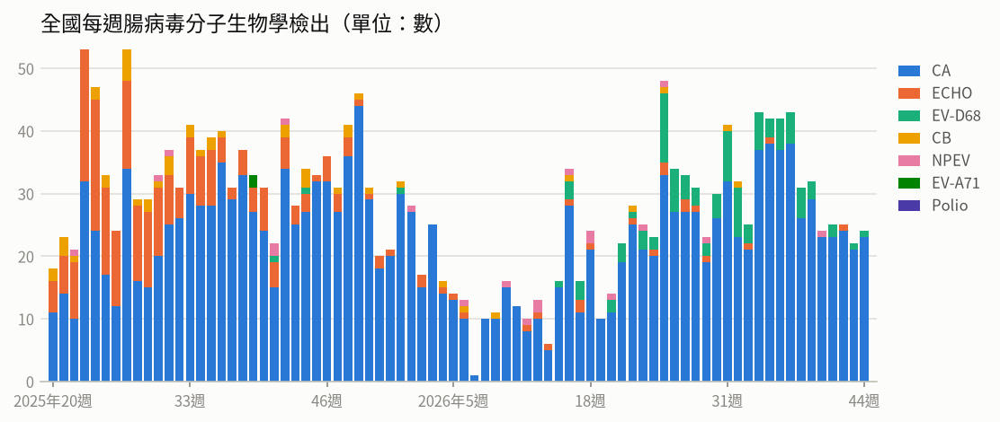

- **全國每週腸病毒分子生物學檢出**（2026年第44週）：共 24，較前一週 ↑ +2（+9%）；陽性率 13.7%

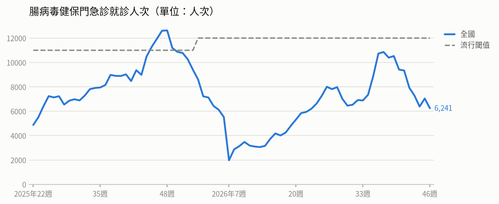

- **腸病毒健保門急診就診人次**（2026年第46週）：共 6,241人次，較前一週 ↓ -801（-11%）（流行閾值 12,000）

### 登革熱

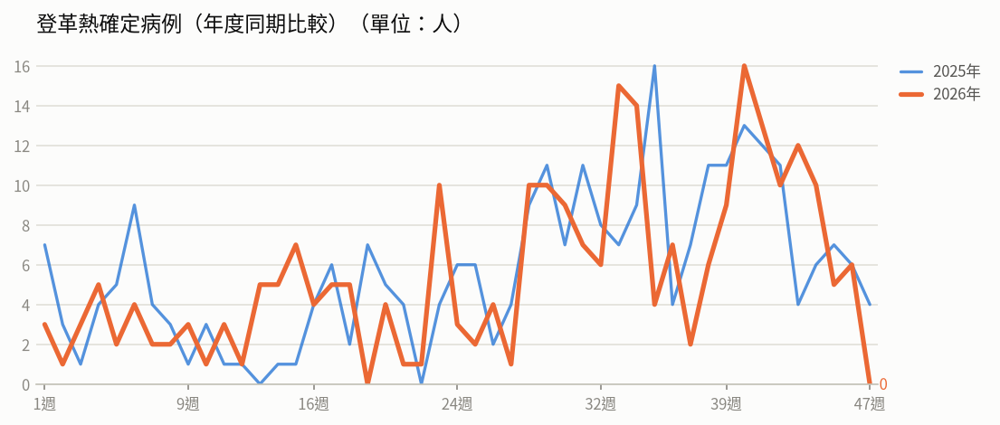

- **登革熱確定病例（年度同期比較）**（2026年第46週）：6人，2025年同期 6人
  - 統計摘要：上週累計數 6、今年累計數 258、去年總數 293、今年累計死亡數 0

> 數據取自 NIDSS（目前為 2026年第47週，統計上一完整週；定序類資料與通報有時間落後，併發重症等項目改取再前一週，以各項標示的週次為準）。最新資料可能因後續回報而變動。

## 重點速覽

- 🔴 **美洲3國遭撤銷麻疹消除認證，疫情創新高**：泛美衛生組織11/17宣布撤銷玻利維亞、墨西哥及美國的麻疹消除認證，認定已重新建立地方性傳播；今年截至11/13美洲區累計58,213例確定病例、82例死亡，遠高於去年同期的12,806例，前往當地前應確認麻疹疫苗接種史。
- 🔴 **剛果伊波拉持續擴大，WHO評估是否構成PHEIC**：累計逾11,500例確定病例、5,630例死亡，致死率約48.9%，每週仍新增400至500例，兒童占確定病例逾25%；社區暴力導致逾千名接觸者失聯，WHO已於11/17召開專家會議評估國際關注公共衛生緊急事件認定。
- 🔴 **國內類流感就診下降，但流感重症與死亡仍居高**：第45週類流感門急診89,487人次較前週降4.3%，上週仍新增71例流感併發重症、37例死亡，本季累計716例重症、157例死亡；重症以65歲以上長者及慢性病患為多，96.4%未接種本季流感疫苗，公費流感與新冠疫苗接種分別已逾593.7萬及175.8萬人次，呼籲儘速接種。
- 🔴 **剛果霍亂蔓延至首都金夏沙，今年逾6萬例**：剛果民主共和國今年累計逾60,000例、1,800例死亡，疫情自北基伍、南基伍省擴散至人口稠密的金夏沙；蒲隆地截至11/3亦累計2,855例確診，前往當地應注意飲水與飲食衛生。
- 🔴 **哥倫比亞登革熱破9.8萬例，4種血清型齊流行**：哥倫比亞今年截至11/10累計98,096例、73例死亡，古巴截至10/31估計累計15,859例，兩國皆4種血清型共同流行，赴流行地區應全程防蚊。
- 🟠 **WHO再延長小兒麻痺PHEIC臨時建議3個月**：本期新增巴基斯坦野生株WPV1病例及南蘇丹、剛果民主共和國、奈及利亞、尼日等國的疫苗衍生病毒病例；澳洲新列入第二級風險國家，赴流行地區前建議確認疫苗接種完整。

## 國際重要疫情

- **剛果民主共和國－伊波拉病毒感染**（關注程度：高）：依據剛果民主共和國國家公共衛生研究所（INSP）資料，該國伊波拉疫情持續新增病例，11月12日新增57例確定病例、其中34例死亡，分布於北基伍省（26例）、伊圖里省（25例）、上韋萊省（4例）及喬波省（2例）。截至11月12日累計11,254例確定病例，含5,505例死亡、3,054例康復，致死率達48.9%，疫情已分布於8個省份、68個衛生區。其中伊圖里省疫情最為嚴峻，佔全國病例數69.2%及當日新增病例數43.9%；北基伍省佔當日新增病例數45.6%，致死率55.3%高於全國平均。
  - 旅遊防疫建議：民眾如需前往剛果民主共和國等疫區，應避免接觸疑似病患、其體液及野生動物（尤其是靈長類與蝙蝠），落實勤洗手等個人衛生措施；返國時如有發燒、腹瀉、出血等不適症狀，應主動告知機場檢疫人員，並儘速就醫並告知旅遊史。
  - [原文連結](https://www.cdc.gov.tw/TravelEpidemic/Detail/G3PSay_dafdAwjsYNm3CCA?epidemicId=tceunE4eeGCf83llk2AmDw)
- **剛果民主共和國－伊波拉病毒感染**（關注程度：高）：依DRC INSP與WHO 2026/11/17資料，剛果民主共和國伊波拉疫情持續擴大，疫情分布於8個省份（68個衛生區），以伊圖里省最嚴峻（占全國病例69%），北基伍省致死率55.5%高於全國平均。病例數較3個月前增加逾1倍，兒童占確定病例逾25%、死亡病例約33%，約三分之二死亡發生於治療中心以外，顯示病例發現及治療仍有延遲。近期社區暴力襲擊造成逾1,000名接觸者失去追蹤並影響治療中心運作，WHO已於11/17召開專家會議評估是否仍構成國際關注公共衛生緊急事件（PHEIC）。
  - 旅遊防疫建議：民眾應避免非必要前往剛果民主共和國疫情流行地區，於當地勿接觸野生動物、生病或死亡病患及其血液體液；返國時如有發燒等不適應主動告知機場檢疫人員，並於返國後21天內留意健康狀況，就醫時主動告知旅遊史。
  - [原文連結](https://www.cdc.gov.tw/TravelEpidemic/Detail/G3PSay_dafdAwjsYNm3CCA?epidemicId=U7lKSCOTvq_xpUbd85NLvA)
- **剛果民主共和國、蒲隆地－霍亂**（關注程度：高）：依據allafrica及Beacon 2026/11/10資訊，剛果民主共和國霍亂疫情嚴峻，病例多集中於北基伍省及南基伍省，近期已蔓延至人口稠密的首都金夏沙，隨雨季到來當局憂心疫情進一步擴散；無國界醫生組織呼籲加強水源加氯消毒、保護水源，並在高風險社區持續推動口服疫苗等防治措施。蒲隆地病例主要集中於布松布拉及魯蒙蓋等地，部分地區居民仰賴湖水與河水作為水源，為主要風險因子之一，當局與WHO正進行衛教宣導並強化醫院感染管制。
  - 旅遊防疫建議：前往上述疫區者應注意飲食與飲水衛生，只飲用瓶裝水或煮沸水、避免生食並勤洗手，必要時行前諮詢旅遊醫學門診評估接種口服霍亂疫苗；返國後如出現腹瀉等症狀應儘速就醫並告知旅遊史。
  - [原文連結](https://www.cdc.gov.tw/TravelEpidemic/Detail/G3PSay_dafdAwjsYNm3CCA?epidemicId=I9ATzSC6t94QyHtqFHS5AA)
- **哥倫比亞、古巴－登革熱**（關注程度：高）：依據Beacon與EL HERALDO 2026/11/12資訊，哥倫比亞疫情以梅塔省（Meta）、玻利瓦爾省（Bolívar）及桑坦德省（Santander）最為嚴峻，4種血清型在全國流行；當局已將疫苗接種範圍擴大至23個優先市鎮的9至10歲兒童，預計2027年4月再擴大至76個市鎮，並加強病媒控制及孳生源清除。古巴今年截至10/31估計累計1萬5,859例，相當於推估（累計）病例數的10.6倍，4種血清型共同流行、以第2型為主，近期病例增加與歷年季節性規律相符。
  - 旅遊防疫建議：前往哥倫比亞、古巴等登革熱流行地區時，請全程做好防蚊措施（穿著淺色長袖衣褲、使用政府核可的防蚊藥劑）；返國後如出現發燒、頭痛、後眼窩痛、肌肉關節痛或出疹等症狀，應儘速就醫並主動告知旅遊史。
  - [原文連結](https://www.cdc.gov.tw/TravelEpidemic/Detail/G3PSay_dafdAwjsYNm3CCA?epidemicId=0AAhZDbf3XFQZFJzbaCMjQ)
- **美國（美洲）－麻疹**（關注程度：高）：依據CNN、路透社與美國CDC資料，美國今年截至11/12累計47個行政區報告5,412例麻疹確定病例，約為去年全年病例數的2.4倍。泛美衛生組織（PAHO）麻疹消除審查委員會將撤銷美國自2000年起維持26年的麻疹消除認證資格，成為美洲第2個失去認證的國家（加拿大已於去年11月失去認證），相關結果報告預計於11/17公布。美國須阻斷疫情並連續至少12個月無地方性傳播，才能恢復認證。
  - 旅遊防疫建議：計畫前往美國等麻疹流行地區者，出發前應確認麻疹相關疫苗接種史，必要時依醫師評估完成接種；返國後如出現發燒、紅疹等症狀，應戴口罩儘速就醫並主動告知旅遊史。
  - [原文連結](https://www.cdc.gov.tw/TravelEpidemic/Detail/G3PSay_dafdAwjsYNm3CCA?epidemicId=P_WEThPqO0LF-bbf9TRNFg)
- **美洲地區（玻利維亞、墨西哥、美國）－麻疹**（關注程度：高）：泛美衛生組織（PAHO）於11月17日宣布撤銷玻利維亞、墨西哥及美國的「麻疹消除認證」，專家委員會認定此三國已重新建立地方性傳播（同一基因型及譜系持續傳播逾12個月）。三國須提出改善計畫，包括維持至少12個月無地方性傳播、各社區兩劑疫苗接種率達並維持至少95%，以及監測系統與實驗室能力等資料，經委員會審查後才可能重新取得認證。今年截至11月13日，美洲區累計58,213例確定病例及82例死亡，較去年同期12,806例大幅上升。
  - 旅遊防疫建議：計畫前往美洲地區（尤其玻利維亞、墨西哥、美國）者，建議出發前確認麻疹疫苗接種史，必要時依醫師評估完成接種；返國後如出現發燒、紅疹等症狀，應戴口罩儘速就醫並告知旅遊史。
  - [原文連結](https://www.cdc.gov.tw/TravelEpidemic/Detail/G3PSay_dafdAwjsYNm3CCA?epidemicId=0OtaL7q3_ue037isaedMwA)
- **全球－新型A型流感（禽流感）**（關注程度：中）：疾管署引用WAHIS資料指出，今年截至11月12日全球累計通報51例人類感染新型A型流感病例，個案發病前多具有易感動物暴露史。禽鳥及動物疫情方面，今年截至11月15日已有72個國家/地區通報4,521起高/低病原性禽流感疫情。近期（11/7-11/13）共15國報告99起H5N1疫情，以德國44起、荷蘭18起、秘魯7起最多；另冰島與拉脫維亞各通報1起H5（N未定型）疫情，冰島並於11月10日通報1起H5N5疫情。
  - 旅遊防疫建議：前往疫情流行地區旅遊時，避免接觸禽鳥、生鮮禽肉及禽類排泄物，勿生食蛋類與禽肉；返國後如出現發燒、咳嗽等呼吸道症狀，應主動告知醫師相關旅遊及接觸史。
  - [原文連結](https://www.cdc.gov.tw/TravelEpidemic/Detail/G3PSay_dafdAwjsYNm3CCA?epidemicId=TZetRfKvJEnGCtctwrxt_Q)
- **全球（巴基斯坦、南蘇丹、剛果民主共和國、奈及利亞、尼日、中非共和國、澳洲）－小兒麻痺症（脊髓灰質炎）**（關注程度：中）：全球小兒麻痺根除倡議組織（GPEI）公布最新疫情，野生株與疫苗衍生病毒（cVDPV1、cVDPV2、cVDPV3）持續於巴基斯坦、南蘇丹、剛果民主共和國、奈及利亞及尼日等國出現病例，巴基斯坦與中非共和國並自環境樣本檢出病毒。WHO IHR第46次小兒麻痺緊急委員會宣布，小兒麻痺病毒國際傳播風險仍構成國際關注公共衛生緊急事件（PHEIC），但未達全球大流行層級，並建議臨時建議措施再延長3個月。此外，澳洲新列入第二級風險（cVDPV2感染國家）。
  - 旅遊防疫建議：計畫前往疫情流行或列為風險等級國家者，出國前應確認小兒麻痺疫苗接種已完成，必要時依醫師評估追加接種；旅途中注意飲食與手部衛生，返國後如有肢體無力等症狀應儘速就醫並告知旅遊史。
  - [原文連結](https://www.cdc.gov.tw/TravelEpidemic/Detail/G3PSay_dafdAwjsYNm3CCA?epidemicId=dU1Du9ucZ0pfDPd_8v2_rw)
- **南蘇丹－黃熱病**（關注程度：中）：依Beacon及SUDANS POST 2026/11/11報導，南蘇丹出現1例黃熱病死亡病例。該名48歲男性農民於10/24出現發燒、頭痛、疲倦、胸痛及關節痛，29日於隔離病房治療期間出現全身皮疹，11/1死亡；檢體2次伊波拉檢驗皆為陰性，後經RT-PCR確診黃熱病。當局已與WHO及非洲CDC啟動緊急應變，進行主動病例監測、接觸者追蹤、病歷回溯與病媒蚊採樣，並強化與剛果民主共和國的跨境監測合作。
  - 旅遊防疫建議：前往南蘇丹、剛果民主共和國等黃熱病流行地區前，建議至旅遊醫學門診諮詢並於出發至少10天前完成黃熱病疫苗接種；當地期間落實防蚊措施，返國後如有發燒、頭痛、肌肉關節痛等症狀應儘速就醫並告知旅遊史。
  - [原文連結](https://www.cdc.gov.tw/TravelEpidemic/Detail/G3PSay_dafdAwjsYNm3CCA?epidemicId=ooaDXHvOqMegT-phD0sOuw)
- **日本、美國－流感**（關注程度：中）：疾管署引述厚生勞動省、JIHS、美國CDC及Beacon資料（2026/11/16）指出，日本今年第45週（11/2-8）定點醫師平均報告11例，較上週10.26例上升但仍低於去年同期；住院1,115例較上週918例增加，其中70歲以上582例占52.2%，以北海道（28.32例）、福島縣（21.08例）、青森縣（19.79例）為主，全國47個都道府縣中有34個病例數較上週增加。美國第44週流感陽性率11.3%、類流感門診就診率3.2%（高於基線值2.9%）、住院9,584例，病毒型別以A（H1N1）占98.9%為主，路易斯安那州、加州、奧勒岡州、南卡羅萊納州、田納西州、德州及華盛頓州等7個行政區類流感活動度高。
  - 旅遊防疫建議：計劃前往日本、美國等流感流行地區者，建議出國前2週完成流感疫苗接種，旅途中落實勤洗手、咳嗽禮節並視情況配戴口罩；返國後如出現發燒、咳嗽等類流感症狀，應儘速就醫並告知旅遊史。
  - [原文連結](https://www.cdc.gov.tw/TravelEpidemic/Detail/G3PSay_dafdAwjsYNm3CCA?epidemicId=Y_Hyt0Rgjn5bGl4CtsJa9g)
- **泰國－白喉**（關注程度：中）：疾管署引述泰國衛生單位（DDC）與Outbreak News Today於2026年11月14日的資訊，泰國今年截至11月9日累計61例白喉疑似病例，患者以4歲以下幼童為主，疫情主要集中在南部。泰國當局表示目前尚無證據顯示疫情已在全國引發流行，但疫苗接種率不足的地區仍可能出現病例。當地已加強病例發現、接觸者追蹤、確保白喉抗毒素供應，並針對疫情較嚴峻地區進行主動補接種疫苗。
  - 旅遊防疫建議：計畫前往泰國（特別是南部地區）者，出國前應確認白喉相關疫苗（如白喉破傷風百日咳混合疫苗）接種史是否完整，必要時諮詢旅遊醫學門診；返國後如出現發燒、喉嚨痛、頸部腫脹或呼吸困難等症狀，應盡速就醫並告知旅遊史。
  - [原文連結](https://www.cdc.gov.tw/TravelEpidemic/Detail/G3PSay_dafdAwjsYNm3CCA?epidemicId=3TqqTmSzlqJuRc2s_KxW5A)
- **菲律賓、尼加拉瓜－屈公病**（關注程度：中）：依據Outbreak News Today 2026/11/12資料，菲律賓屈公病疫情持續，今年累計1,553例、301例住院，較去年同期增加89%，目前尚無死亡病例（去年1例），病例以東維薩亞斯區755例最多，其次為伊羅戈斯區286例及卡拉巴松區203例。尼加拉瓜自5/17-23出現首批12例後疫情持續上升，10月為單月新增病例最高峰，累計5,342例，創2015年以來新高。當地當局評估雨季與氣候變遷導致疫情上升，正加強病媒蚊孳生源清除等防治工作。
  - 旅遊防疫建議：前往菲律賓、尼加拉瓜等屈公病流行地區時，應全程做好防蚊措施，包括穿著淺色長袖衣褲、使用政府核可的防蚊藥劑；返國後如出現發燒、關節痛、紅疹等症狀，請儘速就醫並主動告知旅遊史。
  - [原文連結](https://www.cdc.gov.tw/TravelEpidemic/Detail/G3PSay_dafdAwjsYNm3CCA?epidemicId=izoQQts3FH96CxC0dXsHtg)
- **越南（東南部西寧省、南部地區）－流行性腦脊髓膜炎（B型腦膜炎雙球菌感染症）**（關注程度：中）：依Beacon 2026/11/11資料，越南東南部西寧省通報2例B型腦膜炎雙球菌確定病例，成人個案出現休克及呼吸衰竭，兒童個案出現感染性休克等症狀。當局已展開調查與接觸者追蹤，部分接觸者雖出現疑似症狀，但迄今尚未發現繼發確診病例。越南南部侵襲性腦膜炎疾病病例增加，94%為B型菌株，當局持續監測並釐清個案間是否具流行病學關聯。
  - 旅遊防疫建議：前往越南（尤其南部地區）旅遊或工作時，應注意手部衛生與咳嗽禮節，避免前往人潮擁擠、通風不良場所並視需要諮詢旅遊醫學門診評估疫苗接種；返國後如出現發燒、頭痛、頸部僵硬或出血性皮疹等症狀，應儘速就醫並主動告知旅遊史。
  - [原文連結](https://www.cdc.gov.tw/TravelEpidemic/Detail/G3PSay_dafdAwjsYNm3CCA?epidemicId=Fq-HhWDd8-A4ayOCVFbm3w)
- **全球（含中國、香港、韓國）－COVID-19（新冠併發重症）**（關注程度：低）：疾管署引用WHO FluNet、WHO、中國疾控中心、香港衛生防護中心及KDCA資料指出，全球新冠陽性率於第42週為5.66%，美洲與歐洲區呈上升趨勢，近期流行變異株以XFG、JN.1、NB.1.8.1、PQ.16.1.1及BA.3.2為主。中國與香港疫情處於低點，第45週陽性率分別為0.8%與0.19%，中國以PQ.16.1.1及其亞分支為主，香港污水監測則以NB.1.8.1（99.9%）為主。韓國疫情下降，第45週陽性率7.8%、新增196例住院，變異株以PQ.16.1.1（65.1%）為主，其次為NB.1.8.1（29.7%）及BA.3.2（1.2%）。
  - 旅遊防疫建議：前往歐美及鄰近國家旅遊時仍應落實手部衛生、於人潮擁擠或密閉場所配戴口罩，並依建議完成新冠疫苗接種；返國後如出現發燒、呼吸道症狀應儘速就醫並告知旅遊史。
  - [原文連結](https://www.cdc.gov.tw/TravelEpidemic/Detail/G3PSay_dafdAwjsYNm3CCA?epidemicId=Mm_4o47nYFIVHcibM_zj6A)
- **美國（夏威夷州）－退伍軍人病**（關注程度：低）：依夏威夷衛生部及Outbreak News Today於2026年11月6日資料，美國夏威夷州2名旅客於入住某設施後確診退伍軍人病，並於該設施供水系統檢出退伍軍人菌。當局已與該設施合作改善水質，以因應潛在健康風險，感染源調查仍在進行中。同時正全面回溯調查自去年1月起是否另有其他疑似感染個案。
  - 旅遊防疫建議：前往當地旅遊時可留意住宿場所供水與空調水系統衛生，避免吸入受污染水霧；返國後如出現發燒、咳嗽、呼吸困難等症狀，應盡速就醫並主動告知旅遊史。
  - [原文連結](https://www.cdc.gov.tw/TravelEpidemic/Detail/G3PSay_dafdAwjsYNm3CCA?epidemicId=F8FbY-UruXF5-VyPyMUgzg)

## 本週國內公告摘要

### 一般公告

#### 響應世界抗生素週 疾管署舉辦多元活動 歡迎民眾共襄盛舉

- **來源／關注程度／地區**：衛生福利部疾病管制署／不適用／全國
- **病例概況**：本則為世界抗生素週宣導活動公告，未涉及病例數或疫情趨勢。
- **摘要**：疾管署響應世界衛生組織訂定的11月18日至24日「世界抗生素週」，今年主題為「防疫一體齊行動：立即預防抗生素抗藥性」，強調人類、動物、植物與環境健康相互關聯。相關活動包括高中及國中小學生插畫徵件（共收到844件作品，11月21日於松菸文創創意空間頒獎、得獎作品展出至11月29日）；與高雄國立科學工藝博物館簽訂5年合作協議推動「防疫一體科學展示教育計畫」，首波「哈囉！我有問題－微生物與抗藥性的大小事」特展自11月18日展至12月31日。此外，LINE@疾管家於11月18日上線「抗生素專區」，提供短片、小測驗與小遊戲並可抽LINE POINTS；醫療端則由「抗生素管理與感染管制卓越計畫」聯盟醫院及臺大醫院「抗生素抗藥性防治中心」舉辦響應活動。
- **防疫建議**：民眾應落實抗生素使用「四不一要」原則：不主動要求抗生素、不隨便自行購買、不吃他人的抗生素、不隨便停藥、要遵守醫囑使用。平時勤洗手、依建議接種疫苗並保持健康，不生病就不需使用抗生素，以減少抗藥性細菌傳播。
- **原文連結**：https://www.cdc.gov.tw/Bulletin/Detail/2zXzowzH8aqg-ZSNRtViAw?typeId=9

### 新冠肺炎（COVID-19）

#### 因應公費新冠疫苗接種情形踴躍 疾管署已增購16.9萬劑Novavax新冠疫苗 已在封緘程序 最快於本週五撥配衛生局轉發合約醫療院所供接種使用

- **來源／關注程度／地區**：衛生福利部疾病管制署／中／全國
- **病例概況**：本則新聞未提供病例數，主要說明公費新冠疫苗接種踴躍，自10月1日開打至11月15日已接種逾174萬人次，較去年同期增加3成。
- **摘要**：疾管署表示今年度公費新冠疫苗接種情形踴躍，截至11月15日已接種逾174萬人次，較2025年同期增加3成；目前各縣市疫苗庫存約29.2萬劑（莫德納約22.4萬劑、Novavax約6.8萬劑）。10月宣布增購的16.9萬劑Novavax疫苗已到貨，正由食藥署進行封緘，最快本週五撥配各縣市衛生局轉發合約醫療院所。另有20萬劑莫德納及5萬劑Novavax將於今年12月中旬至明年1月陸續到貨，疾管署並將再增購15萬劑莫德納及10萬劑Novavax於明年春季到貨。
- **防疫建議**：符合公費接種資格的民眾可儘早接種新冠疫苗以提升免疫保護力；前往接種前建議先致電合約醫療院所洽詢疫苗供應情形與接種安排，部分縣市採集中接種點方式服務。
- **原文連結**：https://www.cdc.gov.tw/Bulletin/Detail/IaMe_xKw1Jn8wsW76UTJeQ?typeId=9

### 流感（含新冠肺炎）

#### 近日氣溫變化大 呼籲民眾留意健康狀況並接種疫苗 有危險徵兆快就醫

- **來源／關注程度／地區**：衛生福利部疾病管制署／高／全國
- **病例概況**：第45週（11/8-11/14）類流感門急診89,487人次較前週下降4.3%，但上週新增71例流感併發重症、37例死亡；本季累計716例重症、157例死亡，新冠門急診1,432人次亦下降18.2%，惟仍有3例本土重症及2例死亡。
- **摘要**：疾管署表示近日受東北季風影響氣溫變化大，易感染呼吸道疾病，流感重症及死亡通報個案仍高，對社區威脅不可小覷。流感重症以65歲以上長者（69.8%）及有慢性病史者（85.1%）為多，96.4%未接種本季流感疫苗；社區流行病毒以H1N1占94.7%為主。新冠本季累計80例本土重症、15例死亡，97.5%未接種本季新冠疫苗。公費流感及新冠疫苗自10月1日開打，截至11月16日流感疫苗接種逾593.7萬人次、新冠疫苗逾175.8萬人次，另已增購約16.9萬劑Novavax疫苗，最快本週五撥配各縣市。
- **防疫建議**：長者、幼兒及慢性病患者等高風險族群應儘速接種流感及新冠疫苗，並落實勤洗手、咳嗽禮節、有症狀戴口罩及生病在家休息；若出現呼吸困難、呼吸急促、發紺、血痰、胸痛、意識改變或低血壓等危險徵兆，應立即就醫。
- **原文連結**：https://www.cdc.gov.tw/Bulletin/Detail/W1_ZcIn7ICL7U8Z2C4mDcg?typeId=9
